<h1 align="center"><a href="https://aiml.sh"></a></h1>

<p align="center">Runnable labs for the free AI agent engineering courses on <a href="https://aiml.sh">aiml.sh</a></p>
<p align="center">
  <a href="https://aiml.sh">Website</a> ·
  <a href="https://aiml.sh/paths/ai-agent-engineer/">Learning path</a> ·
  <a href="https://aiml.sh/courses/">All courses</a> ·
  <a href="https://aiml.sh/newsletter/">Newsletter</a>
</p>

[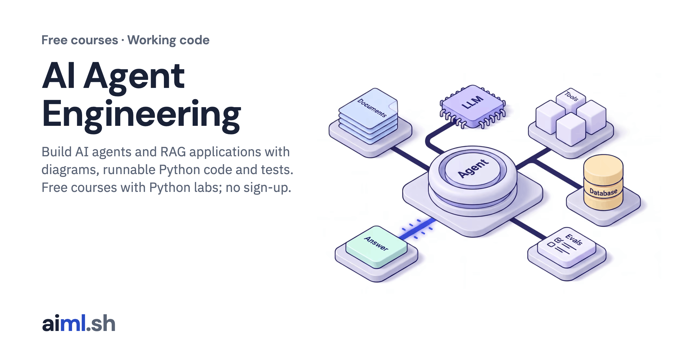](https://aiml.sh)

Model requests, agents, MCP, retrieval, evaluation and the systems around them, in Python with tests and recorded outputs. The lessons live on aiml.sh; this repository holds the code for all 224 lessons in 17 courses (195 labs; some lessons share one).

## 🧭 Where to start

| If you are | Start with | Reading time (approx.) |
|---|---|---|
| New to LLMs and model APIs |  [AI Fundamentals](#course-ai-fundamentals) | 2&nbsp;hours |
| Know Python and want to build agents |  [Building Agents with Google ADK 2.0](#course-google-adk) or  [Building Agents with LangGraph](#course-langgraph) | 6&nbsp;hours / 4&nbsp;hours |
| Want agents to call tools and services |  [Model Context Protocol (MCP)](#course-mcp) | 2&nbsp;hours |
| Want answers grounded in your documents |  [Retrieval-Augmented Generation (RAG)](#course-rag) or  [Building Agentic RAG Applications](#course-agentic-rag) | 2&nbsp;hours / 15&nbsp;hours |
| Want to measure changes before you ship them |  [LLM Evals](#course-llm-evaluation) | 2&nbsp;hours |
| Want to see how models work inside |  [Build a Small Language Model From Scratch](#course-llm-from-scratch) or  [LLM Inference Engineering](#course-llm-inference) | 5&nbsp;hours / 8&nbsp;hours |

## 🛣️ The AI Agent Engineer path

[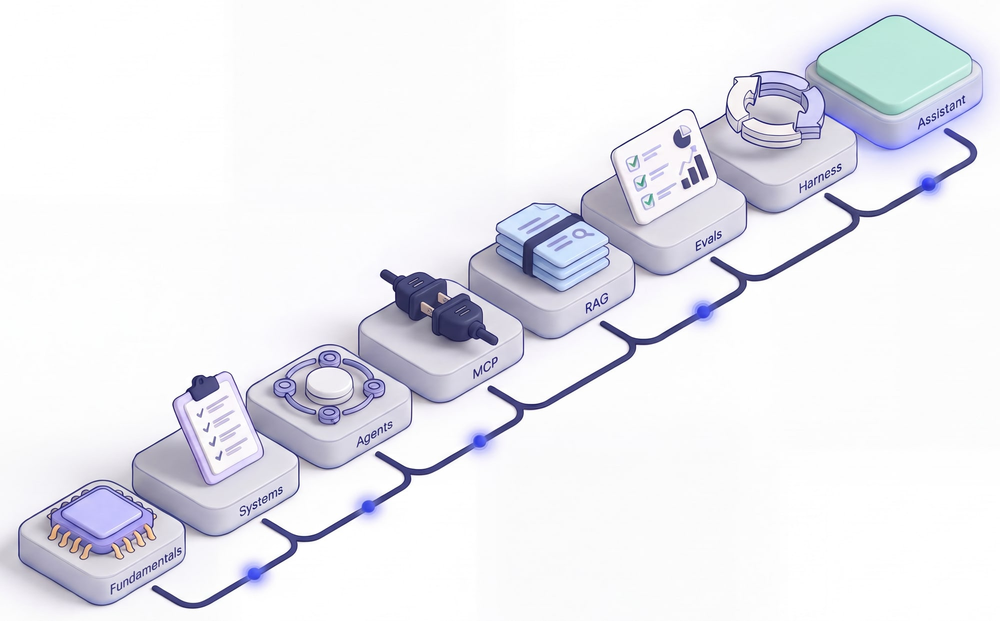](https://aiml.sh/paths/ai-agent-engineer/)

| Step | Task | Course |
|---|---|---|
| 1 | Models, structured output and tool calls |  [AI Fundamentals](#course-ai-fundamentals) |
| 2 | Choose the system and define acceptance |  [Building AI Systems](#course-building-ai-systems) |
| 3 | Build agents with one framework |  [Building Agents with Google ADK 2.0](#course-google-adk) or  [Building Agents with LangGraph](#course-langgraph) |
| 4 | Connect tools through MCP |  [Model Context Protocol (MCP)](#course-mcp) |
| 5 | Retrieve documents and answer with sources |  [Retrieval-Augmented Generation (RAG)](#course-rag) |
| 6 | Evaluate application changes |  [LLM Evals](#course-llm-evaluation) |
| 7 | Bound the agent loop and verify its work |  [Agent Design, Optimization and Harnesses](#course-agent-engineering) |
| 8 | Complete the developer knowledge assistant |  [Building Agentic RAG Applications](#course-agentic-rag) |

## 🛠️ Set up your computer

### 1. Get the code

```bash
git clone https://github.com/arjunprabhulal/aiml.git
cd aiml
```

### 2. Install Python

Each lab names the Python version it was tested with in its README: 119 labs name Python 3.12, 40 name Python 3.11 and 9 name Python 3.13. Install the version the lab names and use it to create that lab's virtual environment.

### 3. Create one virtual environment per lab

Labs do not share dependencies. 115 labs pin exact versions in `requirements-lock.txt` or `requirements.lock`, and 90 have a `requirements.txt`. Install from the lock file when there is one:

```bash
cd courses/<course>/<NN-lesson>/lab
python3.12 -m venv .venv
.venv/bin/python -m pip install -r requirements-lock.txt
```

### 4. Local models with Ollama

55 labs can run a local model through [Ollama](https://ollama.com). Install Ollama, then pull the models a lab names. The models the lab guides name, most used first:

```bash
ollama pull gemma4:e2b
ollama pull qwen3-embedding:0.6b
ollama pull qwen3.5:0.8b
```

### 5. Hosted model keys

63 labs can call Gemini and read the key from `GOOGLE_API_KEY`. Set it in your shell, not in a file you commit:

```bash
export GOOGLE_API_KEY=<your key>
```

25 labs include a `.env.example`; copy it to `.env` and fill in your values. `.env` files are ignored by git.

### 6. Run the tests

Each lab README gives its exact test command: 156 labs use `python -m unittest` and 29 mention `pytest`. Most tests replay recorded outputs, so they run offline without a model or a key; live runs need the model or key the lab names.

## ▶️ Run your first lab

The first MCP lab, [Implement an MCP server with typed tool contracts](courses/mcp/01-implement-an-mcp-server-with-typed-tool-contracts/), uses only Python and the official MCP SDK. The commands below come from its README:

```bash
cd courses/mcp/01-implement-an-mcp-server-with-typed-tool-contracts/lab
python3.12 -m venv .venv
.venv/bin/python -m pip install -r requirements-lock.txt
.venv/bin/python client.py
.venv/bin/python -m unittest -v test_tasks_server.py
```

## 📁 How a lesson folder works

1. `README.md`: what the lesson builds, the tools it uses and a link to the full lesson.
2. `lesson.png`: the diagram the lesson explains.
3. `lab/`: the runnable code, tests, requirements and recorded outputs, with the lab's own instructions in `lab/README.md`.
4. The full lesson on aiml.sh: the reasoning, the recorded results and the failure cases.

## 📚 All courses

Every course and lesson in this repository, grouped as on aiml.sh. Select a lesson to open its folder.

### Foundations and systems

<a name="course-ai-fundamentals"></a>

####  AI Fundamentals

<a href="courses/ai-fundamentals/">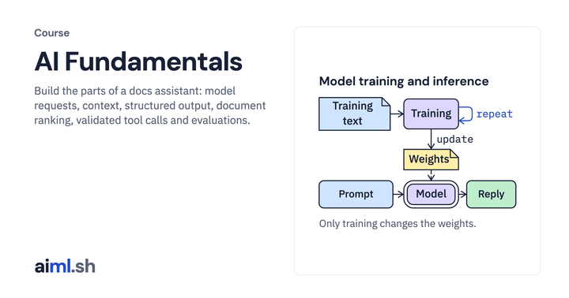</a>

Build the parts of a docs assistant: model requests, context, structured output, document ranking, validated tool calls and evaluations.

**What you'll learn**

- Trace tokenization, next-token generation, context limits and sampling in recorded model runs.
- Call local and hosted models, validate structured responses, and distinguish runtime errors from incorrect answers.
- Rank docs with embeddings and check a model-proposed tool call before executing it.
- Test prompt injection controls and compare answers against fixed evaluation cases.

11 lessons · about 2 hours of reading  
**Prerequisites:** Basic Python, a terminal and JSON. Local labs use Ollama; the hosted comparison also needs a Gemini API key.  
**Course folder:** [`courses/ai-fundamentals/`](courses/ai-fundamentals/) · **Full course:** [aiml.sh/courses/ai-fundamentals/](https://aiml.sh/courses/ai-fundamentals/)

| | Lesson | Time |
|---|---|---|
| <a href="courses/ai-fundamentals/01-what-is-inference/">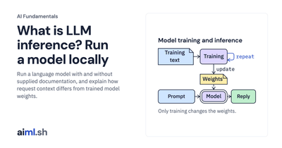</a> | **1. [Run inference with a local LLM](courses/ai-fundamentals/01-what-is-inference/)**<br>Run a language model with and without supplied documentation, and explain how request context differs from trained model weights. | 9&nbsp;min |
| <a href="courses/ai-fundamentals/02-tokens-and-tokenizers/">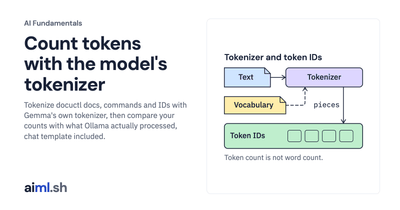</a> | **2. [Count tokens with the model's tokenizer](courses/ai-fundamentals/02-tokens-and-tokenizers/)**<br>Tokenize docuctl docs, commands and IDs with Gemma's own tokenizer, then compare your counts with what Ollama actually processed, chat template included. | 9&nbsp;min |
| <a href="courses/ai-fundamentals/03-next-token-prediction/">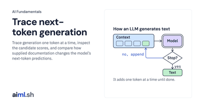</a> | **3. [Trace next-token generation](courses/ai-fundamentals/03-next-token-prediction/)**<br>Trace generation one token at a time, inspect the candidate scores, and compare how supplied documentation changes the model’s next-token predictions. | 9&nbsp;min |
| <a href="courses/ai-fundamentals/04-messages-and-context/">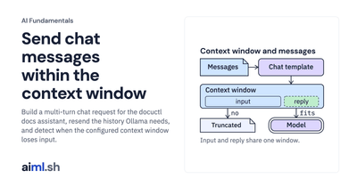</a> | **4. [Send chat messages within the context window](courses/ai-fundamentals/04-messages-and-context/)**<br>Build a multi-turn chat request for the docuctl docs assistant, resend the history Ollama needs, and detect when the configured context window loses input. | 10&nbsp;min |
| <a href="courses/ai-fundamentals/05-generation-controls/">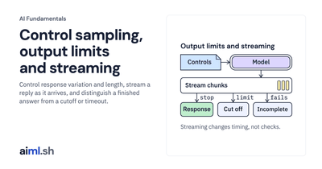</a> | **5. [Control sampling, output limits and streaming](courses/ai-fundamentals/05-generation-controls/)**<br>Control response variation and length, stream a reply as it arrives, and distinguish a finished answer from a cutoff or timeout. | 10&nbsp;min |
| <a href="courses/ai-fundamentals/06-local-models-and-hosted-apis/">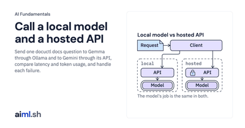</a> | **6. [Call a local model and a hosted API](courses/ai-fundamentals/06-local-models-and-hosted-apis/)**<br>Send one docuctl docs question to Gemma through Ollama and to Gemini through its API, compare latency and token usage, and handle each failure. | 10&nbsp;min |
| <a href="courses/ai-fundamentals/07-json-and-files/">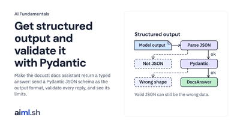</a> | **7. [Get structured output and validate it with Pydantic](courses/ai-fundamentals/07-json-and-files/)**<br>Make the docuctl docs assistant return a typed answer: send a Pydantic JSON schema as the output format, validate every reply, and see its limits. | 10&nbsp;min |
| <a href="courses/ai-fundamentals/08-vectors-and-similarity/">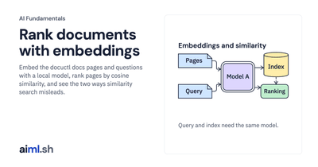</a> | **8. [Rank documents with embeddings](courses/ai-fundamentals/08-vectors-and-similarity/)**<br>Embed the docuctl docs pages and questions with a local model, rank pages by cosine similarity, and see the two ways similarity search misleads. | 10&nbsp;min |
| <a href="courses/ai-fundamentals/09-tools-and-permissions/">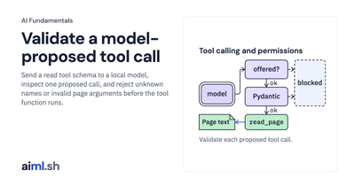</a> | **9. [Validate a model-proposed tool call](courses/ai-fundamentals/09-tools-and-permissions/)**<br>Send a read tool schema to a local model, inspect one proposed call, and reject unknown names or invalid page arguments before the tool function runs. | 11&nbsp;min |
| <a href="courses/ai-fundamentals/10-human-control/">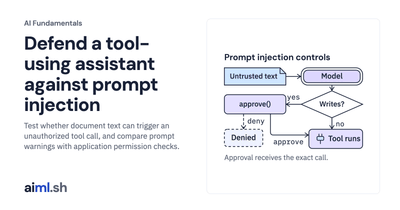</a> | **10. [Defend a tool-using assistant against prompt injection](courses/ai-fundamentals/10-human-control/)**<br>Test whether document text can trigger an unauthorized tool call, and compare prompt warnings with application permission checks. | 11&nbsp;min |
| <a href="courses/ai-fundamentals/11-what-is-an-evaluation/">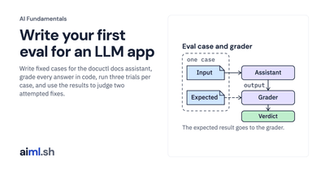</a> | **11. [Write your first eval for an LLM app](courses/ai-fundamentals/11-what-is-an-evaluation/)**<br>Write fixed cases for the docuctl docs assistant, grade every answer in code, run three trials per case, and use the results to judge two attempted fixes. | 11&nbsp;min |

<a name="course-building-ai-systems"></a>

####  Building AI Systems

<a href="courses/building-ai-systems/">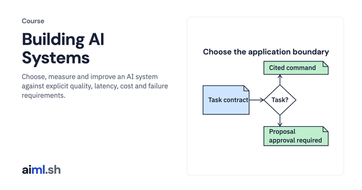</a>

Choose, measure and improve an AI system against explicit quality, latency, cost and failure requirements.

**What you'll learn**

- Define task acceptance, resource budgets and separate response-quality checks.
- Compare model interfaces and candidates with reproducible evaluation contracts.
- Apply access boundaries, output guards, tracing and monitoring.
- Inspect inference work and low-rank updates in bounded local experiments.
- Separate preference-pair and sampled-reward objectives; inspect packed weight error and decoding admission schedules.

21 lessons · about 9 hours of reading  
**Prerequisites:** Python, basic HTTP and JSON, and AI Fundamentals. The adaptation modules add introductory linear algebra and gradients.  
**Course folder:** [`courses/building-ai-systems/`](courses/building-ai-systems/) · **Full course:** [aiml.sh/courses/building-ai-systems/](https://aiml.sh/courses/building-ai-systems/)

| | Lesson | Time |
|---|---|---|
| <a href="courses/building-ai-systems/01-choose-an-ai-system-architecture/">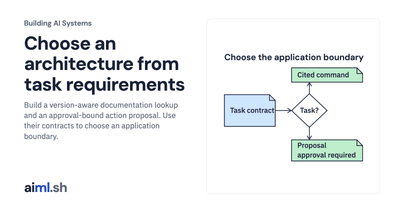</a> | **1. [Choose an architecture from task requirements](courses/building-ai-systems/01-choose-an-ai-system-architecture/)**<br>Build a version-aware documentation lookup and an approval-bound action proposal. Use their contracts to choose an application boundary. | 25&nbsp;min |
| <a href="courses/building-ai-systems/02-create-an-evaluation-set-and-a-failure-taxonomy/">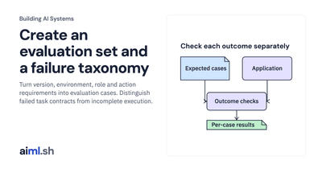</a> | **2. [Create an evaluation set and a failure taxonomy](courses/building-ai-systems/02-create-an-evaluation-set-and-a-failure-taxonomy/)**<br>Turn version, environment, role and action requirements into evaluation cases. Distinguish failed task contracts from incomplete execution. | 25&nbsp;min |
| <a href="courses/building-ai-systems/03-set-task-acceptance-criteria-and-request-resource-budgets/">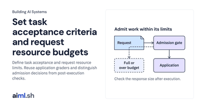</a> | **3. [Set task acceptance criteria and request resource budgets](courses/building-ai-systems/03-set-task-acceptance-criteria-and-request-resource-budgets/)**<br>Define task acceptance and request resource limits. Reuse application graders and distinguish admission decisions from post-execution checks. | 25&nbsp;min |
| <a href="courses/building-ai-systems/04-define-a-task-specific-answer-rubric/">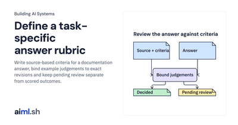</a> | **4. [Define a task-specific answer rubric](courses/building-ai-systems/04-define-a-task-specific-answer-rubric/)**<br>Write source-based criteria for a documentation answer, bind example judgements to exact revisions and keep pending review separate from scored outcomes. | 30&nbsp;min |
| <a href="courses/building-ai-systems/05-separate-source-support-action-correctness-and-format-validity/">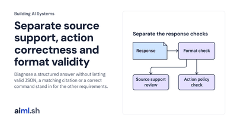</a> | **5. [Separate source support, action correctness and format validity](courses/building-ai-systems/05-separate-source-support-action-correctness-and-format-validity/)**<br>Diagnose a structured answer without letting valid JSON, a matching citation or a correct command stand in for the other requirements. | 25&nbsp;min |
| <a href="courses/building-ai-systems/06-measure-quality-by-request-slice-and-asymmetric-failure-cost/">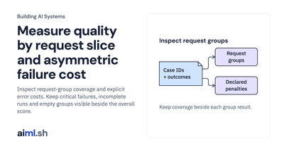</a> | **6. [Measure quality by request slice and asymmetric failure cost](courses/building-ai-systems/06-measure-quality-by-request-slice-and-asymmetric-failure-cost/)**<br>Inspect request-group coverage and explicit error costs. Keep critical failures, incomplete runs and empty groups visible beside the overall score. | 25&nbsp;min |
| <a href="courses/building-ai-systems/07-build-a-repeated-trial-benchmark/">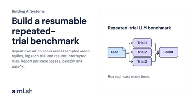</a> | **7. [Build a resumable repeated-trial benchmark](courses/building-ai-systems/07-build-a-repeated-trial-benchmark/)**<br>Repeat evaluation cases across sampled model replies, log each trial and resume interrupted runs. Report per-case passes, pass@k and pass^k. | 22&nbsp;min |
| <a href="courses/building-ai-systems/08-build-a-paired-comparison-report/">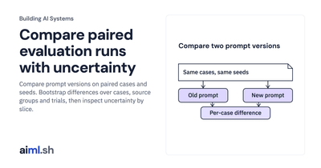</a> | **8. [Compare paired evaluation runs with uncertainty](courses/building-ai-systems/08-build-a-paired-comparison-report/)**<br>Compare prompt versions on paired cases and seeds. Bootstrap differences over cases, source groups and trials, then inspect uncertainty by slice. | 22&nbsp;min |
| <a href="courses/building-ai-systems/09-build-a-portable-model-adapter-with-contract-tests/">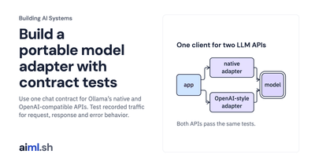</a> | **9. [Build a portable model adapter with contract tests](courses/building-ai-systems/09-build-a-portable-model-adapter-with-contract-tests/)**<br>Use one chat contract for Ollama’s native and OpenAI-compatible APIs. Test recorded traffic for request, response and error behavior. | 26&nbsp;min |
| <a href="courses/building-ai-systems/10-build-a-model-selection-harness/">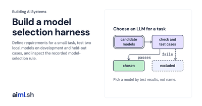</a> | **10. [Build a model selection harness](courses/building-ai-systems/10-build-a-model-selection-harness/)**<br>Define requirements for a small task, test two local models on development and held-out cases, and inspect the recorded model-selection rule. | 22&nbsp;min |
| <a href="courses/building-ai-systems/11-build-authentication-and-authorization-boundaries-for-users-and-tools/">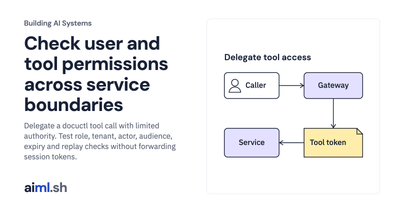</a> | **11. [Check user and tool permissions across service boundaries](courses/building-ai-systems/11-build-authentication-and-authorization-boundaries-for-users-and-tools/)**<br>Delegate a docuctl tool call with limited authority. Test role, tenant, actor, audience, expiry and replay checks without forwarding session tokens. | 22&nbsp;min |
| <a href="courses/building-ai-systems/12-build-a-policy-boundary-for-untrusted-agent-handoffs-and-tool-requests/">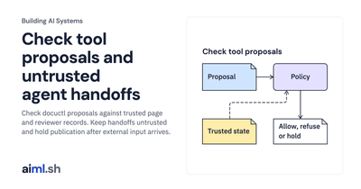</a> | **12. [Check tool proposals and untrusted agent handoffs](courses/building-ai-systems/12-build-a-policy-boundary-for-untrusted-agent-handoffs-and-tool-requests/)**<br>Check docuctl proposals against trusted page and reviewer records. Keep handoffs untrusted and hold publication after external input arrives. | 22&nbsp;min |
| <a href="courses/building-ai-systems/13-build-a-guardrails-proxy-with-streaming-output-tests/">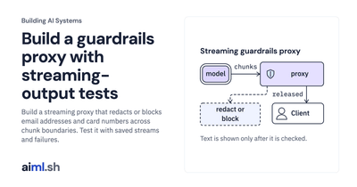</a> | **13. [Build a guardrails proxy with streaming-output tests](courses/building-ai-systems/13-build-a-guardrails-proxy-with-streaming-output-tests/)**<br>Build a streaming proxy that redacts or blocks email addresses and card numbers across chunk boundaries. Test it with saved streams and failures. | 20&nbsp;min |
| <a href="courses/building-ai-systems/14-build-end-to-end-request-tracing-with-evidence-provenance/">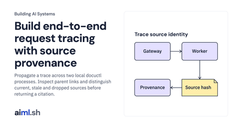</a> | **14. [Build end-to-end request tracing with source provenance](courses/building-ai-systems/14-build-end-to-end-request-tracing-with-evidence-provenance/)**<br>Propagate a trace across two local docuctl processes. Inspect parent links and distinguish current, stale and dropped sources before returning a citation. | 25&nbsp;min |
| <a href="courses/building-ai-systems/15-build-llm-monitoring-for-latency-cost-and-errors/">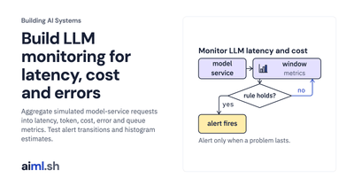</a> | **15. [Build LLM monitoring for latency, cost and errors](courses/building-ai-systems/15-build-llm-monitoring-for-latency-cost-and-errors/)**<br>Aggregate simulated model-service requests into latency, token, cost, error and queue metrics. Test alert transitions and histogram estimates. | 22&nbsp;min |
| <a href="courses/building-ai-systems/16-measure-kv-cache-work/">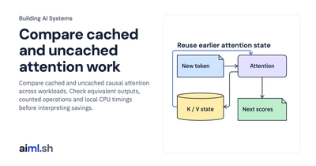</a> | **16. [Compare cached and uncached attention work](courses/building-ai-systems/16-measure-kv-cache-work/)**<br>Compare cached and uncached causal attention across workloads. Check equivalent outputs, counted operations and local CPU timings before interpreting savings. | 25&nbsp;min |
| <a href="courses/building-ai-systems/17-compare-full-and-low-rank-updates/">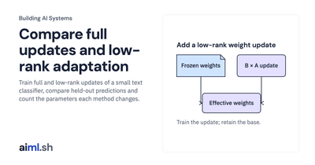</a> | **17. [Compare full updates and low-rank adaptation](courses/building-ai-systems/17-compare-full-and-low-rank-updates/)**<br>Train full and low-rank updates of a small text classifier, compare held-out predictions and count the parameters each method changes. | 25&nbsp;min |
| <a href="courses/building-ai-systems/18-compare-packed-weight-quantization-and-output-error/">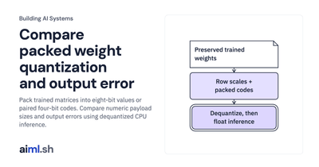</a> | **18. [Compare packed weight quantization and output error](courses/building-ai-systems/18-compare-packed-weight-quantization-and-output-error/)**<br>Pack trained matrices into eight-bit values or paired four-bit codes. Compare numeric payload sizes and output errors using dequantized CPU inference. | 30&nbsp;min |
| <a href="courses/building-ai-systems/19-admit-decoding-requests-between-token-steps/">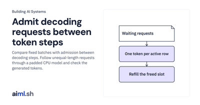</a> | **19. [Admit decoding requests between token steps](courses/building-ai-systems/19-admit-decoding-requests-between-token-steps/)**<br>Compare fixed batches with admission between decoding steps. Follow unequal-length requests through a padded CPU model and check the generated tokens. | 30&nbsp;min |
| <a href="courses/building-ai-systems/20-inspect-a-direct-preference-optimization-update/">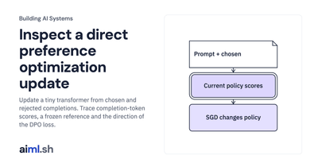</a> | **20. [Inspect a direct preference optimization update](courses/building-ai-systems/20-inspect-a-direct-preference-optimization-update/)**<br>Update a tiny transformer from chosen and rejected completions. Trace completion-token scores, a frozen reference and the direction of the DPO loss. | 30&nbsp;min |
| <a href="courses/building-ai-systems/21-run-group-relative-policy-updates-on-sampled-completions/">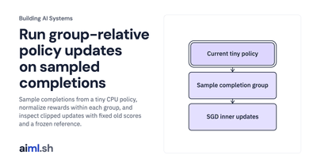</a> | **21. [Run group-relative policy updates on sampled completions](courses/building-ai-systems/21-run-group-relative-policy-updates-on-sampled-completions/)**<br>Sample completions from a tiny CPU policy, normalize rewards within each group, and inspect clipped updates with fixed old scores and a frozen reference. | 30&nbsp;min |

<a name="course-llm-from-scratch"></a>

####  Build a Small Language Model From Scratch

<a href="courses/llm-from-scratch/">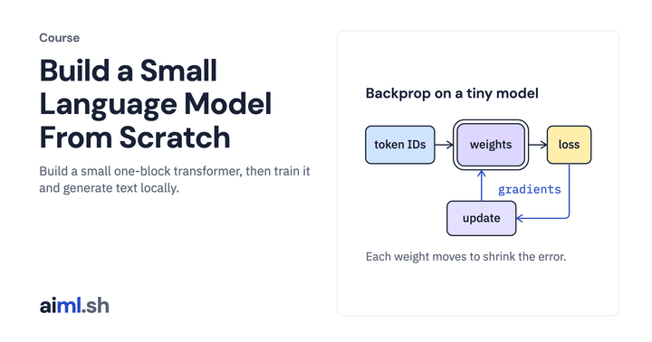</a>

Build a small one-block transformer, then train it and generate text locally.

**What you'll learn**

- Implement and inspect a training step, tokenizer, causal attention and transformer block.
- Train on bundled synthetic stories and bind resumable checkpoints to their inputs.
- Generate text with sampling, compare cached generation and validate a local HTTP interface.
- Port the one-block transformer to PyTorch and compare outputs and gradients within explicit numerical tolerances.

11 lessons · about 5 hours of reading  
**Prerequisites:** Python basics, elementary algebra and probabilities. The preparation guide below reviews the numerical ideas used in Lesson 1.  
**Course folder:** [`courses/llm-from-scratch/`](courses/llm-from-scratch/) · **Full course:** [aiml.sh/courses/llm-from-scratch/](https://aiml.sh/courses/llm-from-scratch/)

| | Lesson | Time |
|---|---|---|
| <a href="courses/llm-from-scratch/01-build-one-training-step-by-hand/">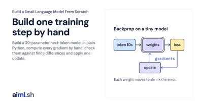</a> | **1. [Build one training step by hand](courses/llm-from-scratch/01-build-one-training-step-by-hand/)**<br>Build a 20-parameter next-token model in plain Python, compute every gradient by hand, check them against finite differences and apply one update. | 25&nbsp;min |
| <a href="courses/llm-from-scratch/02-build-a-byte-pair-encoding-tokenizer/">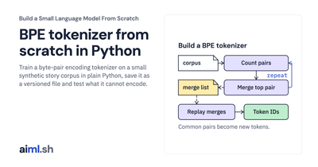</a> | **2. [Build a byte-pair encoding tokenizer](courses/llm-from-scratch/02-build-a-byte-pair-encoding-tokenizer/)**<br>Train a byte-pair encoding tokenizer on a small synthetic story corpus in plain Python, save it as a versioned file and test what it cannot encode. | 25&nbsp;min |
| <a href="courses/llm-from-scratch/03-build-a-next-token-prediction-baseline/">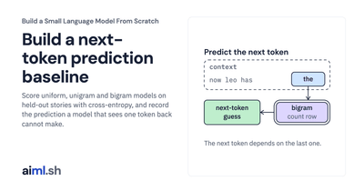</a> | **3. [Build a next-token prediction baseline](courses/llm-from-scratch/03-build-a-next-token-prediction-baseline/)**<br>Score uniform, unigram and bigram models on held-out stories with cross-entropy, and record the prediction a model that sees one token back cannot make. | 25&nbsp;min |
| <a href="courses/llm-from-scratch/04-build-causal-self-attention-and-inspect-intermediate-outputs/">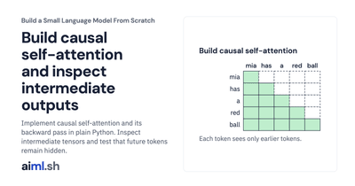</a> | **4. [Build causal self-attention and inspect intermediate outputs](courses/llm-from-scratch/04-build-causal-self-attention-and-inspect-intermediate-outputs/)**<br>Implement causal self-attention and its backward pass in plain Python. Inspect intermediate tensors and test that future tokens remain hidden. | 30&nbsp;min |
| <a href="courses/llm-from-scratch/05-build-a-transformer-block-with-positional-information/">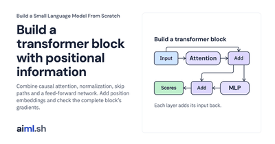</a> | **5. [Build a transformer block with positional information](courses/llm-from-scratch/05-build-a-transformer-block-with-positional-information/)**<br>Combine causal attention, normalization, skip paths and a feed-forward network. Add position embeddings and check the complete block’s gradients. | 30&nbsp;min |
| <a href="courses/llm-from-scratch/06-build-a-small-language-model-training-pipeline/">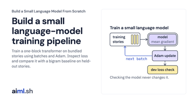</a> | **6. [Build a small language-model training pipeline](courses/llm-from-scratch/06-build-a-small-language-model-training-pipeline/)**<br>Train a one-block transformer on bundled stories using batches and Adam. Inspect loss and compare it with a bigram baseline on held-out stories. | 30&nbsp;min |
| <a href="courses/llm-from-scratch/07-build-checkpoints-and-resumable-training/">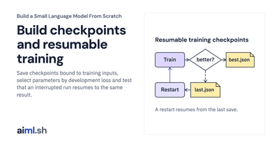</a> | **7. [Build checkpoints and resumable training](courses/llm-from-scratch/07-build-checkpoints-and-resumable-training/)**<br>Save checkpoints bound to training inputs, select parameters by development loss and test that an interrupted run resumes to the same result. | 30&nbsp;min |
| <a href="courses/llm-from-scratch/08-build-text-generation-with-sampling-controls/">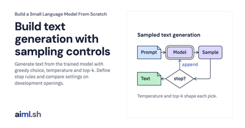</a> | **8. [Build text generation with sampling controls](courses/llm-from-scratch/08-build-text-generation-with-sampling-controls/)**<br>Generate text from the trained model with greedy choice, temperature and top-k. Define stop rules and compare settings on development openings. | 25&nbsp;min |
| <a href="courses/llm-from-scratch/09-build-a-kv-cache-for-llm-generation/">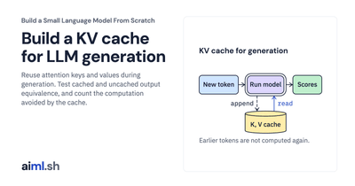</a> | **9. [Build a KV cache for LLM generation](courses/llm-from-scratch/09-build-a-kv-cache-for-llm-generation/)**<br>Reuse attention keys and values during generation. Test cached and uncached output equivalence, and count the computation avoided by the cache. | 25&nbsp;min |
| <a href="courses/llm-from-scratch/10-build-a-server-for-your-trained-llm/">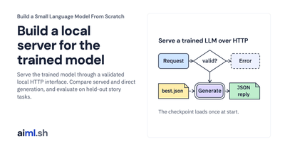</a> | **10. [Build a local server for the trained model](courses/llm-from-scratch/10-build-a-server-for-your-trained-llm/)**<br>Serve the trained model through a validated local HTTP interface. Compare served and direct generation, and evaluate on held-out story tasks. | 30&nbsp;min |
| <a href="courses/llm-from-scratch/11-compare-a-handwritten-transformer-with-pytorch/">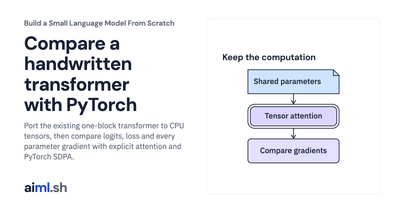</a> | **11. [Compare a handwritten transformer with PyTorch](courses/llm-from-scratch/11-compare-a-handwritten-transformer-with-pytorch/)**<br>Port the existing one-block transformer to CPU tensors, then compare logits, loss and every parameter gradient with explicit attention and PyTorch SDPA. | 30&nbsp;min |

<a name="course-llm-inference"></a>

####  LLM Inference Engineering

<a href="courses/llm-inference/">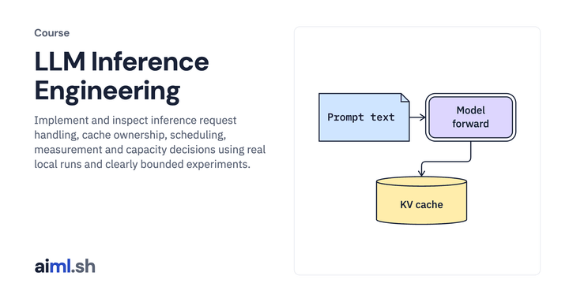</a>

Implement and inspect inference request handling, cache ownership, scheduling, measurement and capacity decisions using real local runs and clearly bounded experiments.

**What you'll learn**

- Measure actual prefill, decode, streaming and cancellation behavior with a pinned open model.
- Implement cache allocation and request scheduling, then reason about memory, queueing and latency.
- Evaluate a quantized candidate, profile host work and compare compiled normalization on real tensors.
- Separate workload measurements from assumed cost models when comparing operating points, admission policies, rollout gates and capacity plans.

20 lessons · about 8 hours of reading  
**Prerequisites:** Python functions, dataclasses, HTTP and JSON; basic causal attention. Offline labs run without a GPU. Live text experiments require the pinned model and runtime; Metal and CPU commands are identified separately.  
**Course folder:** [`courses/llm-inference/`](courses/llm-inference/) · **Full course:** [aiml.sh/courses/llm-inference/](https://aiml.sh/courses/llm-inference/)

| | Lesson | Time |
|---|---|---|
| <a href="courses/llm-inference/01-trace-an-inference-request/">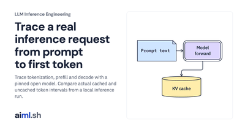</a> | **1. [Trace a real inference request from prompt to first token](courses/llm-inference/01-trace-an-inference-request/)**<br>Trace tokenization, prefill and decode with a pinned open model. Compare actual cached and uncached token intervals from a local inference run. | 25&nbsp;min |
| <a href="courses/llm-inference/02-stream-tokens-over-sse-and-cancel-dropped-requests/"></a> | **2. [Stream model output and stop work when the client disconnects](courses/llm-inference/02-stream-tokens-over-sse-and-cancel-dropped-requests/)**<br>Build a local streaming HTTP server with bounded admission and disconnect cleanup. Test SSE framing and iterator release over real sockets. | 25&nbsp;min |
| <a href="courses/llm-inference/03-benchmark-streaming-inference/"></a> | **3. [Benchmark streaming inference under load](courses/llm-inference/03-benchmark-streaming-inference/)**<br>Measure offered load, completed streams, rejections and first-token latency. Use a real HTTP client and retain errors in the benchmark record. | 25&nbsp;min |
| <a href="courses/llm-inference/04-size-gpu-memory-for-model-weights-and-the-kv-cache/"></a> | **4. [Budget model weights, KV cache, and runtime memory](courses/llm-inference/04-size-gpu-memory-for-model-weights-and-the-kv-cache/)**<br>Calculate weight and attention-cache payloads with consistent byte units. Compare grouped-query cache sizes and budget runtime memory separately. | 25&nbsp;min |
| <a href="courses/llm-inference/05-choose-hardware-for-inference/"></a> | **5. [Choose hardware from the workload bottleneck](courses/llm-inference/05-choose-hardware-for-inference/)**<br>Use a roofline estimate to distinguish compute and bandwidth limits. Compare memory fit and explain why hardware choice depends on workload. | 25&nbsp;min |
| <a href="courses/llm-inference/06-stop-memory-waste-with-paged-kv-caching/"></a> | **6. [Implement paged cache allocation and copy-on-write](courses/llm-inference/06-stop-memory-waste-with-paged-kv-caching/)**<br>Implement a paged cache allocator with reference counts and copy-on-write. Inspect ownership and fragmentation using concrete token markers. | 25&nbsp;min |
| <a href="courses/llm-inference/07-verify-tiled-attention/"></a> | **7. [Explain tiled attention and verify its output](courses/llm-inference/07-verify-tiled-attention/)**<br>Implement tiled attention with online softmax on the CPU. Verify numerical agreement and distinguish storage savings from measured GPU runtime. | 25&nbsp;min |
| <a href="courses/llm-inference/08-replace-static-batching-with-continuous-batching/"></a> | **8. [Schedule requests between decode iterations](courses/llm-inference/08-replace-static-batching-with-continuous-batching/)**<br>Compare fixed and changing batch membership with a request scheduler. Inspect actual local model interleaving and its latency tradeoffs. | 25&nbsp;min |
| <a href="courses/llm-inference/09-fix-long-prompt-stalls-with-chunked-prefill/"></a> | **9. [Balance long-prompt prefill against streaming latency](courses/llm-inference/09-fix-long-prompt-stalls-with-chunked-prefill/)**<br>Schedule prompt chunks around active decode work. Compare modeled token budgets with a real cached-forward experiment and explain added overhead. | 25&nbsp;min |
| <a href="courses/llm-inference/10-cache-shared-prompt-prefixes-and-route-to-warm-gpus/"></a> | **10. [Reuse prompt prefixes without overloading a warm replica](courses/llm-inference/10-cache-shared-prompt-prefixes-and-route-to-warm-gpus/)**<br>Implement radix-prefix matching, pinning and eviction. Compare cache affinity with queue waiting and inspect real reuse of model cache tensors. | 25&nbsp;min |
| <a href="courses/llm-inference/11-evaluate-model-quantization/"></a> | **11. [Quantize a model and evaluate the regression](courses/llm-inference/11-evaluate-model-quantization/)**<br>Convert real model linear layers to INT8 and compare development likelihood. Inspect the observed regression before accepting a serving candidate. | 25&nbsp;min |
| <a href="courses/llm-inference/12-use-speculative-decoding-and-know-when-it-hurts/"></a> | **12. [Check speculative decoding correctness and its cost](courses/llm-inference/12-use-speculative-decoding-and-know-when-it-hurts/)**<br>Implement speculative token acceptance and residual resampling. Verify the target distribution and separate correctness from assumed speedups. | 25&nbsp;min |
| <a href="courses/llm-inference/13-choose-a-latency-throughput-operating-point/"></a> | **13. [Choose a latency-throughput operating point](courses/llm-inference/13-choose-a-latency-throughput-operating-point/)**<br>Choose a feasible latency and throughput operating point. Inspect memory limits, communication assumptions and efficiency per serving device. | 25&nbsp;min |
| <a href="courses/llm-inference/14-profile-inference-host-overhead/"></a> | **14. [Investigate host overhead before changing GPU settings](courses/llm-inference/14-profile-inference-host-overhead/)**<br>Profile host operators around an actual Metal model forward. Read recorded events without treating CPU timings as GPU kernel measurements. | 25&nbsp;min |
| <a href="courses/llm-inference/15-compare-eager-and-compiled-normalization/"></a> | **15. [Compare eager and compiled normalization on real tensors](courses/llm-inference/15-compare-eager-and-compiled-normalization/)**<br>Compare eager and compiled normalization on real Metal tensors. Check numerical agreement and synchronized timings across several input shapes. | 25&nbsp;min |
| <a href="courses/llm-inference/16-investigate-inference-tail-latency/"></a> | **16. [Investigate inference tail latency with request records](courses/llm-inference/16-investigate-inference-tail-latency/)**<br>Aggregate request records to investigate tail latency. Keep timing boundaries, preemptions and admission outcomes distinct when testing hypotheses. | 25&nbsp;min |
| <a href="courses/llm-inference/17-enforce-multi-tenant-fairness-priority-queues-and-admission-limits/"></a> | **17. [Protect interactive requests from noisy neighbors](courses/llm-inference/17-enforce-multi-tenant-fairness-priority-queues-and-admission-limits/)**<br>Implement tenant queues, token budgets and deficit round-robin scheduling. Inspect admission limits and the latency cost of protecting interactive work. | 25&nbsp;min |
| <a href="courses/llm-inference/18-autoscale-gpus-with-slow-cold-starts-and-roll-out-model-updates-safely/"></a> | **18. [Plan cold starts and gate model rollouts](courses/llm-inference/18-autoscale-gpus-with-slow-cold-starts-and-roll-out-model-updates-safely/)**<br>Model replica startup and finite standby capacity, then evaluate canary gates. Distinguish requested capacity from ready capacity and compare tradeoffs. | 25&nbsp;min |
| <a href="courses/llm-inference/19-split-prefill-and-decode-pools-and-serve-large-moe-models/"></a> | **19. [Budget cache transfer before splitting inference pools](courses/llm-inference/19-split-prefill-and-decode-pools-and-serve-large-moe-models/)**<br>Calculate cache-transfer payloads before separating prefill and decode. Explore bandwidth and expert-placement assumptions without claiming fleet benchmarks. | 25&nbsp;min |
| <a href="courses/llm-inference/20-size-serving-capacity/"></a> | **20. [Size serving capacity from accepted benchmark results](courses/llm-inference/20-size-serving-capacity/)**<br>Size serving replicas from accepted workload-matched results. Convert request demand to peak capacity and include reserves and stated cost assumptions. | 25&nbsp;min |

<a name="course-building-mlops"></a>

####  Building MLOps

<a href="courses/building-mlops/"></a>

Take one user-return prediction application from a manual baseline through reproducible training, local release controls and outcome monitoring.

**What you'll learn**

- Define prediction time, data availability and delayed labels; train and reload a baseline under explicit evaluation rules.
- Version historical features and datasets, then track real local training with MLflow.
- Automate the same workflow with Prefect, test failure recovery and gate candidates.
- Register, serve, stage and roll back compatible model bundles locally.
- Monitor request failures, delayed outcomes and input drift before choosing a response.

21 lessons · about 10 hours of reading  
**Prerequisites:** Python, SQL, basic supervised learning and familiarity with training and validation datasets.  
**Course folder:** [`courses/building-mlops/`](courses/building-mlops/) · **Full course:** [aiml.sh/courses/building-mlops/](https://aiml.sh/courses/building-mlops/)

| | Lesson | Time |
|---|---|---|
| <a href="courses/building-mlops/01-record-data-availability-and-label-delay/"></a> | **1. [Use only data available when the prediction is made](courses/building-mlops/01-record-data-availability-and-label-delay/)**<br>Separate event time, arrival time and label readiness so a historical return prediction uses only available inputs and finalized outcomes. | 25&nbsp;min |
| <a href="courses/building-mlops/02-design-temporal-and-entity-aware-evaluation-splits/"></a> | **2. [Choose evaluation dates for the return model](courses/building-mlops/02-design-temporal-and-entity-aware-evaluation-splits/)**<br>Match the evaluation to future predictions for existing users, keep the declared date windows and exclude later outcomes from earlier decisions. | 25&nbsp;min |
| <a href="courses/building-mlops/03-build-a-supervised-learning-baseline-with-reproducible-dataset-splits/"></a> | **3. [Train, save and reload the user-return model](courses/building-mlops/03-build-a-supervised-learning-baseline-with-reproducible-dataset-splits/)**<br>Prepare historical user-return examples, fit and evaluate a baseline, then reload its saved scaler and model to predict in a fresh process. | 25&nbsp;min |
| <a href="courses/building-mlops/04-connect-prediction-errors-to-product-costs/"></a> | **4. [Choose a decision threshold using explicit error costs](courses/building-mlops/04-connect-prediction-errors-to-product-costs/)**<br>Compare three thresholds on the same validation predictions while keeping the fitted model and final test set unchanged. | 25&nbsp;min |
| <a href="courses/building-mlops/05-validate-a-dataset-and-quarantine-invalid-records/"></a> | **5. [Validate incoming events before preparing training data](courses/building-mlops/05-validate-a-dataset-and-quarantine-invalid-records/)**<br>Preserve original events, quarantine invalid records and block the entire training batch when field, identity or temporal checks fail. | 25&nbsp;min |
| <a href="courses/building-mlops/06-build-point-in-time-feature-joins/"></a> | **6. [Reconstruct the feature used by an earlier prediction](courses/building-mlops/06-build-point-in-time-feature-joins/)**<br>Store feature publication history and reconstruct the count available to an earlier return prediction, without applying later corrections. | 25&nbsp;min |
| <a href="courses/building-mlops/07-test-feature-freshness-and-training-serving-parity/"></a> | **7. [Compare historical and current feature calculations](courses/building-mlops/07-test-feature-freshness-and-training-serving-parity/)**<br>Compare the same feature version, cutoff and arrival policy, then distinguish a calculation mismatch from stale or unavailable feature data. | 25&nbsp;min |
| <a href="courses/building-mlops/08-version-data-schemas-and-feature-definitions/"></a> | **8. [Version the dataset and feature contract together](courses/building-mlops/08-version-data-schemas-and-feature-definitions/)**<br>Bind data, schemas and feature definitions to explicit versions in SQLite; refuse identity conflicts and roll back a partial binding attempt. | 25&nbsp;min |
| <a href="courses/building-mlops/09-track-run-identity-and-select-an-immutable-training-artifact/"></a> | **9. [Track a training run and reload its model](courses/building-mlops/09-track-run-identity-and-select-an-immutable-training-artifact/)**<br>Connect the dataset, source, fitting settings and validation result to one MLflow run, then retrieve the model another process can use. | 30&nbsp;min |
| <a href="courses/building-mlops/10-automate-the-user-return-workflow-with-prefect/"></a> | **10. [Connect preparation, training and evaluation with Prefect](courses/building-mlops/10-automate-the-user-return-workflow-with-prefect/)**<br>Automate the manual return-model workflow while keeping the accepted events, historical features and fitted model connected. | 30&nbsp;min |
| <a href="courses/building-mlops/11-retry-a-failed-pipeline-step-without-repeating-training/"></a> | **11. [Retry a failed step without repeating the experiment](courses/building-mlops/11-retry-a-failed-pipeline-step-without-repeating-training/)**<br>Recover a failed write of the completion record without repeating training; reuse a completed attempt only when its inputs and artifacts still match. | 30&nbsp;min |
| <a href="courses/building-mlops/12-test-data-and-model-pipeline-changes-in-ci/"></a> | **12. [Test pipeline changes before producing a candidate](courses/building-mlops/12-test-data-and-model-pipeline-changes-in-ci/)**<br>Run unit and integration checks through one local CI command, retain discovered test counts and diagnostics, and propagate a failed result. | 30&nbsp;min |
| <a href="courses/building-mlops/13-gate-a-model-candidate-on-validation-results/"></a> | **13. [Evaluate a candidate against a declared release policy](courses/building-mlops/13-gate-a-model-candidate-on-validation-results/)**<br>Recompute validation from the saved model, bind the decision to a policy and keep failed candidates available for inspection. | 30&nbsp;min |
| <a href="courses/building-mlops/14-register-and-select-a-content-addressed-model/"></a> | **14. [Register and select an explicit model version](courses/building-mlops/14-register-and-select-a-content-addressed-model/)**<br>Package the fitted return model with its contract and gate decision, then select a checked version through a local MLflow alias. | 30&nbsp;min |
| <a href="courses/building-mlops/15-serve-a-versioned-predictor-through-batch-and-http/"></a> | **15. [Produce daily predictions and expose an optional HTTP interface](courses/building-mlops/15-serve-a-versioned-predictor-through-batch-and-http/)**<br>Use one validated predictor for the analyst’s batch and a loopback HTTP endpoint, with the selected bundle attached to every prediction. | 30&nbsp;min |
| <a href="courses/building-mlops/16-route-a-sticky-canary-and-compare-cohort-outcomes/"></a> | **16. [Stage a candidate with an explicit traffic decision](courses/building-mlops/16-route-a-sticky-canary-and-compare-cohort-outcomes/)**<br>Route a repeatable subset of observation IDs to a candidate bundle, retain routing generations and reject stale configuration updates. | 30&nbsp;min |
| <a href="courses/building-mlops/17-roll-back-a-model-with-feature-contract-checks/"></a> | **17. [Roll back to a compatible model bundle](courses/building-mlops/17-roll-back-a-model-with-feature-contract-checks/)**<br>Observe a controlled candidate failure, restore a checked earlier routing generation and confirm predictions use the stable bundle. | 30&nbsp;min |
| <a href="courses/building-mlops/18-distinguish-schema-freshness-and-distribution-signals/"></a> | **18. [Monitor prediction requests and input failures](courses/building-mlops/18-distinguish-schema-freshness-and-distribution-signals/)**<br>Collect bounded request counts, validation failures and local latency measurements; keep these service signals separate from prediction quality. | 30&nbsp;min |
| <a href="courses/building-mlops/19-join-delayed-outcomes-and-review-retraining/"></a> | **19. [Evaluate predictions after return labels become final](courses/building-mlops/19-join-delayed-outcomes-and-review-retraining/)**<br>Join predictions to their original observations, keep unfinished outcomes pending and report quality by the bundle that produced them. | 30&nbsp;min |
| <a href="courses/building-mlops/20-investigate-feature-drift-before-retraining/"></a> | **20. [Investigate changed inputs before choosing a response](courses/building-mlops/20-investigate-feature-drift-before-retraining/)**<br>Compare a retained feature distribution, separate invalid data from a genuine change and consult finalized outcomes before proposing retraining. | 30&nbsp;min |
| <a href="courses/building-mlops/21-recover-the-user-return-pipeline-without-automatic-promotion/"></a> | **21. [Recover the input path and evaluate a new candidate](courses/building-mlops/21-recover-the-user-return-pipeline-without-automatic-promotion/)**<br>Return to the valid source after the controlled data fault, run the checked pipeline again and keep traffic unchanged until a release decision. | 30&nbsp;min |

### Agents and frameworks

<a name="course-google-adk"></a>

####  Building Agents with Google ADK 2.0

<a href="courses/google-adk/"></a>

Build agents, tools and multi-step workflows with Google ADK 2.0, then evaluate them.

**What you'll learn**

- Define an ADK agent with function tools, run it from Python with a Runner and session service, and read its event stream.
- Connect an agent to MCP servers with McpToolset, validate typed function arguments and require confirmation for writes.
- Persist sessions in SQLite and search conversation memory while the process runs; guard model and tool calls with callbacks and plugins.
- Build graph workflows with conditional edges, pause one for human approval with RequestInput and delegate to sub-agents.
- Score an agent's tool trajectory and final response with AgentEvaluator before you change it.

17 lessons · about 6 hours of reading · Google ADK 2.0  
**Prerequisites:** Python and HTTP APIs.  
**Course folder:** [`courses/google-adk/`](courses/google-adk/) · **Full course:** [aiml.sh/courses/google-adk/building-agents/](https://aiml.sh/courses/google-adk/building-agents/)

| | Lesson | Time |
|---|---|---|
| <a href="courses/google-adk/01-build-an-llm-agent/"></a> | **1. [Build your first ADK agent with Gemini](courses/google-adk/01-build-an-llm-agent/)**<br>Build a documentation assistant with Google ADK, understand its model and instructions, and run it from the terminal or development Web UI. | 15&nbsp;min |
| <a href="courses/google-adk/02-run-an-agent-from-python-and-read-its-event-stream/"></a> | **2. [Run an agent and read its event stream](courses/google-adk/02-run-an-agent-from-python-and-read-its-event-stream/)**<br>Use Python Runner to manage an ADK conversation, inspect model and tool events, select the final answer and handle streaming and model-call limits. | 20&nbsp;min |
| <a href="courses/google-adk/03-add-typed-function-tools/"></a> | **3. [Give an agent typed function tools](courses/google-adk/03-add-typed-function-tools/)**<br>Give a Google ADK 2.0 agent typed function tools, validate every call with Pydantic before it runs, and require human approval for the tool that writes. | 25&nbsp;min |
| <a href="courses/google-adk/04-connect-an-agent-to-mcp-servers-with-mcptoolset/"></a> | **4. [Connect an agent to MCP servers with McpToolset](courses/google-adk/04-connect-an-agent-to-mcp-servers-with-mcptoolset/)**<br>Attach a typed MCP server to a Google ADK 2.0 agent with McpToolset, expose only the tools it needs, read what reaches the model and catch a failed start. | 20&nbsp;min |
| <a href="courses/google-adk/05-persist-session-state-and-long-term-memory/"></a> | **5. [Persist sessions and search conversation memory](courses/google-adk/05-persist-session-state-and-long-term-memory/)**<br>Persist Google ADK 2.0 sessions in SQLite with DatabaseSessionService, keep user state across restarts and recall earlier conversations with load_memory. | 25&nbsp;min |
| <a href="courses/google-adk/06-guard-model-and-tool-calls-with-callbacks-and-plugins/"></a> | **6. [Guard model and tool calls with callbacks and plugins](courses/google-adk/06-guard-model-and-tool-calls-with-callbacks-and-plugins/)**<br>Redact matching access-key identifiers before storage or model use, and reject file-tool reads outside the workspace with ADK callbacks and plugins. | 25&nbsp;min |
| <a href="courses/google-adk/07-build-a-graph-workflow-from-nodes-and-edges/"></a> | **7. [Build a graph workflow from nodes and edges](courses/google-adk/07-build-a-graph-workflow-from-nodes-and-edges/)**<br>Build a release-notes workflow with function nodes, a typed agent node and a deterministic check that every commit reaches the output. | 20&nbsp;min |
| <a href="courses/google-adk/08-route-a-workflow-with-conditional-edges/"></a> | **8. [Route a workflow with conditional edges](courses/google-adk/08-route-a-workflow-with-conditional-edges/)**<br>Route documentation build logs with Python, use a default edge for incomplete runs and ask an agent for link suggestions only when needed. | 20&nbsp;min |
| <a href="courses/google-adk/09-pause-a-workflow-for-human-approval/"></a> | **9. [Pause a workflow for human approval](courses/google-adk/09-pause-a-workflow-for-human-approval/)**<br>Pause a migration workflow with the SQL attached, validate a reviewer decision and resume the same session to apply or reject the change. | 25&nbsp;min |
| <a href="courses/google-adk/10-write-dynamic-workflows-in-python-code/"></a> | **10. [Build dynamic workflows in Python](courses/google-adk/10-write-dynamic-workflows-in-python-code/)**<br>Review changed documentation pages with dynamic child nodes, deterministic lint checks and a bounded agent fix loop with retries and timeouts. | 25&nbsp;min |
| <a href="courses/google-adk/11-delegate-to-sub-agents-in-a-collaborative-workflow/"></a> | **11. [Delegate to sub-agents through a coordinator](courses/google-adk/11-delegate-to-sub-agents-in-a-collaborative-workflow/)**<br>Build a documentation review team with a coordinator, two typed specialists and an event check that both delegations ran. | 20&nbsp;min |
| <a href="courses/google-adk/12-evaluate-an-agents-tool-trajectory-and-response/"></a> | **12. [Evaluate an agent's tool trajectory and response](courses/google-adk/12-evaluate-an-agents-tool-trajectory-and-response/)**<br>Write evaluation cases for tool use and complete answers, run ADK AgentEvaluator and understand the limits of trajectory, ROUGE and judge scores. | 25&nbsp;min |
| <a href="courses/google-adk/13-choose-an-adk-workflow-pattern/"></a> | **13. [Choose an ADK workflow pattern](courses/google-adk/13-choose-an-adk-workflow-pattern/)**<br>Compare ADK workflow patterns by dependencies, control and failure policy, then inspect the real lesson graphs without calling a model. | 15&nbsp;min |
| <a href="courses/google-adk/14-generate-and-review/"></a> | **14. [Generate and review a release announcement](courses/google-adk/14-generate-and-review/)**<br>Build an ADK writer and reviewer that compare a release announcement with changelog facts, then enforce the typed verdict in code. | 20&nbsp;min |
| <a href="courses/google-adk/15-iterative-refinement/"></a> | **15. [Revise a changelog line with a bounded loop](courses/google-adk/15-iterative-refinement/)**<br>Refine a changelog line in an ADK 2.0 graph loop: a lint checks each draft, a back-edge sends problems to a reviser, and a state counter stops the loop. | 20&nbsp;min |
| <a href="courses/google-adk/16-parallel-fan-out-and-gather/"></a> | **16. [Run independent workflow branches and gather results](courses/google-adk/16-parallel-fan-out-and-gather/)**<br>Run ADK 2.0 workflow branches in parallel and merge them with a JoinNode, then see one failed branch fail the graph and a dynamic parent keep the rest. | 25&nbsp;min |
| <a href="courses/google-adk/17-hierarchical-task-decomposition/"></a> | **17. [Delegate an upgrade guide through a bounded agent tree](courses/google-adk/17-hierarchical-task-decomposition/)**<br>Build a depth-limited ADK AgentTool tree for an upgrade guide, check its source paths and share a model-call budget across nested runs. | 25&nbsp;min |

<a name="course-google-adk-integrations"></a>

####  Connecting Agents to Tools and Services with Google ADK 2.0

<a href="courses/google-adk-integrations/"></a>

Connect agents to BigQuery, databases through MCP Toolbox, Agent Search, Google Search and code execution, then add Skills and A2A.

**What you'll learn**

- Load Agent Skills from a folder and run their scripts through a code executor.
- Ground answers with Google Search and compute with Gemini code execution, and cite from grounding metadata.
- Query PostgreSQL through MCP Toolbox for Databases with fixed SQL tools and a read-only role.
- Serve an agent over A2A and call it from another agent.

6 lessons · about 2 hours of reading · Google ADK 2.0  
**Prerequisites:** Python, HTTP APIs, and ADK agents with tools (the Building Agents with Google ADK 2.0 course covers them).  
**Course folder:** [`courses/google-adk-integrations/`](courses/google-adk-integrations/) · **Full course:** [aiml.sh/courses/google-adk-integrations/](https://aiml.sh/courses/google-adk-integrations/)

| | Lesson | Time |
|---|---|---|
| <a href="courses/google-adk-integrations/01-give-an-agent-skills-from-a-folder/"></a> | **1. [Give an agent skills from a folder with SkillToolset](courses/google-adk-integrations/01-give-an-agent-skills-from-a-folder/)**<br>Load a folder of Agent Skills into an ADK agent with SkillToolset, run skill scripts, and catch the failures that silently skip a skill's steps. | 20&nbsp;min |
| <a href="courses/google-adk-integrations/02-use-gemini-built-in-tools-google-search-and-code-execution/"></a> | **2. [Use Gemini built-in tools: Google Search grounding and code execution](courses/google-adk-integrations/02-use-gemini-built-in-tools-google-search-and-code-execution/)**<br>Add Gemini's Google Search and code execution to an ADK agent beside a function tool, cite answers from grounding metadata, and handle request errors. | 20&nbsp;min |
| <a href="courses/google-adk-integrations/03-query-postgresql-through-mcp-toolbox-for-databases/"></a> | **3. [Query PostgreSQL through MCP Toolbox for Databases](courses/google-adk-integrations/03-query-postgresql-through-mcp-toolbox-for-databases/)**<br>Connect an ADK agent to PostgreSQL through MCP Toolbox with fixed SQL tools and a read-only role, and catch toolsets that fail to load. | 25&nbsp;min |
| <a href="courses/google-adk-integrations/04-query-bigquery-with-bigquerytoolset/"></a> | **4. [Query BigQuery with BigQueryToolset](courses/google-adk-integrations/04-query-bigquery-with-bigquerytoolset/)**<br>Query docs analytics through ADK BigQueryToolset with SELECT-only execution, a per-query bytes cap, and offline tests for refused jobs. | 25&nbsp;min |
| <a href="courses/google-adk-integrations/05-search-private-data-stores-with-agent-search/"></a> | **5. [Search private data stores with Agent Search](courses/google-adk-integrations/05-search-private-data-stores-with-agent-search/)**<br>Search engineering documents with ADK VertexAiSearchTool, validate a team filter from application state, and inspect recorded grounding metadata. | 25&nbsp;min |
| <a href="courses/google-adk-integrations/06-expose-an-agent-over-a2a-and-consume-it/"></a> | **6. [Expose the docs assistant over A2A and consume it](courses/google-adk-integrations/06-expose-an-agent-over-a2a-and-consume-it/)**<br>Serve an ADK agent over A2A with to_a2a, call it from another agent with RemoteA2aAgent, and debug card, connection and timeout failures. | 25&nbsp;min |

<a name="course-google-adk-production"></a>

####  Running and Deploying Agents with Google ADK 2.0

<a href="courses/google-adk-production/"></a>

Serve, observe, evaluate and deploy ADK agents with runtime controls, context caching, traces, simulated users, Cloud Run and Agent Runtime.

**What you'll learn**

- Serve an agent over HTTP, tune runs with RunConfig, and resume, rewind or migrate sessions.
- Run an agent from Pub/Sub and Eventarc deliveries behind an auth check.
- Reuse cached prompt prefixes, compact conversation history, store artifacts and call REST APIs from an OpenAPI spec.
- Trace runs with OpenTelemetry, test against simulated users, and put identity, policy and confirmation guardrails around tools.
- Inspect Agents CLI project deployment, then deploy agents to Cloud Run and Agent Runtime with ADK deployment commands.

20 lessons · about 8 hours of reading · Google ADK 2.0  
**Prerequisites:** Python, HTTP and JSON, and the Building Agents with Google ADK 2.0 course.  
**Course folder:** [`courses/google-adk-production/`](courses/google-adk-production/) · **Full course:** [aiml.sh/courses/google-adk-production/](https://aiml.sh/courses/google-adk-production/)

| | Lesson | Time |
|---|---|---|
| <a href="courses/google-adk-production/01-serve-an-agent-over-http-and-drive-it-from-the-cli/"></a> | **1. [Serve an agent over HTTP and drive it from the CLI](courses/google-adk-production/01-serve-an-agent-over-http-and-drive-it-from-the-cli/)**<br>Serve a Google ADK 2.0 agent with adk api_server, call /run and /run_sse from a Python client, and script adk run with replay files and JSONL output. | 20&nbsp;min |
| <a href="courses/google-adk-production/02-build-an-agent-as-yaml-config-and-in-visual-builder/"></a> | **2. [Configure an ADK agent with YAML](courses/google-adk-production/02-build-an-agent-as-yaml-config-and-in-visual-builder/)**<br>Define a Google ADK 2.0 agent in root_agent.yaml, load it with from_config, and test which YAML the loader and the Visual Builder save endpoint refuse. | 20&nbsp;min |
| <a href="courses/google-adk-production/03-tune-a-run-with-runconfig-and-read-the-event-loop/"></a> | **3. [Tune a run with RunConfig and read the event loop](courses/google-adk-production/03-tune-a-run-with-runconfig-and-read-the-event-loop/)**<br>Set Google ADK 2.0 RunConfig per run to tag events, cap model calls and history, and time out the model, then trace when the Runner commits state. | 20&nbsp;min |
| <a href="courses/google-adk-production/04-resume-an-interrupted-agent-run/"></a> | **4. [Resume an interrupted agent run](courses/google-adk-production/04-resume-an-interrupted-agent-run/)**<br>Make a Google ADK 2.0 app resumable, finish a run whose process died inside a tool, and keep the retried tool from filing a duplicate issue. | 20&nbsp;min |
| <a href="courses/google-adk-production/05-rewind-a-session-and-migrate-its-database/"></a> | **5. [Rewind a session and migrate its database](courses/google-adk-production/05-rewind-a-session-and-migrate-its-database/)**<br>Undo turns in a Google ADK 2.0 session with rewind_async, see what it restores, and migrate a legacy pickle session database with adk migrate session. | 25&nbsp;min |
| <a href="courses/google-adk-production/06-run-an-agent-from-event-triggers/"></a> | **6. [Run an agent from event triggers](courses/google-adk-production/06-run-an-agent-from-event-triggers/)**<br>Start an ADK agent from Pub/Sub and Eventarc request bodies, authenticate local trigger calls, and deduplicate the review tool’s writes. | 20&nbsp;min |
| <a href="courses/google-adk-production/07-keep-long-sessions-in-budget-with-compaction-and-context-caching/"></a> | **7. [Reduce repeated context with caching and compaction](courses/google-adk-production/07-keep-long-sessions-in-budget-with-compaction-and-context-caching/)**<br>Cache the docs assistant's manual with ContextCacheConfig, summarize old turns with EventsCompactionConfig, and measure both in Gemini usage metadata. | 25&nbsp;min |
| <a href="courses/google-adk-production/08-save-and-load-files-with-artifacts/"></a> | **8. [Save and load files with Artifacts](courses/google-adk-production/08-save-and-load-files-with-artifacts/)**<br>Store an uploaded ship.toml and versioned reviews as ADK artifacts on disk, load files only when needed, and compare session and user scopes. | 20&nbsp;min |
| <a href="courses/google-adk-production/09-call-a-rest-api-from-an-openapi-spec-with-authentication/"></a> | **9. [Call a REST API from an OpenAPI spec, with authentication](courses/google-adk-production/09-call-a-rest-api-from-an-openapi-spec-with-authentication/)**<br>Turn a release API's OpenAPI spec into ADK tools, send its API key outside the prompt, keep the agent read-only, and debug wrong keys. | 25&nbsp;min |
| <a href="courses/google-adk-production/10-make-tools-parallel-ready/"></a> | **10. [Make tools parallel-ready](courses/google-adk-production/10-make-tools-parallel-ready/)**<br>Measure how ADK runs several function calls from one Gemini response, and make them overlap with async tools or a tool thread pool. | 20&nbsp;min |
| <a href="courses/google-adk-production/11-expose-the-docs-assistant-as-an-mcp-server/"></a> | **11. [Expose the docs assistant as an MCP server](courses/google-adk-production/11-expose-the-docs-assistant-as-an-mcp-server/)**<br>Serve the docs assistant as one MCP tool with to_mcp_server, call it from the MCP SDK and another ADK agent, and fix key and timeout failures. | 25&nbsp;min |
| <a href="courses/google-adk-production/12-trace-and-measure-agent-runs-with-opentelemetry/"></a> | **12. [Trace and measure agent runs with OpenTelemetry](courses/google-adk-production/12-trace-and-measure-agent-runs-with-opentelemetry/)**<br>Record ADK spans and GenAI metrics with OpenTelemetry, inspect one docs-assistant run, and control prompt and tool content in exported spans. | 25&nbsp;min |
| <a href="courses/google-adk-production/13-test-an-agent-against-simulated-users/"></a> | **13. [Test an agent against simulated users](courses/google-adk-production/13-test-an-agent-against-simulated-users/)**<br>Evaluate a docs assistant with simulated novice and expert users, inspect multi-turn scores, and diagnose turn caps and unsupported metrics. | 25&nbsp;min |
| <a href="courses/google-adk-production/14-inject-tool-failures-with-environment-simulation/"></a> | **14. [Inject tool failures with environment simulation](courses/google-adk-production/14-inject-tool-failures-with-environment-simulation/)**<br>Inject docs-service failures with ADK environment simulation, replay the recorded responses, and test the limits of retry guidance and error rules. | 25&nbsp;min |
| <a href="courses/google-adk-production/15-write-a-custom-eval-metric-and-optimize-the-instruction/"></a> | **15. [Write a custom eval metric and optimize the instruction](courses/google-adk-production/15-write-a-custom-eval-metric-and-optimize-the-instruction/)**<br>Score citations against completed docs reads, optimize an ADK instruction with GEPA, and inspect copied facts and limits of the validation set. | 30&nbsp;min |
| <a href="courses/google-adk-production/16-apply-safety-and-security-guardrails-to-agent-tools/"></a> | **16. [Apply safety and security guardrails to agent tools](courses/google-adk-production/16-apply-safety-and-security-guardrails-to-agent-tools/)**<br>Guard docs-assistant write tools with role checks, confirmation and path validation, then test refused calls and a followed prompt injection. | 25&nbsp;min |
| <a href="courses/google-adk-production/17-use-agent-platform-models-sessions-and-memory-bank/"></a> | **17. [Use Agent Platform models, sessions and Memory Bank](courses/google-adk-production/17-use-agent-platform-models-sessions-and-memory-bank/)**<br>Connect a local ADK runner to managed sessions and Memory Bank, separate model and storage locations, and inspect one cross-session recall run. | 20&nbsp;min |
| <a href="courses/google-adk-production/18-scaffold-and-deploy-an-agent-with-the-agents-cli/"></a> | **18. [Scaffold and deploy an agent with the Agents CLI](courses/google-adk-production/18-scaffold-and-deploy-an-agent-with-the-agents-cli/)**<br>Use an Agents CLI project for an existing ADK agent, inspect deployment defaults, set explicit resource limits, and resume a recorded remote session. | 20&nbsp;min |
| <a href="courses/google-adk-production/19-deploy-an-adk-agent-to-agent-runtime/"></a> | **19. [Deploy an ADK agent to Agent Runtime](courses/google-adk-production/19-deploy-an-adk-agent-to-agent-runtime/)**<br>Deploy an ADK agent with the native CLI, call Agent Runtime session and streaming methods, and distinguish endpoint mistakes from user-session errors. | 20&nbsp;min |
| <a href="courses/google-adk-production/20-deploy-an-adk-agent-to-cloud-run/"></a> | **20. [Deploy an ADK agent to Cloud Run](courses/google-adk-production/20-deploy-an-adk-agent-to-cloud-run/)**<br>Serve an ADK agent on private Cloud Run, separate caller and runtime permissions, and inspect what happens to local sessions across a revision change. | 20&nbsp;min |

<a name="course-google-adk-live"></a>

####  Building Live and Voice Agents with Google ADK 2.0

<a href="courses/google-adk-live/"></a>

Stream audio and screen frames with ADK live agents, handle tools and sessions, test voice callbacks, and build a custom WebSocket bridge.

**What you'll learn**

- Stream audio, transcriptions and control events through run_live.
- Manage live sessions, media formats and tool responses.
- Sequence live task nodes and inspect typed handoffs.
- Test callback limits and clean up custom WebSocket connections.

7 lessons · about 3 hours of reading · Google ADK 2.0  
**Prerequisites:** Python async code and the Building Agents with Google ADK 2.0 course or equivalent ADK experience. Live runs need a Gemini Live API key; recorded replays do not.  
**Course folder:** [`courses/google-adk-live/`](courses/google-adk-live/) · **Full course:** [aiml.sh/courses/google-adk-live/](https://aiml.sh/courses/google-adk-live/)

| | Lesson | Time |
|---|---|---|
| <a href="courses/google-adk-live/01-stream-a-voice-conversation-with-run-live/"></a> | **1. [Stream a voice conversation with run_live](courses/google-adk-live/01-stream-a-voice-conversation-with-run-live/)**<br>Open an ADK live connection, send text and microphone audio, inspect transcripts and audio events, and compare saved answers with and without the docs page. | 25&nbsp;min |
| <a href="courses/google-adk-live/02-read-live-events-and-manage-live-sessions/"></a> | **2. [Read live events and manage live sessions](courses/google-adk-live/02-read-live-events-and-manage-live-sessions/)**<br>Fold ADK live events into captions, handle interruptions, inspect saved session history, and test reconnect behavior with and without a handle. | 30&nbsp;min |
| <a href="courses/google-adk-live/03-send-audio-images-and-video-and-configure-voice/"></a> | **3. [Send audio, images and video, and configure voice](courses/google-adk-live/03-send-audio-images-and-video-and-configure-voice/)**<br>Send PCM audio and JPEG frames to an ADK live agent, choose its voice, use push-to-talk signals, and diagnose format and configuration failures. | 25&nbsp;min |
| <a href="courses/google-adk-live/04-call-tools-during-a-live-conversation/"></a> | **4. [Call tools during a live conversation](courses/google-adk-live/04-call-tools-during-a-live-conversation/)**<br>Run docs lookup and background tools in an ADK live conversation, inspect function responses, and reproduce tool errors and model-specific limits. | 30&nbsp;min |
| <a href="courses/google-adk-live/05-run-live-agents-inside-a-workflow/"></a> | **5. [Run live agents inside a workflow](courses/google-adk-live/05-run-live-agents-inside-a-workflow/)**<br>Sequence a voice intake and docs-answer agent with ADK Workflow, inspect the typed handoff, and test live modes and incomplete transcripts. | 25&nbsp;min |
| <a href="courses/google-adk-live/06-guard-and-evaluate-a-voice-agent/"></a> | **6. [Guard and evaluate a voice agent](courses/google-adk-live/06-guard-and-evaluate-a-voice-agent/)**<br>Test ADK live input, output and tool callbacks, inspect audio delivered before a block, and check what a recorded speech evaluation really scored. | 25&nbsp;min |
| <a href="courses/google-adk-live/07-build-a-custom-websocket-server-for-a-live-agent/"></a> | **7. [Build a custom WebSocket server for a live agent](courses/google-adk-live/07-build-a-custom-websocket-server-for-a-live-agent/)**<br>Bridge a WebSocket client to an ADK live agent with binary audio, JSON events, bounded concurrent sessions and cleanup when either direction stops. | 25&nbsp;min |

<a name="course-langgraph"></a>

####  Building Agents with LangGraph

<a href="courses/langgraph/"></a>

Build and compare self-contained code-review agents and workflows with LangGraph: tools, stop conditions, context and token budgets, timeouts, checkpoints, idempotent retries, verified outcomes, human approval and memory.

**What you'll learn**

- Build a StateGraph agent with tools, route each reply with conditional edges and stop it in a named state.
- Trim conversation history to a token budget, and time out tool and model calls.
- Checkpoint a workflow to SQLite, resume it after a crash, and make retried writes idempotent.
- Verify a multi-step task from the files it changed, not from the agent's report.
- Pause a graph for human approval and share repository conventions across threads through a store.

9 lessons · about 4 hours of reading · LangGraph 1.2  
**Prerequisites:** Python 3.12, async Python and pytest, and a Gemini API key (or Ollama with gemma4:e2b).  
**Course folder:** [`courses/langgraph/`](courses/langgraph/) · **Full course:** [aiml.sh/courses/langgraph/](https://aiml.sh/courses/langgraph/)

| | Lesson | Time |
|---|---|---|
| <a href="courses/langgraph/01-build-a-graph-agent-with-tools/"></a> | **1. [Build a graph agent with tools](courses/langgraph/01-build-a-graph-agent-with-tools/)**<br>Build a LangGraph code-review agent that chooses read-only tools, receives their results and answers, then test tool errors and graph step limits. | 25&nbsp;min |
| <a href="courses/langgraph/02-add-branches-and-stop-conditions/"></a> | **2. [Add branches and stop conditions to a LangGraph agent](courses/langgraph/02-add-branches-and-stop-conditions/)**<br>Replace tools_condition with a custom LangGraph router that stops repeated tool calls and runs near recursion_limit, and test every branch without a model. | 20&nbsp;min |
| <a href="courses/langgraph/03-trim-history-to-a-token-budget/"></a> | **3. [Trim conversation history to a token budget in LangGraph](courses/langgraph/03-trim-history-to-a-token-budget/)**<br>Trim a LangGraph code-review thread with trim_messages, pin key decisions, and compare the token estimate with Gemini’s reported input usage. | 25&nbsp;min |
| <a href="courses/langgraph/04-add-timeouts-and-token-budgets/"></a> | **4. [Add timeouts and token budgets to a LangGraph agent](courses/langgraph/04-add-timeouts-and-token-budgets/)**<br>Bound a LangGraph agent with tool and model timeouts and a soft token budget, then inspect a genuine tool proposal followed by a native local timeout. | 22&nbsp;min |
| <a href="courses/langgraph/05-checkpoint-and-resume-a-workflow/"></a> | **5. [Checkpoint a LangGraph workflow and resume it after a crash](courses/langgraph/05-checkpoint-and-resume-a-workflow/)**<br>Checkpoint a LangGraph workflow to SQLite with SqliteSaver, kill the process mid-run, resume without calling Gemini again and see which steps repeat. | 22&nbsp;min |
| <a href="courses/langgraph/06-make-retries-idempotent/"></a> | **6. [Make LangGraph retries idempotent](courses/langgraph/06-make-retries-idempotent/)**<br>Retry a ticket-filing write with a LangGraph RetryPolicy, see a retry file a duplicate, and stop duplicates across retries and resumes with an idempotency key. | 22&nbsp;min |
| <a href="courses/langgraph/07-plan-execute-and-verify-a-task/"></a> | **7. [Plan, execute and verify a multi-step task in LangGraph](courses/langgraph/07-plan-execute-and-verify-a-task/)**<br>Build a LangGraph plan, execute and verify graph that applies a review fix with a create_agent executor and grades it by running the project's tests. | 25&nbsp;min |
| <a href="courses/langgraph/08-add-human-in-the-loop-interrupts/"></a> | **8. [Add human-in-the-loop interrupts](courses/langgraph/08-add-human-in-the-loop-interrupts/)**<br>Pause a LangGraph code-review agent with interrupt() before it posts a comment, then resume it with Command(resume=...) to approve, edit or reject. | 30&nbsp;min |
| <a href="courses/langgraph/09-add-a-long-term-memory-store/"></a> | **9. [Add a long-term memory store](courses/langgraph/09-add-a-long-term-memory-store/)**<br>Give a LangGraph code-review agent memory across threads with a store keyed by repository and topic, and see the stale-rule and namespace-prefix failures. | 30&nbsp;min |

<a name="course-agents-cli"></a>

####  Building, Evaluating, and Deploying Agents with Google Agents CLI

<a href="courses/agents-cli/"></a>

Scaffold, enhance, upgrade, evaluate, deploy, publish and observe ADK agents across the full Google Agents CLI lifecycle.

**What you'll learn**

- Scaffold an ADK prototype with agents-cli scaffold create, keep App(name='app') aligned with agent_directory, pass agents-cli lint, and run multi-turn local sessions.
- Graduate a prototype in place with scaffold enhance, run 3-way template merges with scaffold upgrade, and add or override CLI commands with agents-cli-extension.yaml.
- Decouple trace collection (eval generate) from scoring (eval grade), synthesize multi-turn user simulations, cluster losses with eval analyze, and inspect result differences with eval compare and a separate regression gate.
- Provision Terraform infrastructure, inspect Agent Runtime preflight checks and Cloud Run command previews with deploy --dry-run, register ADK or A2A agents with publish gemini, and query two-tier BigQuery telemetry.

6 lessons · about 2 hours of reading · Google Agents CLI 1.11  
**Prerequisites:** Python 3.12, a terminal, and basic familiarity with Google ADK agents (the Building Agents with Google ADK 2.0 course covers them).  
**Course folder:** [`courses/agents-cli/`](courses/agents-cli/) · **Full course:** [aiml.sh/courses/agents-cli/](https://aiml.sh/courses/agents-cli/)

| | Lesson | Time |
|---|---|---|
| <a href="courses/agents-cli/01-create-and-run-an-agent-project-with-agents-cli/"></a> | **1. [Scaffold, lint, and run an ADK project with Google Agents CLI](courses/agents-cli/01-create-and-run-an-agent-project-with-agents-cli/)**<br>Scaffold a prototype ADK agent with agents-cli, inspect agents-cli-manifest.yaml, run agents-cli lint, and serve multi-turn ADK and A2A sessions locally. | 18&nbsp;min |
| <a href="courses/agents-cli/02-upgrade-and-extend-an-agents-cli-project/"></a> | **2. [Enhance, upgrade, and extend an Agents CLI project](courses/agents-cli/02-upgrade-and-extend-an-agents-cli-project/)**<br>Add Cloud Run and CI/CD scaffolding in place with scaffold enhance, run 3-way template merges with scaffold upgrade, and wire agents-cli-extension.yaml. | 20&nbsp;min |
| <a href="courses/agents-cli/03-evaluate-an-agent-with-agents-cli-eval/"></a> | **3. [Generate traces and grade evaluations with agents-cli eval](courses/agents-cli/03-evaluate-an-agent-with-agents-cli-eval/)**<br>Author single-turn and continued-conversation datasets, generate ADK traces with agents-cli eval generate, and score custom metrics in eval grade. | 22&nbsp;min |
| <a href="courses/agents-cli/04-synthesize-user-simulations-and-compare-eval-runs/"></a> | **4. [Synthesize user simulations and compare evaluation runs](courses/agents-cli/04-synthesize-user-simulations-and-compare-eval-runs/)**<br>Generate simulated conversations, inspect failure groups and compare baseline and candidate evaluation runs with Google Agents CLI. | 20&nbsp;min |
| <a href="courses/agents-cli/05-provision-terraform-and-deploy-with-agents-cli/"></a> | **5. [Provision Terraform infrastructure and deploy with agents-cli](courses/agents-cli/05-provision-terraform-and-deploy-with-agents-cli/)**<br>Separate Terraform ownership from code rollouts. Inspect Agent Runtime preflight checks and Cloud Run command previews before deploying an agent. | 22&nbsp;min |
| <a href="courses/agents-cli/06-publish-to-gemini-and-configure-agent-observability/"></a> | **6. [Publish to Gemini and configure agent observability](courses/agents-cli/06-publish-to-gemini-and-configure-agent-observability/)**<br>Configure Gemini Enterprise agent registration, separate trace metadata from message payloads, and validate settings before checking delivery after deployment. | 20&nbsp;min |

### Retrieval and context

<a name="course-rag"></a>

####  Retrieval-Augmented Generation (RAG)

<a href="courses/rag/"></a>

Search developer docs with LangChain and pgvector, then answer with checked source links.

**What you'll learn**

- Split and embed documents with LangChain while recording the model and chunk settings.
- Use PGVectorStore to replace, filter and delete indexed chunks.
- Compare exact, HNSW and IVFFlat results with the same saved questions.
- Retrieve source chunks and chart images, then check citation IDs and excerpts.

6 lessons · about 2 hours of reading  
**Prerequisites:** Python, JSON, basic SQL tables, embeddings and cosine similarity.  
**Course folder:** [`courses/rag/`](courses/rag/) · **Full course:** [aiml.sh/courses/rag/](https://aiml.sh/courses/rag/)

| | Lesson | Time |
|---|---|---|
| <a href="courses/rag/01-build-an-embedding-pipeline/"></a> | **1. [Build an embedding pipeline with LangChain](courses/rag/01-build-an-embedding-pipeline/)**<br>Prepare documents for search by splitting them into passages and creating embeddings. Keep source details and settings with the vectors. | 22&nbsp;min |
| <a href="courses/rag/02-build-a-vector-store/"></a> | **2. [Build a PostgreSQL vector store with LangChain](courses/rag/02-build-a-vector-store/)**<br>Store searchable document passages in PostgreSQL. Update, filter and delete them, then check what happens when a write is retried or interrupted. | 24&nbsp;min |
| <a href="courses/rag/03-build-a-vector-search-comparison-exact-ann-pgvector/"></a> | **3. [Compare exact, HNSW and IVFFlat search in pgvector](courses/rag/03-build-a-vector-search-comparison-exact-ann-pgvector/)**<br>Compare exact and approximate vector search on the same questions. Inspect which passages each method returns and how PostgreSQL runs the query. | 26&nbsp;min |
| <a href="courses/rag/04-build-a-rag-pipeline-with-citations/"></a> | **4. [Build a RAG pipeline with citations](courses/rag/04-build-a-rag-pipeline-with-citations/)**<br>Answer questions from retrieved document passages. Check that each citation names a supplied source and quotes text that actually appears in it. | 28&nbsp;min |
| <a href="courses/rag/05-build-multimodal-rag-with-verifiable-source-references/"></a> | **5. [Build multimodal RAG with chart source references](courses/rag/05-build-multimodal-rag-with-verifiable-source-references/)**<br>Find a chart through its description, then let a model read the image. Check the image’s identity and inspect the answer against its source. | 26&nbsp;min |
| <a href="courses/rag/06-build-exact-vector-search/"></a> | **6. [Rank document vectors with cosine distance](courses/rag/06-build-exact-vector-search/)**<br>See how cosine distance ranks document vectors for a question. Check vector dimensions and lengths, then inspect the returned passages. | 16&nbsp;min |

<a name="course-context-and-memory"></a>

####  Context and Memory Engineering for AI Agents

<a href="courses/context-and-memory/"></a>

Assemble bounded model requests, compare context policies and maintain scoped memory with explicit provenance, retention and deletion rules.

**What you'll learn**

- Assemble, compact, isolate and compare model context.
- Store and retrieve memory with explicit user and task scope.
- Consolidate conflicts, retain provenance and propagate deletion.
- Evaluate retained facts and memory usefulness separately from token savings.

10 lessons · about 5 hours of reading  
**Prerequisites:** Python, JSON, the AI Fundamentals context-window lesson and the context budget manager (Trim history to a token budget in the LangGraph course). Token-counting labs require the pinned tokenizer and dependencies named in their READMEs; offline replay does not require model weights.  
**Course folder:** [`courses/context-and-memory/`](courses/context-and-memory/) · **Full course:** [aiml.sh/courses/context-and-memory/](https://aiml.sh/courses/context-and-memory/)

| | Lesson | Time |
|---|---|---|
| <a href="courses/context-and-memory/01-build-a-context-assembler/"></a> | **1. [Assemble a model request within a context budget](courses/context-and-memory/01-build-a-context-assembler/)**<br>Assemble instructions, tools, history and retrieved passages into one model request. Keep required sections whole and record optional content that does not fit. | 30&nbsp;min |
| <a href="courses/context-and-memory/02-build-context-compaction/"></a> | **2. [Build context compaction with information-loss tests](courses/context-and-memory/02-build-context-compaction/)**<br>Replace removed conversation turns with cited notes. Test retained, lost and stale facts instead of assuming a shorter context preserves every fact. | 28&nbsp;min |
| <a href="courses/context-and-memory/03-build-isolated-contexts/"></a> | **3. [Build isolated contexts for users, tasks, and agents](courses/context-and-memory/03-build-isolated-contexts/)**<br>Scope context to the requesting app, user, task or agent. Compare a leaking shared list with a scoped store and test restricted worker handoffs. | 26&nbsp;min |
| <a href="courses/context-and-memory/04-build-a-context-selection-benchmark/"></a> | **4. [Build a context-selection benchmark](courses/context-and-memory/04-build-a-context-selection-benchmark/)**<br>Compare four history-selection strategies on shared cases, budgets and graders. Inspect retained facts, stale facts and strategy-specific failures. | 27&nbsp;min |
| <a href="courses/context-and-memory/05-build-a-memory-service/"></a> | **5. [Build a memory service with explicit user and task scope](courses/context-and-memory/05-build-a-memory-service/)**<br>Store assistant memory in SQLite across restarts. Scope each read by user and task, then test that another scope cannot retrieve the stored facts. | 26&nbsp;min |
| <a href="courses/context-and-memory/06-build-memory-provenance-and-deletion/"></a> | **6. [Build memory provenance and deletion](courses/context-and-memory/06-build-memory-provenance-and-deletion/)**<br>Track memory sources, corrections and expiry in SQLite. Delete forgotten content while retaining a text-free record, and test scope isolation. | 30&nbsp;min |
| <a href="courses/context-and-memory/07-build-memory-retrieval/"></a> | **7. [Build working, semantic, and episodic memory retrieval](courses/context-and-memory/07-build-memory-retrieval/)**<br>Retrieve working notes, facts and past events with separate rules and token quotas. Compare this with a pooled ranking on the same memory tasks. | 28&nbsp;min |
| <a href="courses/context-and-memory/08-build-memory-consolidation-with-conflict-tests/"></a> | **8. [Build memory consolidation with conflict tests](courses/context-and-memory/08-build-memory-consolidation-with-conflict-tests/)**<br>Merge duplicate memories and resolve conflicts using source and recency rules. Retain superseded facts with records of the consolidation decision. | 28&nbsp;min |
| <a href="courses/context-and-memory/09-build-a-memory-compaction-benchmark/"></a> | **9. [Compare memory compaction with fact-retention checks](courses/context-and-memory/09-build-a-memory-compaction-benchmark/)**<br>Replay a conversation with changed and forgotten facts. Compare four context strategies under one budget and inspect current, stale and deleted facts. | 30&nbsp;min |
| <a href="courses/context-and-memory/10-build-a-memory-usefulness-eval/"></a> | **10. [Build a memory usefulness eval](courses/context-and-memory/10-build-a-memory-usefulness-eval/)**<br>Measure needed facts, unnecessary memory, stale lines and forgotten content sent with requests. Compare usefulness with recall and storage growth. | 26&nbsp;min |

<a name="course-agentic-rag"></a>

####  Building Agentic RAG Applications

<a href="courses/agentic-rag/"></a>

Build a documentation assistant that answers from permitted, versioned sources. Learn retrieval, bounded agent decisions, service integration and evaluation through runnable examples.

**What you'll learn**

- Trace RAG requests, replay saved replies and consume a real Gemini provider stream.
- Ingest and version documentation, then compare lexical, vector and hybrid retrieval.
- Choose source windows and fit them into a token-bounded request.
- Compare fixed, scripted and Gemini-selected retrieval policies, then expose search and read through HTTP and MCP.
- Apply collection permissions, caching, tracing and concurrency limits, then use task evaluations to control a local release.

37 lessons · about 15 hours of reading  
**Prerequisites:** Basic Python functions and JSON. Model requests and embeddings are introduced in the first module; review development and held-out splits before Module 2. Module 3 uses local UTF-8 fixtures and needs no model server.  
**Course folder:** [`courses/agentic-rag/`](courses/agentic-rag/) · **Full course:** [aiml.sh/courses/agentic-rag/](https://aiml.sh/courses/agentic-rag/)

| | Lesson | Time |
|---|---|---|
| <a href="courses/agentic-rag/01-how-rag-works/"></a> | **1. [How RAG works](courses/agentic-rag/01-how-rag-works/)**<br>Learn how an application searches documents, supplies relevant passages to a language model and links its answer to sources. | 6&nbsp;min |
| <a href="courses/agentic-rag/02-follow-a-rag-request-end-to-end/"></a> | **2. [Trace a RAG request from search to answer](courses/agentic-rag/02-follow-a-rag-request-end-to-end/)**<br>Follow a question through document search, context assembly and the model request, then check the answer’s source links. | 25&nbsp;min |
| <a href="courses/agentic-rag/03-build-a-rag-eval-dataset/"></a> | **3. [Build a RAG eval dataset](courses/agentic-rag/03-build-a-rag-eval-dataset/)**<br>Define which questions your documents can answer and which passages support them. Keep documentation versions and evaluation splits separate. | 25&nbsp;min |
| <a href="courses/agentic-rag/04-record-a-rag-baseline/"></a> | **4. [Record a RAG baseline](courses/agentic-rag/04-record-a-rag-baseline/)**<br>Save a fixed RAG run before changing it. Compare retrieved passages and answer checks while keeping failures and missing responses visible. | 28&nbsp;min |
| <a href="courses/agentic-rag/05-load-developer-documentation/"></a> | **5. [Load developer documentation](courses/agentic-rag/05-load-developer-documentation/)**<br>Turn pinned local documentation files into text records. Reject changed inputs and keep each document’s identity, source link and version. | 20&nbsp;min |
| <a href="courses/agentic-rag/06-track-passage-sources/"></a> | **6. [Track passage sources](courses/agentic-rag/06-track-passage-sources/)**<br>Keep a passage tied to its exact source lines. Detect changed source files or altered passage text before displaying it. | 20&nbsp;min |
| <a href="courses/agentic-rag/07-handle-ingestion-failures/"></a> | **7. [Handle ingestion failures](courses/agentic-rag/07-handle-ingestion-failures/)**<br>Continue loading valid documents when another source fails. Keep accepted text and failure reasons together, and mark incomplete batches. | 20&nbsp;min |
| <a href="courses/agentic-rag/08-version-documents-and-chunks/"></a> | **8. [Version documents and chunks](courses/agentic-rag/08-version-documents-and-chunks/)**<br>Give document text, metadata and chunks their own revision identities. Compare a source-text edit with a metadata-only title change. | 25&nbsp;min |
| <a href="courses/agentic-rag/09-resume-document-ingestion/"></a> | **9. [Resume document ingestion](courses/agentic-rag/09-resume-document-ingestion/)**<br>Restart interrupted ingestion without skipping unfinished sources or duplicating completed chunks. Check stored content before trusting a checkpoint. | 25&nbsp;min |
| <a href="courses/agentic-rag/10-update-and-delete-indexed-content/"></a> | **10. [Update and delete indexed content](courses/agentic-rag/10-update-and-delete-indexed-content/)**<br>Replace or remove document passages and their text-index entries together. Verify search results and roll back interrupted changes. | 25&nbsp;min |
| <a href="courses/agentic-rag/11-how-bm25-ranks-documents/"></a> | **11. [How BM25 ranks documents](courses/agentic-rag/11-how-bm25-ranks-documents/)**<br>See how matching words and document lengths affect SQLite BM25 ranking. Inspect indexed terms and scores before interpreting a result. | 25&nbsp;min |
| <a href="courses/agentic-rag/12-add-vector-retrieval/"></a> | **12. [Add vector retrieval](courses/agentic-rag/12-add-vector-retrieval/)**<br>Search with saved text embeddings in a LangChain vector store. Inspect ranked passages and reject questions outside the recording. | 25&nbsp;min |
| <a href="courses/agentic-rag/13-apply-filters-across-retrievers/"></a> | **13. [Apply filters across retrievers](courses/agentic-rag/13-apply-filters-across-retrievers/)**<br>Apply the same documentation-version rule before choosing lexical and vector results. See why filtering after a result limit can lose useful passages. | 25&nbsp;min |
| <a href="courses/agentic-rag/14-build-hybrid-retrieval/"></a> | **14. [Build hybrid retrieval](courses/agentic-rag/14-build-hybrid-retrieval/)**<br>Combine word-based and vector-search rankings without adding incompatible scores. Trace each passage’s contribution to the combined order. | 25&nbsp;min |
| <a href="courses/agentic-rag/15-rerank-retrieved-passages/"></a> | **15. [Rerank retrieved passages](courses/agentic-rag/15-rerank-retrieved-passages/)**<br>Reorder retrieved passages with term coverage, Gemini and a cross-encoder. Compare their recorded rankings and the limits of each scorer. | 25&nbsp;min |
| <a href="courses/agentic-rag/16-compare-retrieval-configurations/"></a> | **16. [Compare retrieval configurations](courses/agentic-rag/16-compare-retrieval-configurations/)**<br>Compare word-based, vector, hybrid and reranked search on the same questions and source targets. Inspect individual misses before averages. | 25&nbsp;min |
| <a href="courses/agentic-rag/17-choose-chunk-boundaries/"></a> | **17. [Choose chunk boundaries](courses/agentic-rag/17-choose-chunk-boundaries/)**<br>Compare character, paragraph and heading-based splits on one document. Check whether each chunk keeps an instruction with its qualifier. | 25&nbsp;min |
| <a href="courses/agentic-rag/18-retrieve-surrounding-context/"></a> | **18. [Retrieve surrounding context](courses/agentic-rag/18-retrieve-surrounding-context/)**<br>Add nearby source text around selected passages, merge overlaps, and keep each window inside the same section and document revision. | 25&nbsp;min |
| <a href="courses/agentic-rag/19-assemble-context-within-a-token-budget/"></a> | **19. [Assemble context within a token budget](courses/agentic-rag/19-assemble-context-within-a-token-budget/)**<br>Fit source windows, instructions and the question into a complete token-counted request. Reserve space for output and reject required-content overflow. | 25&nbsp;min |
| <a href="courses/agentic-rag/20-stream-rag-answers/"></a> | **20. [Stream RAG answers](courses/agentic-rag/20-stream-rag-answers/)**<br>Reconstruct complete replies from streamed data and check source references before accepting them. Compare saved replay with a recorded Gemini stream. | 25&nbsp;min |
| <a href="courses/agentic-rag/21-handle-conflicting-documentation/"></a> | **21. [Handle conflicting documentation](courses/agentic-rag/21-handle-conflicting-documentation/)**<br>Keep the requested documentation version, compare explicit source rules, and withhold an answer request when eligible claims conflict. | 25&nbsp;min |
| <a href="courses/agentic-rag/22-add-search-and-read-tools/"></a> | **22. [Add search and read tools](courses/agentic-rag/22-add-search-and-read-tools/)**<br>Separate candidate search from reading source text. Bind each read to a result issued for the same request and document snapshot. | 25&nbsp;min |
| <a href="courses/agentic-rag/23-refine-queries-and-search-again/"></a> | **23. [Refine queries with a scripted policy](courses/agentic-rag/23-refine-queries-and-search-again/)**<br>Use a scripted policy to read a passage, refine its search query and decide when to stop. Keep each attempt and its stopping reason. | 25&nbsp;min |
| <a href="courses/agentic-rag/24-limit-retrieval-agent-runs/"></a> | **24. [Bound scripted retrieval runs](courses/agentic-rag/24-limit-retrieval-agent-runs/)**<br>Check search, read and source-byte allowances before running a scripted action. Distinguish denied calls from admitted calls that fail. | 25&nbsp;min |
| <a href="courses/agentic-rag/25-compare-agents-and-pipelines/"></a> | **25. [Compare fixed, scripted and Gemini retrieval policies](courses/agentic-rag/25-compare-agents-and-pipelines/)**<br>Compare fixed, scripted and Gemini-selected retrieval on the same tasks. Check source reads separately from whether the controller finished. | 25&nbsp;min |
| <a href="courses/agentic-rag/26-build-a-model-driven-rag-agent/"></a> | **26. [Build a model-driven RAG agent](courses/agentic-rag/26-build-a-model-driven-rag-agent/)**<br>Let Gemini choose search, read, answer or stop actions. Enforce tool limits, check citations and compare the recorded results with fixed RAG. | 35&nbsp;min |
| <a href="courses/agentic-rag/27-serve-the-rag-application-with-fastapi/"></a> | **27. [Serve the RAG application with FastAPI](courses/agentic-rag/27-serve-the-rag-application-with-fastapi/)**<br>Expose the retrieval core through FastAPI. Validate requests, return source traces and distinguish HTTP errors from limited retrieval runs. | 25&nbsp;min |
| <a href="courses/agentic-rag/28-build-a-retrieval-inspector/"></a> | **28. [Build a retrieval inspector](courses/agentic-rag/28-build-a-retrieval-inspector/)**<br>Inspect retrieval decisions and source passages in a browser. Check response bytes and request identity before displaying the latest result. | 25&nbsp;min |
| <a href="courses/agentic-rag/29-connect-retrieval-tools-through-mcp/"></a> | **29. [Connect retrieval tools through MCP](courses/agentic-rag/29-connect-retrieval-tools-through-mcp/)**<br>Expose documentation search and reads through an MCP client and server. Discover tool schemas and keep issued passage handles in the same session. | 25&nbsp;min |
| <a href="courses/agentic-rag/30-authorize-collection-searches/"></a> | **30. [Authorize collection searches](courses/agentic-rag/30-authorize-collection-searches/)**<br>Limit search and passage reads to collections the caller may access. Recheck identity and current permissions before returning source text. | 20&nbsp;min |
| <a href="courses/agentic-rag/31-cache-retrieval-results/"></a> | **31. [Cache retrieval results](courses/agentic-rag/31-cache-retrieval-results/)**<br>Reuse completed retrieval results only for matching callers, permissions and source snapshots. Expire old entries and skip failed or incomplete runs. | 20&nbsp;min |
| <a href="courses/agentic-rag/32-trace-rag-requests/"></a> | **32. [Trace RAG requests](courses/agentic-rag/32-trace-rag-requests/)**<br>Follow each local retrieval execution through its operations. Separate concurrent attempts and keep questions, source text and credentials out of trace logs. | 25&nbsp;min |
| <a href="courses/agentic-rag/33-limit-concurrent-rag-requests/"></a> | **33. [Limit concurrent RAG requests](courses/agentic-rag/33-limit-concurrent-rag-requests/)**<br>Limit active retrieval work and waiting requests. Inspect queue overflow, waiting deadlines and slot cleanup when a client cancels or times out. | 25&nbsp;min |
| <a href="courses/agentic-rag/34-run-rag-evals-on-an-updated-corpus/"></a> | **34. [Run RAG evals on an updated corpus](courses/agentic-rag/34-run-rag-evals-on-an-updated-corpus/)**<br>Compare retrieval before and after a document update. Reject stale target labels and keep deleted sources visible in the comparison. | 20&nbsp;min |
| <a href="courses/agentic-rag/35-evaluate-retrieval-agent-tasks/"></a> | **35. [Evaluate scripted retrieval tasks](courses/agentic-rag/35-evaluate-retrieval-agent-tasks/)**<br>Check whether fixed and scripted policies read their required passages. Separate execution checks, task outcomes and local release decisions. | 25&nbsp;min |
| <a href="courses/agentic-rag/36-release-the-rag-application/"></a> | **36. [Release the RAG application](courses/agentic-rag/36-release-the-rag-application/)**<br>Check a staged local retrieval service against its files, runtime behavior and task report. Preserve failed promotion and rollback results. | 25&nbsp;min |
| <a href="courses/agentic-rag/37-build-developer-knowledge-assistant/"></a> | **37. [Build the developer knowledge assistant](courses/agentic-rag/37-build-developer-knowledge-assistant/)**<br>Build a local documentation assistant with a browser UI and CLI. Connect version-aware search, collection permissions, source-linked answers and evaluation. | 35&nbsp;min |

### Tools and evaluation

<a name="course-mcp"></a>

####  Model Context Protocol (MCP)

<a href="courses/mcp/"></a>

Implement, test and secure MCP servers and clients, from stdio to a remote OAuth-protected service with scoped database access.

**What you'll learn**

- Implement typed MCP tools, serve them over stdio and Streamable HTTP, and pin their contracts in tests.
- Build an MCP client that acts on discovery, checks each call before sending it and traces it across processes.
- Expose resources, resource templates and prompts from an MCP server, and test each primitive.
- Give MCP tools to Google ADK and LangGraph agents running Gemma, and handle a failing tool.
- Secure a remote MCP server with OAuth 2.1 and scoped tokens, and serve a read-only database with scoped roles and row caps.

7 lessons · about 2 hours of reading · MCP SDK 2.3  
**Prerequisites:** Python 3.12 and async Python, and basic HTTP and SQL.  
**Course folder:** [`courses/mcp/`](courses/mcp/) · **Full course:** [aiml.sh/courses/mcp/](https://aiml.sh/courses/mcp/)

| | Lesson | Time |
|---|---|---|
| <a href="courses/mcp/01-implement-an-mcp-server-with-typed-tool-contracts/"></a> | **1. [Implement an MCP server with typed tool contracts](courses/mcp/01-implement-an-mcp-server-with-typed-tool-contracts/)**<br>Implement a task-tracker server with the MCP Python SDK whose typed tool schemas reject bad arguments and keep tool errors apart from protocol errors. | 15&nbsp;min |
| <a href="courses/mcp/02-serve-mcp-over-stdio-and-streamable-http-and-test-the-contracts/"></a> | **2. [Serve MCP over stdio and Streamable HTTP, and test the contracts](courses/mcp/02-serve-mcp-over-stdio-and-streamable-http-and-test-the-contracts/)**<br>Serve one MCP Python SDK server over stdio and Streamable HTTP, read the JSON-RPC requests the client sends, and pin its tool contracts with pytest. | 20&nbsp;min |
| <a href="courses/mcp/03-build-an-mcp-client/"></a> | **3. [Build an MCP client with discovery, calls and tracing](courses/mcp/03-build-an-mcp-client/)**<br>Build an MCP client that discovers tools, checks arguments before calling them, distinguishes failures and traces calls across client and server. | 22&nbsp;min |
| <a href="courses/mcp/04-build-an-mcp-server-with-tools-resources-and-prompts/"></a> | **4. [Expose resources and prompts from an MCP server](courses/mcp/04-build-an-mcp-server-with-tools-resources-and-prompts/)**<br>Build a docs server with the MCP Python SDK that offers a search tool, pages as resources and a review prompt, and returns the specified error codes. | 20&nbsp;min |
| <a href="courses/mcp/05-integrate-mcp-tools-into-adk-and-langgraph-agents/"></a> | **5. [Integrate MCP tools into ADK and LangGraph agents](courses/mcp/05-integrate-mcp-tools-into-adk-and-langgraph-agents/)**<br>Connect one MCP server to a Google ADK agent with McpToolset and a LangGraph agent with langchain-mcp-adapters, and compare how each handles tool failures. | 20&nbsp;min |
| <a href="courses/mcp/06-build-a-remote-mcp-service-with-authentication-and-authorization/"></a> | **6. [Secure a remote MCP server with OAuth 2.1 and scoped tokens](courses/mcp/06-build-a-remote-mcp-service-with-authentication-and-authorization/)**<br>Serve an MCP server over Streamable HTTP that accepts only tokens issued for it, publishes Protected Resource Metadata and returns 403 for a missing scope. | 24&nbsp;min |
| <a href="courses/mcp/07-build-a-scoped-postgresql-mcp-tool-with-read-only-roles-and-query-limits/"></a> | **7. [Build a read-only database MCP server with scoped roles](courses/mcp/07-build-a-scoped-postgresql-mcp-tool-with-read-only-roles-and-query-limits/)**<br>Let a model run SQL through an MCP tool on PostgreSQL 17 with a read-only role, a statement timeout and row and byte limits, and test what each layer stops. | 26&nbsp;min |

<a name="course-llm-evaluation"></a>

####  LLM Evals

<a href="courses/llm-evaluation/"></a>

Test LLM features with pytest and DeepEval, measure RAG and tool-call quality per stage, and gate prompt, model and dataset changes on regressions in CI.

**What you'll learn**

- Build a pytest eval harness with a versioned dataset, deterministic checks, a calibrated LLM-as-judge metric and record/replay for CI.
- Score an agent's tool calls, retrieval and grounded answers separately with DeepEval metrics, and name the stage that failed.
- Write perturbation and prompt-injection tests, and find flips that a single pass rate hides.
- Gate a prompt, model or dataset change on regressions in GitHub Actions, and refuse runs that can't be compared.
- Check dataset splits for leakage and match recorded cases and stages to a local release manifest.

6 lessons · about 2 hours of reading · DeepEval 4.3  
**Prerequisites:** Python and pytest basics: test functions, assert and fixtures. Live runs use a Gemini API key or a local Ollama model; replaying the recorded runs needs neither.  
**Course folder:** [`courses/llm-evaluation/`](courses/llm-evaluation/) · **Full course:** [aiml.sh/courses/llm-evaluation/](https://aiml.sh/courses/llm-evaluation/)

| | Lesson | Time |
|---|---|---|
| <a href="courses/llm-evaluation/01-build-an-eval-harness/"></a> | **1. [Build an eval harness with pytest](courses/llm-evaluation/01-build-an-eval-harness/)**<br>Build a versioned pytest eval harness for an LLM triage function with structured-output checks, a calibrated DeepEval G-Eval judge, pass^k and offline replay. | 25&nbsp;min |
| <a href="courses/llm-evaluation/02-measure-rag-and-tool-call-quality/"></a> | **2. [Measure RAG and tool-call quality](courses/llm-evaluation/02-measure-rag-and-tool-call-quality/)**<br>Evaluate a LangChain docs agent stage by stage with DeepEval, score its tool calls, retrieval and answer faithfulness, and report the first stage that fails. | 25&nbsp;min |
| <a href="courses/llm-evaluation/03-build-robustness-tests-for-an-llm-app/"></a> | **3. [Write robustness tests for an LLM app](courses/llm-evaluation/03-build-robustness-tests-for-an-llm-app/)**<br>Extend a pytest eval suite with meaning-preserving perturbations and prompt-injection cases, run it on Gemini and Gemma, and read per-perturbation pass counts. | 20&nbsp;min |
| <a href="courses/llm-evaluation/04-gate-releases-on-eval-regressions/"></a> | **4. [Gate releases on eval regressions in CI](courses/llm-evaluation/04-gate-releases-on-eval-regressions/)**<br>Gate prompt, model and dataset changes by comparing a pytest eval run with the main baseline, block new failures and run it in GitHub Actions without a model. | 22&nbsp;min |
| <a href="courses/llm-evaluation/05-build-held-out-dataset-and-leakage-checks/"></a> | **5. [Check evaluation datasets for leakage](courses/llm-evaluation/05-build-held-out-dataset-and-leakage-checks/)**<br>Keep related tracker issues in one split, review word overlap and copied prompt text, and detect changes after a held-out dataset is frozen. | 22&nbsp;min |
| <a href="courses/llm-evaluation/06-build-a-release-manifest-for-application-model-tokenizer-prompt-data-and-index-versions/"></a> | **6. [Bind an eval run to a release manifest](courses/llm-evaluation/06-build-a-release-manifest-for-application-model-tokenizer-prompt-data-and-index-versions/)**<br>Hash a tracker docs-assistant bundle, compare its settings with a recorded eval run, and reject changed files or missing evaluated cases. | 20&nbsp;min |

<a name="course-agent-engineering"></a>

####  Agent Design, Optimization and Harnesses

<a href="courses/agent-engineering/"></a>

Choose a control policy, improve it on separated task data and independently verify bounded local actions.

**What you'll learn**

- Compare workflows and bounded policies using the same task cases.
- Curate traces, tune on development tasks and calibrate independent graders.
- Run bounded local repair and coding-agent loops, then verify edits independently.

9 lessons · about 4 hours of reading  
**Prerequisites:** A prior ADK or LangGraph course, tool contracts, retrieval and LLM Evals. These modules use those components rather than teach their introductions again.  
**Course folder:** [`courses/agent-engineering/`](courses/agent-engineering/) · **Full course:** [aiml.sh/courses/agent-engineering/](https://aiml.sh/courses/agent-engineering/)

| | Lesson | Time |
|---|---|---|
| <a href="courses/agent-engineering/01-compare-a-workflow-with-a-bounded-policy/"></a> | **1. [Compare a workflow with a bounded policy](courses/agent-engineering/01-compare-a-workflow-with-a-bounded-policy/)**<br>Compare a keyword route, fixed search/read workflow and scripted decision loop on shared documentation tasks. Measure outcomes and tool work. | 25&nbsp;min |
| <a href="courses/agent-engineering/02-run-a-search-and-read-decision-loop/"></a> | **2. [Run a search-and-read decision loop](courses/agent-engineering/02-run-a-search-and-read-decision-loop/)**<br>Separate policy decisions from tool execution. Enforce action schemas, tool and turn limits, and citation provenance before checking the returned command. | 25&nbsp;min |
| <a href="courses/agent-engineering/03-delegate-independent-tasks-with-explicit-worker-state/"></a> | **3. [Delegate independent tasks with explicit worker state](courses/agent-engineering/03-delegate-independent-tasks-with-explicit-worker-state/)**<br>Fan out two documentation requests into separate bounded runtimes. Gather results by task ID and account for dispatch, merge and incomplete-worker behavior. | 25&nbsp;min |
| <a href="courses/agent-engineering/04-curate-traces-before-selecting-an-improvement/"></a> | **4. [Curate traces before selecting an improvement](courses/agent-engineering/04-curate-traces-before-selecting-an-improvement/)**<br>Deduplicate versioned questions, keep task families within one split and save the actual decisions and tool observations for each cleaned case. | 25&nbsp;min |
| <a href="courses/agent-engineering/05-tune-retrieval-policy-on-separated-task-families/"></a> | **5. [Tune retrieval policy on separated task families](courses/agent-engineering/05-tune-retrieval-policy-on-separated-task-families/)**<br>Choose alias expansion and candidate count on development tasks. Freeze the selected configuration before measuring source recall on separate task families. | 25&nbsp;min |
| <a href="courses/agent-engineering/06-calibrate-outcome-graders-and-compare-repeated-trials/"></a> | **6. [Calibrate task graders before comparing policies](courses/agent-engineering/06-calibrate-outcome-graders-and-compare-repeated-trials/)**<br>Expose false positives in a format-only grader, compare it with the task contract and calculate what any-success and repeated-success metrics actually mean. | 25&nbsp;min |
| <a href="courses/agent-engineering/07-bound-a-local-repair-process/"></a> | **7. [Bound a local repair process](courses/agent-engineering/07-bound-a-local-repair-process/)**<br>Restrict a retry-condition patch, write each candidate into a fresh workspace and run independent behavioral checks in a separate process with a timeout. | 25&nbsp;min |
| <a href="courses/agent-engineering/08-build-a-coding-agent-loop/"></a> | **8. [Build a coding-agent loop](courses/agent-engineering/08-build-a-coding-agent-loop/)**<br>Build a coding-agent loop that streams model messages, runs repository tools, checks a real test repair and stops at a fixed turn limit. | 25&nbsp;min |
| <a href="courses/agent-engineering/09-verify-edits-independently-of-completion-claims/"></a> | **9. [Verify edits independently of completion claims](courses/agent-engineering/09-verify-edits-independently-of-completion-claims/)**<br>Run controlled repair candidates through the existing harness. Preserve completion claims as observations while grading the behavior of each fresh candidate. | 20&nbsp;min |

## 📄 License

The lab code is released under the [MIT License](LICENSE). Lesson text and diagrams remain on aiml.sh.

## ✍️ Author

Written by [Arjun Prabhulal](https://arjunprabhulal.com).
