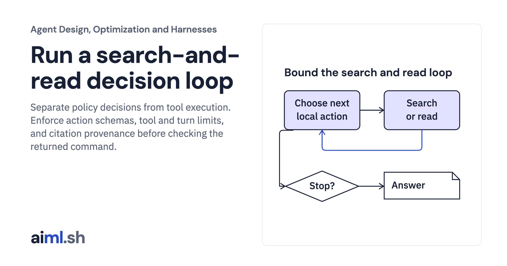

 [Agent Design, Optimization and Harnesses](../) · lesson 2 of 9

# Run a search-and-read decision loop

Separate policy decisions from tool execution. Enforce action schemas, tool and turn limits, and citation provenance before checking the returned command.

- **Full lesson:** [https://aiml.sh/courses/agent-engineering/run-a-search-and-read-decision-loop/](https://aiml.sh/courses/agent-engineering/run-a-search-and-read-decision-loop/)
- **Reading time:** 25 min
- **Uses:** Standard library only

## Lab

This lesson uses the same lab as [01-compare-a-workflow-with-a-bounded-policy](../01-compare-a-workflow-with-a-bounded-policy/lab/).
