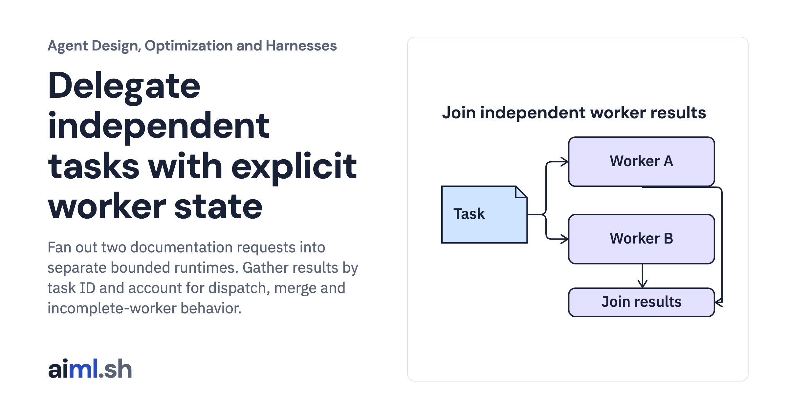

 [Agent Design, Optimization and Harnesses](../) · lesson 3 of 9

# Delegate independent tasks with explicit worker state

Fan out two documentation requests into separate bounded runtimes. Gather results by task ID and account for dispatch, merge and incomplete-worker behavior.

- **Full lesson:** [https://aiml.sh/courses/agent-engineering/delegate-independent-tasks-with-explicit-worker-state/](https://aiml.sh/courses/agent-engineering/delegate-independent-tasks-with-explicit-worker-state/)
- **Reading time:** 25 min
- **Uses:** Standard library only

## Lab

This lesson uses the same lab as [01-compare-a-workflow-with-a-bounded-policy](../01-compare-a-workflow-with-a-bounded-policy/lab/).
