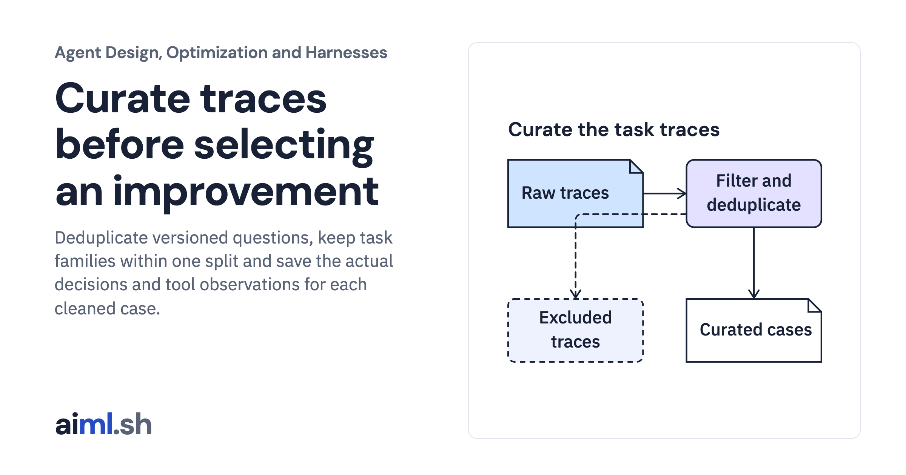

 [Agent Design, Optimization and Harnesses](../) · lesson 4 of 9

# Curate traces before selecting an improvement

Deduplicate versioned questions, keep task families within one split and save the actual decisions and tool observations for each cleaned case.

- **Full lesson:** [https://aiml.sh/courses/agent-engineering/curate-traces-before-selecting-an-improvement/](https://aiml.sh/courses/agent-engineering/curate-traces-before-selecting-an-improvement/)
- **Reading time:** 25 min
- **Uses:** Standard library only

## Lab

This lesson uses the same lab as [01-compare-a-workflow-with-a-bounded-policy](../01-compare-a-workflow-with-a-bounded-policy/lab/).
