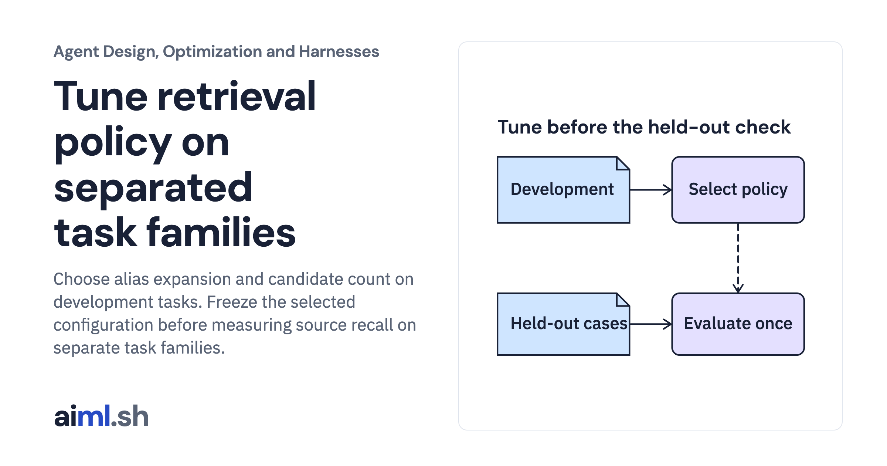

 [Agent Design, Optimization and Harnesses](../) · lesson 5 of 9

# Tune retrieval policy on separated task families

Choose alias expansion and candidate count on development tasks. Freeze the selected configuration before measuring source recall on separate task families.

- **Full lesson:** [https://aiml.sh/courses/agent-engineering/tune-retrieval-policy-on-separated-task-families/](https://aiml.sh/courses/agent-engineering/tune-retrieval-policy-on-separated-task-families/)
- **Reading time:** 25 min
- **Uses:** Standard library only

## Lab

This lesson uses the same lab as [01-compare-a-workflow-with-a-bounded-policy](../01-compare-a-workflow-with-a-bounded-policy/lab/).
