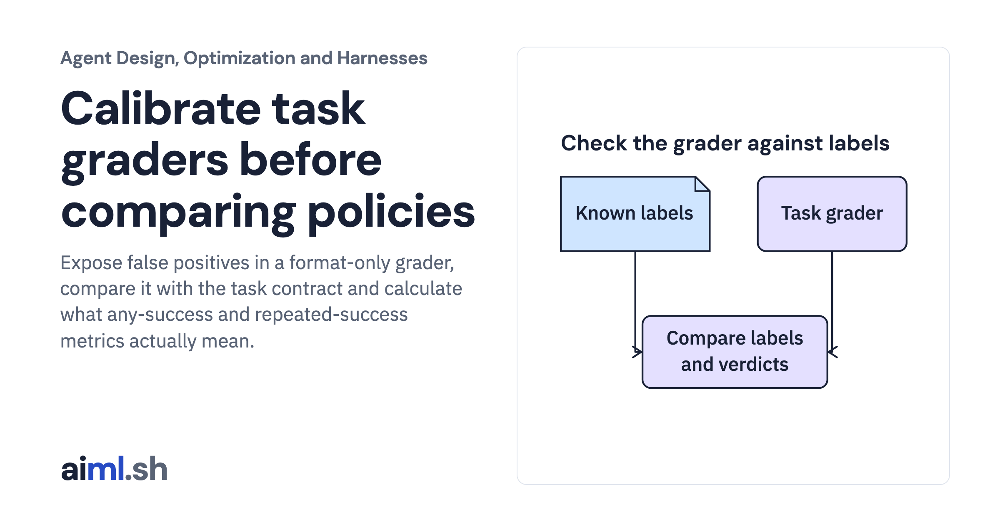

 [Agent Design, Optimization and Harnesses](../) · lesson 6 of 9

# Calibrate task graders before comparing policies

Expose false positives in a format-only grader, compare it with the task contract and calculate what any-success and repeated-success metrics actually mean.

- **Full lesson:** [https://aiml.sh/courses/agent-engineering/calibrate-outcome-graders-and-compare-repeated-trials/](https://aiml.sh/courses/agent-engineering/calibrate-outcome-graders-and-compare-repeated-trials/)
- **Reading time:** 25 min
- **Uses:** Standard library only

## Lab

This lesson uses the same lab as [01-compare-a-workflow-with-a-bounded-policy](../01-compare-a-workflow-with-a-bounded-policy/lab/).
