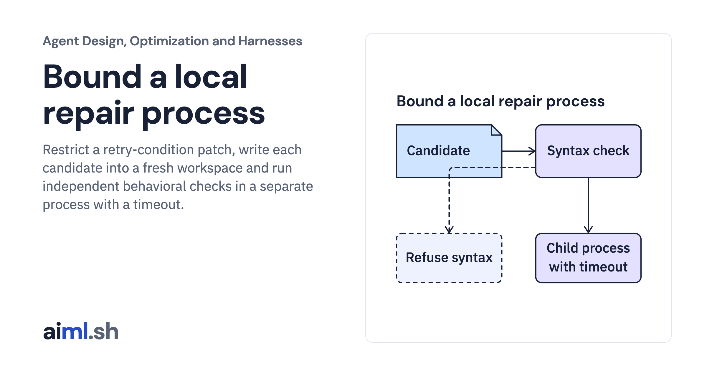

 [Agent Design, Optimization and Harnesses](../) · lesson 7 of 9

# Bound a local repair process

Restrict a retry-condition patch, write each candidate into a fresh workspace and run independent behavioral checks in a separate process with a timeout.

- **Full lesson:** [https://aiml.sh/courses/agent-engineering/bound-a-local-repair-process/](https://aiml.sh/courses/agent-engineering/bound-a-local-repair-process/)
- **Reading time:** 25 min
- **Uses:** Standard library only

## Lab

This lesson uses the same lab as [01-compare-a-workflow-with-a-bounded-policy](../01-compare-a-workflow-with-a-bounded-policy/lab/).
