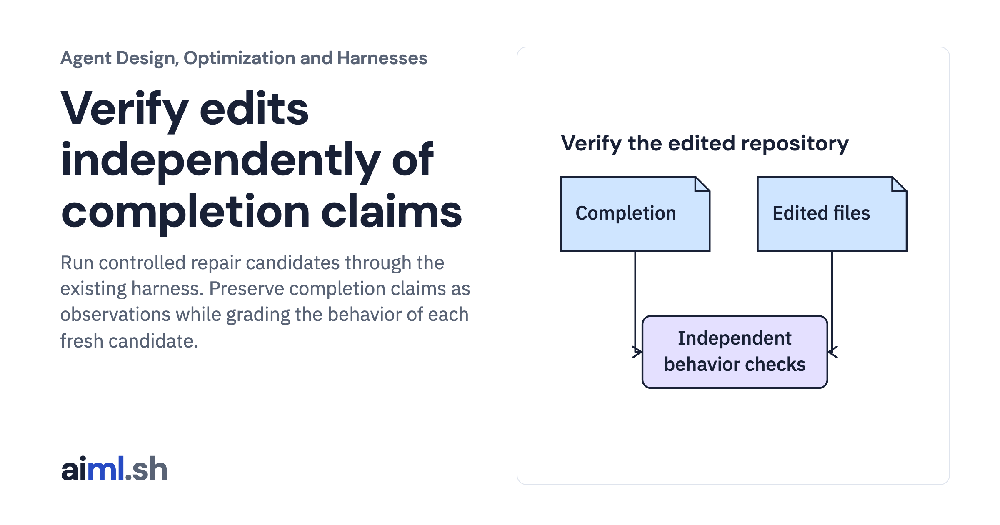

 [Agent Design, Optimization and Harnesses](../) · lesson 9 of 9

# Verify edits independently of completion claims

Run controlled repair candidates through the existing harness. Preserve completion claims as observations while grading the behavior of each fresh candidate.

- **Full lesson:** [https://aiml.sh/courses/agent-engineering/verify-edits-independently-of-completion-claims/](https://aiml.sh/courses/agent-engineering/verify-edits-independently-of-completion-claims/)
- **Reading time:** 20 min
- **Uses:** Standard library only

## Lab

This lesson uses the same lab as [01-compare-a-workflow-with-a-bounded-policy](../01-compare-a-workflow-with-a-bounded-policy/lab/).
