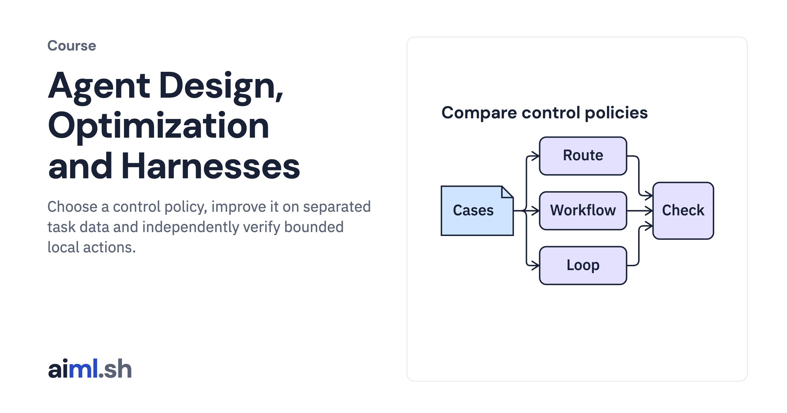

#  Agent Design, Optimization and Harnesses

Choose a control policy, improve it on separated task data and independently verify bounded local actions.

- **Course on aiml.sh:** [https://aiml.sh/courses/agent-engineering/](https://aiml.sh/courses/agent-engineering/)
- **Lessons:** 9 · **Reading time:** about 4 hours
- **Prerequisites:** A prior ADK or LangGraph course, tool contracts, retrieval and LLM Evals. These modules use those components rather than teach their introductions again.

## What you'll learn

- Compare workflows and bounded policies using the same task cases.
- Curate traces, tune on development tasks and calibrate independent graders.
- Run bounded local repair and coding-agent loops, then verify edits independently.

## Lessons

| # | Lesson | Time | Code | Full lesson |
|---|---|---|---|---|
| 1 | [Compare a workflow with a bounded policy](01-compare-a-workflow-with-a-bounded-policy/) | 25&nbsp;min | [lab](01-compare-a-workflow-with-a-bounded-policy/lab/) | [read](https://aiml.sh/courses/agent-engineering/compare-a-workflow-with-a-bounded-policy/) |
| 2 | [Run a search-and-read decision loop](02-run-a-search-and-read-decision-loop/) | 25&nbsp;min | [lab](01-compare-a-workflow-with-a-bounded-policy/lab/) | [read](https://aiml.sh/courses/agent-engineering/run-a-search-and-read-decision-loop/) |
| 3 | [Delegate independent tasks with explicit worker state](03-delegate-independent-tasks-with-explicit-worker-state/) | 25&nbsp;min | [lab](01-compare-a-workflow-with-a-bounded-policy/lab/) | [read](https://aiml.sh/courses/agent-engineering/delegate-independent-tasks-with-explicit-worker-state/) |
| 4 | [Curate traces before selecting an improvement](04-curate-traces-before-selecting-an-improvement/) | 25&nbsp;min | [lab](01-compare-a-workflow-with-a-bounded-policy/lab/) | [read](https://aiml.sh/courses/agent-engineering/curate-traces-before-selecting-an-improvement/) |
| 5 | [Tune retrieval policy on separated task families](05-tune-retrieval-policy-on-separated-task-families/) | 25&nbsp;min | [lab](01-compare-a-workflow-with-a-bounded-policy/lab/) | [read](https://aiml.sh/courses/agent-engineering/tune-retrieval-policy-on-separated-task-families/) |
| 6 | [Calibrate task graders before comparing policies](06-calibrate-outcome-graders-and-compare-repeated-trials/) | 25&nbsp;min | [lab](01-compare-a-workflow-with-a-bounded-policy/lab/) | [read](https://aiml.sh/courses/agent-engineering/calibrate-outcome-graders-and-compare-repeated-trials/) |
| 7 | [Bound a local repair process](07-bound-a-local-repair-process/) | 25&nbsp;min | [lab](01-compare-a-workflow-with-a-bounded-policy/lab/) | [read](https://aiml.sh/courses/agent-engineering/bound-a-local-repair-process/) |
| 8 | [Build a coding-agent loop](08-build-a-coding-agent-loop/) | 25&nbsp;min | [lab](08-build-a-coding-agent-loop/lab/) | [read](https://aiml.sh/courses/agent-engineering/build-a-coding-agent-loop/) |
| 9 | [Verify edits independently of completion claims](09-verify-edits-independently-of-completion-claims/) | 20&nbsp;min | [lab](01-compare-a-workflow-with-a-bounded-policy/lab/) | [read](https://aiml.sh/courses/agent-engineering/verify-edits-independently-of-completion-claims/) |

Each lesson folder has a short summary, its diagram and its lab. The complete lesson, with explanations, recorded results and checks, is on aiml.sh.

[Back to all courses](../../README.md#courses)
