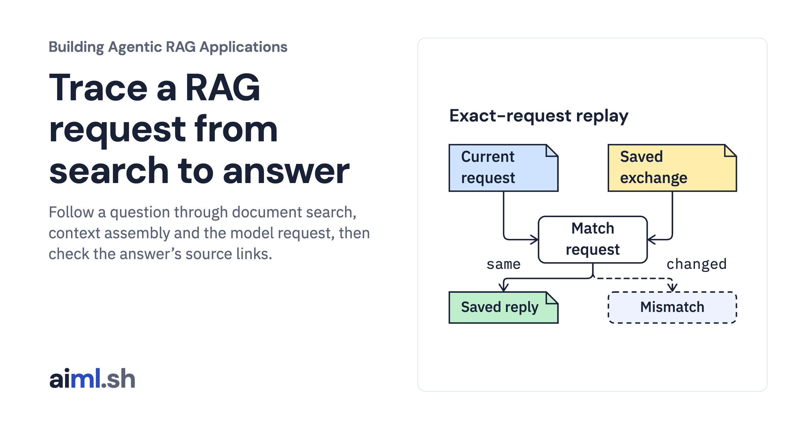

 [Building Agentic RAG Applications](../) · lesson 2 of 37

# Trace a RAG request from search to answer

[](https://aiml.sh/courses/agentic-rag/follow-a-rag-request-end-to-end/)

Follow a question through document search, context assembly and the model request, then check the answer’s source links.

- **Full lesson:** [https://aiml.sh/courses/agentic-rag/follow-a-rag-request-end-to-end/](https://aiml.sh/courses/agentic-rag/follow-a-rag-request-end-to-end/)
- **Reading time:** 25 min
- **Uses:** langchain-core, langchain-text-splitters, numpy and pydantic; complete pins in requirements-lock.txt

## Lab

The [`lab/`](lab/) folder holds the complete runnable code, tests and recorded outputs, the same files as the lesson's download on aiml.sh. The lesson explains each step.

### Lab notes

#### Build a RAG Pipeline

Retrieval, Context Assembly, and Answer Generation.

Execute a local RAG pipeline with exact-request replay of the preserved pilot's real model output. Retrieval, context assembly, source checks and event order execute now; no fresh model inference, provider transport capture or distributed tracing is claimed.

##### Run

Python 3.12+ is required by the lockfile (including NumPy). Create a virtual environment, install `requirements-lock.txt`, then:

```sh
export PYTHONPATH=src
python trace_run.py
python -m unittest discover -s tests -v
python render_output.py --html /tmp/rag-request-runtime/report.html
```

The renderer executes the driver before displaying its actual record. Generated HTML remains outside `public/`; PNGs are actual desktop/medium/phone captures. Environment details are in the raw run. Only the two recorded questions have saved query vectors and exact reply bindings. An unrecorded question is refused without fabricating embeddings. This is not an arbitrary-question generation service. No weights or model server are needed.

##### Layout

- `src/agentic_rag/concepts.py`: unchanged original pilot maintained LangChain index, prompt and source-check code.
- `src/agentic_rag/request_trace.py`: exact question/message replay bindings, actual ranked retrieval, complete selected context, emitted events and source links.
- `data/`: unchanged original Python API summaries/source links.
- `runs/2026-10-22-concept/recorded-run.json`: unchanged real Qwen/Gemma recording, including actual vectors/requests/replies/digests.
- `runs/2026-10-22-request/`: actual current replay trace/stdout/tests, deliberate mutation results and runtime PNGs.
- `tests/`: scoped mechanism and failure tests; no network/model calls.

The logical index ID describes the replay corpus, vectors and splitter. A deterministic request key repeats for the same question/index; it is not a globally unique invocation. Scores are vector similarities, not answer-correctness probabilities. Source membership cannot prove that an answer follows from the selected text. Empty-index and mutated-prompt/reply probes are explicitly controlled cases, not additional model observations.

Original application code MIT; LangChain MIT; original Qwen/Gemma model-source licenses Apache-2.0. No model weights are redistributed.
