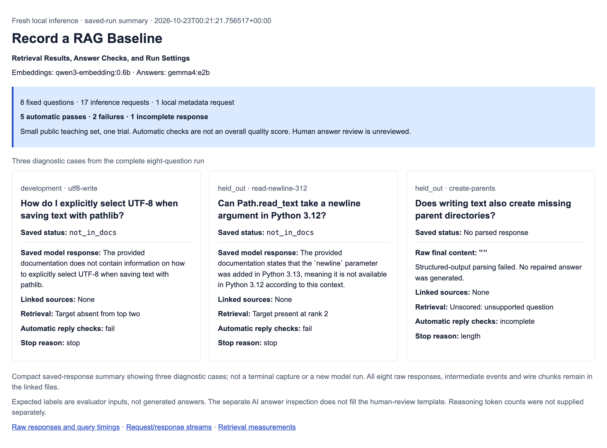

# Record a RAG Baseline

Retrieval Results, Answer Checks, and Run Settings.

This lab records the existing fixed RAG pipeline against eight versioned Python
documentation questions. It reuses the preceding pipeline, dataset and Evals
runner. It is not an agent loop or a new evaluation framework.

## Set up the extracted lab

Use Python 3.12 or later. From the extracted record-a-rag-baseline folder:

```sh
python3 -m venv .venv
source .venv/bin/activate
python -m pip install -r requirements-lock.txt
```

No API key or running model is needed to inspect the plan, run the offline tests
or replay the included recording. No model weights are included or downloaded by
the lab. A new recording requires the exact existing Ollama models named in its
plan; it never falls back to a hosted provider.

## Inspect the plan and run offline checks

```sh
python baseline.py plan
python baseline.py plan --split development --split held_out --include-held-out
python -m unittest -v test_dataset.py test_baseline.py
```

The default plan selects four development cases. The other four fixtures are
public held-out teaching cases, not unseen external benchmark data. Expected
statuses, relevance targets and version labels belong to the evaluator, not the
model prompt.

## Replay the included local run

The included eight-question run was executed once with local Qwen embeddings and
Gemma answers. Its automatic checks report five passes, two failures and one
incomplete response. These checks are not a general answer-quality score. The
UTF-8 question missed its writing passage, the Python 3.12 newline answer returned
the wrong structured status, and the parent-directory question stopped at its
length limit with no final answer. All original responses and failures remain.

```sh
python runs/20261023T002037.167760Z-fixed-eight-local-baseline/source/baseline.py replay \
  --record runs/20261023T002037.167760Z-fixed-eight-local-baseline
```

The recording binds all 27 files in its original source bundle, including its
README and tests. That exact bundle is retained in the run's source folder.
The command above uses it so strict source/result hash checks still apply.
The current README and additional snapshot tests were added after recording;
the pipeline, recorder, local adapter, dataset and grader implementations are
unchanged. The archived README records the earlier preparation stage.

Replay regrades saved responses. It does not start Ollama, call a model, retry the
length-stopped answer or repair an invalid reply. Unsupported questions have null
retrieval metrics. Missing usage stays missing. human-review.json remains an
unreviewed template; assistant-review.json is separate AI inspection, not a human
review.

The run folder retains actual requests/responses, per-case events, vectors,
parsing errors, usage, query timings, stdout/stderr and source hashes. Its four
high-resolution output PNGs are genuine browser captures of a saved-run report,
not terminal screenshots or another inference run. They show three diagnostic
cases; recording.json and http-ledger.json retain all eight.

## Inspect the saved output

<details>
<summary>Actual saved-run report: three diagnostic cases</summary>



These are genuine browser screenshots of the saved local run, not terminal
captures or another model run. All eight original responses remain in the files.

- [Full-resolution desktop screenshot](runs/20261023T002037.167760Z-fixed-eight-local-baseline/output-1440.png)
- [Medium-width screenshot](runs/20261023T002037.167760Z-fixed-eight-local-baseline/output-medium.png)
- [390px layout screenshot](runs/20261023T002037.167760Z-fixed-eight-local-baseline/output-390.png)
- [320px layout screenshot](runs/20261023T002037.167760Z-fixed-eight-local-baseline/output-320.png)
- [Raw responses](runs/20261023T002037.167760Z-fixed-eight-local-baseline/recording.json) and [request/response ledger](runs/20261023T002037.167760Z-fixed-eight-local-baseline/http-ledger.json)

</details>

## Record a separate experiment

Read the offline plan and review the current source before requesting new model
work. Its code_bundle_sha256 identifies the current files; use that reviewed hash
instead of copying the historical hash from the included run.

```sh
python baseline.py record --fresh-local --reviewed-code-sha256 REVIEWED_CODE_HASH \
  --split development --split held_out --include-held-out --trials 1 \
  --out runs/NEW_UTC_DIRECTORY
```

The hash is a source binding, not permission to spend resources. The command is
an explicit fresh local inference operation. Existing output directories are
refused. The parent starts an isolated child without inherited provider
credentials. Only existing Ollama loopback endpoints are allowed; there are no
model pulls, hosted calls, silent retries, repair prompts or judge calls.

The full plan permits one document-embedding batch, eight query embeddings and
at most eight answer generations: 17 inference HTTP attempts, one trial per case.
A separate bounded metadata check verifies the installed model digests. Each
answer request uses temperature 0 and num_predict=400 with the same Reply schema.
An output limit does not prove completion. Timeouts and invalid JSON are saved;
neither causes a second generation.

Compare exact annotated chunk/version targets for retrieval, structured response
checks and factual support separately. With one target per supported question,
recall at two equals Hit@2 here. A valid source ID does not show that the answer
follows from its passage. Eight authored questions and one trial do not establish
general accuracy, latency percentiles or a security guarantee.

The original application and authored fixtures are MIT licensed. Reuse hashes
remain in baseline-source-versions.json. No previous lesson or recording is
overwritten by the single-input plan/replay commands.
