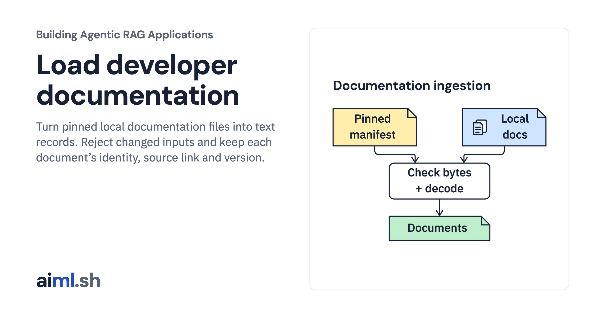

 [Building Agentic RAG Applications](../) · lesson 5 of 37

# Load developer documentation

[](https://aiml.sh/courses/agentic-rag/load-developer-documentation/)

Turn pinned local documentation files into text records. Reject changed inputs and keep each document’s identity, source link and version.

- **Full lesson:** [https://aiml.sh/courses/agentic-rag/load-developer-documentation/](https://aiml.sh/courses/agentic-rag/load-developer-documentation/)
- **Reading time:** 20 min
- **Uses:** Python standard library; no model or third-party packages

## Lab

The [`lab/`](lab/) folder holds the complete runnable code, tests and recorded outputs, the same files as the lesson's download on aiml.sh. The lesson explains each step.

### Lab notes

#### Load Developer Documentation

Load four pinned local Python API summaries and preserve their source metadata.
The text is reused byte-for-byte from the published baseline lab's
`data/sources.json`; these are original summaries, not complete upstream pages.
The manifest retains each summary's URL, version and existing `fact_status`.
No new upstream documentation check is claimed.

Requires Python 3.11 or later; no third-party dependencies, installation, network,
model or credentials. Run from this directory:

```sh
python3 load_documents.py --output runs/my-run/documents.json
python3 -m unittest discover -v
```

The recorded command loaded four documents with exit status 0. See
`runs/2026-10-23-ingestion/documents.json`, `stdout.txt`, `tests.txt` and
`execution.json` for actual output, 15 unit checks and source hashes.
The recorded run is local file processing, not model inference.

`fixtures/source-manifest.json` is the input contract. Each source must have a
unique ID and path. The loader accepts Markdown files under the fixture root,
rejects traversal and symlinks, reads at most 64 KiB plus one byte, checks SHA-256
against the original bytes and decodes strict UTF-8. It normalizes CRLF to LF
only after checking the byte hash. The normalized document preserves the original
hash, URL, version and fact status; it is not a hash of normalized text.

Changed, missing, oversized, empty and undecodable files stop this strict batch.
A hash matches expected bytes; it does not prove that a document is correct,
current or trustworthy. The fixture directory must remain under operator control:
these path checks do not protect against a concurrent process replacing files
between validation and opening. This CLI creates JSON, not a vector index or a
retrieval service. It does not execute the documented Python 3.13 API.

Render an actual result for inspection with `python3 render_output.py --input runs/2026-10-23-ingestion/documents.json --output /tmp/ingestion-report.html`. The HTML displays the saved run; rendering it does not execute ingestion again.
