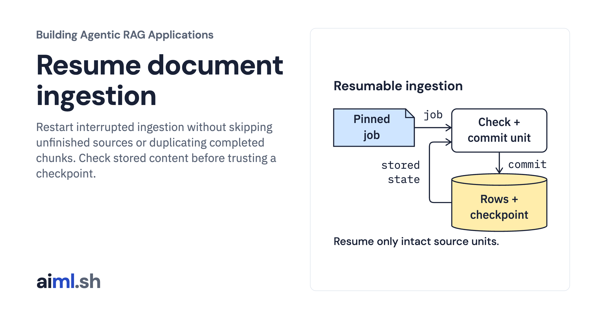

 [Building Agentic RAG Applications](../) · lesson 9 of 37

# Resume document ingestion

[](https://aiml.sh/courses/agentic-rag/resume-document-ingestion/)

Restart interrupted ingestion without skipping unfinished sources or duplicating completed chunks. Check stored content before trusting a checkpoint.

- **Full lesson:** [https://aiml.sh/courses/agentic-rag/resume-document-ingestion/](https://aiml.sh/courses/agentic-rag/resume-document-ingestion/)
- **Reading time:** 25 min
- **Uses:** Python standard library sqlite3 and its linked SQLite library; no model or third-party packages

## Lab

The [`lab/`](lab/) folder holds the complete runnable code, tests and recorded outputs, the same files as the lesson's download on aiml.sh. The lesson explains each step.

### Lab notes

#### Resume document ingestion

`ingest.py` commits one complete source unit at a time: source revision, all its
chunks and the completion checkpoint. An injected interruption after chunk
inserts raises before the transaction commits. SQLite rolls back that source;
previous source commits survive. `run.py` closes the database after the failure,
opens the same file, resumes and then retries the completed job.

One database belongs to one job ID and one pinned snapshot ID. The job also pins a canonical SHA-256 of the entire
supplied snapshot, so changing text, metadata or chunker settings while retaining
the claimed snapshot ID is rejected before source processing. A different job
requires a new database. A changed snapshot cannot reuse an existing job. Before
skipping a checkpoint, the runner compares the stored source revision and the
entire stored chunk ID/source/text set with the supplied source. Missing or
altered stored chunks cause refusal. A checkpoint indicates this source unit was
committed, not that its content is correct.

Tests cover interrupted rollback, persistent restart, duplicate retry,
changed snapshot refusal, another-job refusal, stale checkpoint refusal and
missing or altered committed chunks. This is a single-writer local ingestion
workflow. It does not implement concurrent workers, cancellation, a distributed
queue, database recovery after disk failure or replacement of changed sources.

##### Runtime and input boundary

Requires Python 3.11 or later and the Python standard library. No model, network,
credentials or downloads are used. The SQLite library used by the update/delete
lab must include FTS5; a missing module raises `sqlite3.OperationalError` during
setup. No packages are installed by these commands.

The supplied snapshot preserves original Python API summaries and the document,
metadata and chunk identity contract from `version-documents-and-chunks`. It is
trusted local input, not an authenticated remote manifest. These labs do not
recompute identities or accept untrusted uploaded snapshots. Source versions
refer to the summarized API, not the Python interpreter running the lab.

##### Run and compare

Run from this lesson directory. Choose a new database path for each demonstration;
`run.py` refuses to reuse an existing file so the recorded sequence stays clear.

```sh
python3 run.py --database /tmp/resume-document-ingestion-example.sqlite
python3 -m unittest -v
```

The actual run is recorded in `runs/2026-10-23-maintenance/run.json`, with exact
stdout in `stdout.txt`. Test output and environment/source hashes accompany it.
To compare, run with another new database path and redirect stdout, then use
`diff` against `run.json`. SQLite version may differ between runtimes.

```sh
python3 render_output.py /tmp/resume-document-ingestion-report.html
```

The renderer reads the actual JSON record and creates a responsive HTML report.
Browser captures show this report, not a reconstructed terminal or model output.
This local source/index execution does not measure answer quality or throughput.
