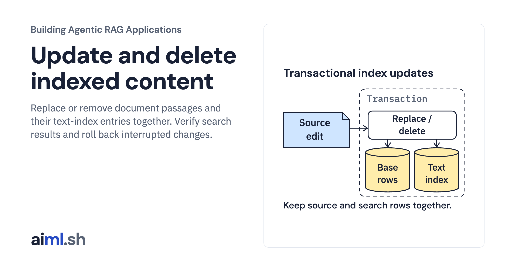

 [Building Agentic RAG Applications](../) · lesson 10 of 37

# Update and delete indexed content

[](https://aiml.sh/courses/agentic-rag/update-and-delete-indexed-content/)

Replace or remove document passages and their text-index entries together. Verify search results and roll back interrupted changes.

- **Full lesson:** [https://aiml.sh/courses/agentic-rag/update-and-delete-indexed-content/](https://aiml.sh/courses/agentic-rag/update-and-delete-indexed-content/)
- **Reading time:** 25 min
- **Uses:** Python standard library sqlite3 with linked SQLite FTS5; no model or third-party packages

## Lab

The [`lab/`](lab/) folder holds the complete runnable code, tests and recorded outputs, the same files as the lesson's download on aiml.sh. The lesson explains each step.

### Lab notes

#### Update and delete indexed content

`index.py` maintains three real SQLite structures: source revisions, chunks and
an FTS5 lexical search index. Replacing a source deletes its old chunks and FTS
rows, inserts its new revision and chunks, then commits all three together.
Deleting a source removes its FTS rows, chunks and source row in one transaction.
A missing source deletion returns `missing-no-op`; this makes retries explicit.

`run.py` loads the original snapshot, applies the supplied text-change snapshot
to the changed source, records injected replacement and deletion rollbacks,
runs actual FTS5 `MATCH` queries, deletes that source and
repeats the deletion. The query `saving` has no match before the local teaching
revision, matches its added paragraph after replacement, and has no match after
deletion. The raw record includes every retired chunk ID and table state.

Tests cover old chunk removal and actual old/new MATCH results, interrupted
replacement rollback, repeated replacement, actual MATCH removal on deletion,
missing deletion and interrupted deletion rollback. The tests use an explicit
local replacement paragraph to isolate the index-maintenance contract.

FTS5 is a local lexical index here, not a dense-vector store or ranking lesson.
Removing rows prevents them appearing in these subsequent queries. It does not
securely erase old database pages, backups, caches or copies. This single-writer
lab has no concurrent search-serving or authorization contract.

##### Runtime and input boundary

Requires Python 3.11 or later and the Python standard library. No model, network,
credentials or downloads are used. The SQLite library used by the update/delete
lab must include FTS5; a missing module raises `sqlite3.OperationalError` during
setup. No packages are installed by these commands.

The supplied snapshot preserves original Python API summaries and the document,
metadata and chunk identity contract from `version-documents-and-chunks`. It is
trusted local input, not an authenticated remote manifest. These labs do not
recompute identities or accept untrusted uploaded snapshots. Source versions
refer to the summarized API, not the Python interpreter running the lab.

##### Run and compare

Run from this lesson directory. Choose a new database path for each demonstration;
`run.py` refuses to reuse an existing file so the recorded sequence stays clear.

```sh
python3 run.py --database /tmp/update-and-delete-indexed-content-example.sqlite
python3 -m unittest -v
```

The actual run is recorded in `runs/2026-10-23-maintenance/run.json`, with exact
stdout in `stdout.txt`. Test output and environment/source hashes accompany it.
To compare, run with another new database path and redirect stdout, then use
`diff` against `run.json`. SQLite version may differ between runtimes.

```sh
python3 render_output.py /tmp/update-and-delete-indexed-content-report.html
```

The renderer reads the actual JSON record and creates a responsive HTML report.
Browser captures show this report, not a reconstructed terminal or model output.
This local source/index execution does not measure answer quality or throughput.
