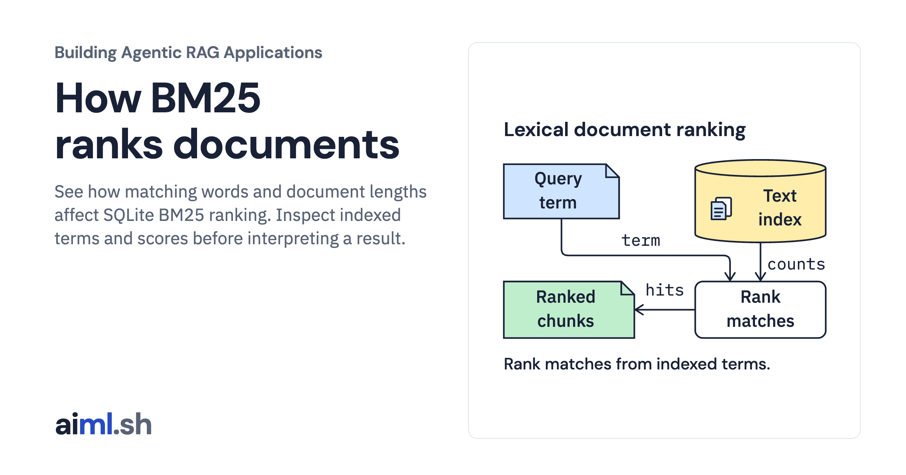

 [Building Agentic RAG Applications](../) · lesson 11 of 37

# How BM25 ranks documents

[](https://aiml.sh/courses/agentic-rag/how-bm25-ranks-documents/)

See how matching words and document lengths affect SQLite BM25 ranking. Inspect indexed terms and scores before interpreting a result.

- **Full lesson:** [https://aiml.sh/courses/agentic-rag/how-bm25-ranks-documents/](https://aiml.sh/courses/agentic-rag/how-bm25-ranks-documents/)
- **Reading time:** 25 min
- **Uses:** Python standard library sqlite3 and linked SQLite FTS5; no model or third-party packages

## Lab

The [`lab/`](lab/) folder holds the complete runnable code, tests and recorded outputs, the same files as the lesson's download on aiml.sh. The lesson explains each step.

### Lab notes

#### How BM25 Ranks Documents

Run SQLite FTS5's real native `bm25()` function over the four paragraph chunks
from the preceding module's initial snapshot. Requires Python 3.12 or later with
SQLite FTS5 enabled; no third-party packages, models, network or downloads.

```sh
python3 run.py --output runs/my-run/result.json
python3 -m unittest discover -v
python3 render_output.py --input runs/my-run/result.json --output /tmp/bm25-report.html
```

Run from this directory. If the linked SQLite library lacks FTS5, table creation
fails rather than substituting another ranking algorithm. The actual local run,
raw stdout, tests and source/environment record are under
`runs/2026-10-23-bm25/`. Reading its report is not a new search execution.

##### What the index stores

`fixtures/snapshot.json` is copied unchanged from the module4 initial snapshot.
Its four chunks contain original Python API summaries, not complete upstream pages.
The source ID, chunk ID, Python API version and source URL stay attached to each
search result. The copied snapshot validator checks internal consistency before
index creation; it does not authenticate the source or recheck Python API claims.
Only `text` is indexed; metadata columns are `UNINDEXED`. `unicode61` is SQLite's
tokenizer, with default options. `fts5vocab` exposes its actual term instances.
For example `write_text` contributes separate `write` and `text` terms; the lab
does not pretend Python identifier punctuation remains a single indexed token.

##### Read the native ranking

Lower (more negative) native scores rank first. `chunk_id ASC` breaks exact score
ties deterministically. For the recorded `text` query the source order is
`path-read`, `path-read-3-13`, `path-write`. Scores are relevance ranks within this
index/query, not probabilities, calibrated confidence or model judgments.

For this one-term, one-indexed-column contract, the diagnostic uses SQLite's
actual vocabulary to count term frequency `tf`, document token length `dl`,
average length `avgdl`, matching-document count `df` and total documents `N`.
It computes `idf = max(log((N - df + 0.5)/(df + 0.5)), 1e-6)` and
`-idf * tf * (k1 + 1) / (tf + k1 * (1 - b + b * dl / avgdl))`.
SQLite fixes `k1=1.2` and `b=0.75`; these are not exposed as tuning parameters here.
Frequency saturates rather than growing linearly; document length changes the
normalization denominator. The tests compare this explanation against native
scores, while the application always sorts by the native function's output.

See the official [BM25 function documentation](https://www.sqlite.org/fts5.html#the_bm25_function),
[unicode61 tokenizer](https://www.sqlite.org/fts5.html#unicode61_tokenizer), and
[fts5vocab tables](https://www.sqlite.org/fts5.html#the_fts5vocab_virtual_table_module).
This diagnostic is intentionally limited to a single term. It does not claim to
explain phrase, Boolean, prefix or weighted-column FTS queries.

##### Query policy and boundaries

The API accepts up to 16 distinct ASCII alphanumeric terms (at most 64 characters per term and 256 characters overall). Spaces and underscores separate terms. It lowercases and quotes each term independently, then combines them with OR. Operator words are literals; multiword queries match any term. Multiword rows carry native scores without the single-term diagnostic fields. Whitespace-only queries
return `empty_query`; absent terms return `no_match`. FTS syntax, punctuation,
SQL fragments and invalid limits fail with `ValueError('invalid_query')`.
Limit must be an integer from 1 through 100. The strict policy is an application
choice, not a limitation of FTS5 or its Unicode tokenizer.

The tests cover actual ranking, tokenizer output, metadata attachment,
malformed query handling, bounded limits, absent/empty queries, snapshot tampering
and exact-score ties. The tie test inserts a controlled duplicate row; its
synthetic IDs are test fixtures and do not appear in the recorded corpus run.

This is a small in-memory CLI index. It does not implement persistence, production
query serving, metadata filters, embeddings, hybrid search or a new version of
the earlier vector-retrieval course. The Python 3.13 source remains documented
only; this lab does not execute its described API. A word match does not establish
that a passage answers the developer's question.
