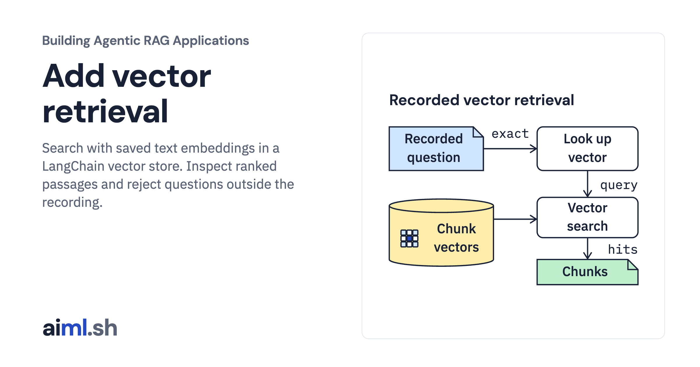

 [Building Agentic RAG Applications](../) · lesson 12 of 37

# Add vector retrieval

[](https://aiml.sh/courses/agentic-rag/add-vector-retrieval/)

Search with saved text embeddings in a LangChain vector store. Inspect ranked passages and reject questions outside the recording.

- **Full lesson:** [https://aiml.sh/courses/agentic-rag/add-vector-retrieval/](https://aiml.sh/courses/agentic-rag/add-vector-retrieval/)
- **Reading time:** 25 min
- **Uses:** langchain-core 1.7.0, numpy 2.5.4 and pydantic 2.14.1; complete pins in requirements.lock

## Lab

The [`lab/`](lab/) folder holds the complete runnable code, tests and recorded outputs, the same files as the lesson's download on aiml.sh. The lesson explains each step.

### Lab notes

#### Add vector retrieval

`VectorRetriever` inserts the versioned chunks into an actual LangChain
`InMemoryVectorStore`. `SavedEmbeddings` refuses unknown document/query text,
checks the raw vector recording hash, and validates vector dimensions, finite
numeric values and positive finite norms. Returned vectors are copied so callers
cannot mutate the saved inputs. No fallback computes an embedding.

`run.py` queries only the four development questions with their requested Python
version filter. It records the real top-two results and demonstrates rejection
of an unknown question. The unsupported cloud-backup question still produces
candidate passages: similarity ordering does not establish answerability.
The unfiltered UTF-8 question ranks the Python 3.13 read summary first, which is
also why a plausible score is not proof of the intended write instruction.

Tests exercise the actual framework store and known chunk bindings, unrecorded
queries/documents, held-out refusal, changed corpus text, vector-file tampering,
invalid dimensions/nonfinite/zero vectors, copy isolation and invalid result
counts. The vector course explains embeddings and similarity; this lab adds the
retriever to the existing document pipeline.

##### Runtime and preserved inputs

Python 3.12 or later. Direct dependencies are pinned in `requirements.txt`; the
complete installed dependency closure is recorded in `requirements.lock`.
The recorded run uses LangChain Core 1.7.0, NumPy 2.5.4 and Pydantic 2.14.1.
No package was installed for this run. Use an environment with these dependencies
already present, then run from this lesson directory:

```sh
python run.py
python -m unittest -v
python render_output.py /tmp/retrieval-report.html
```

`fixtures/vectors.json` is a byte-identical copy of the preserved Qwen
`qwen3-embedding:0.6b` document/question vectors from the earlier recorded baseline.
`fixtures/provenance.json` preserves the original model digest, query instruction,
source run and vector-file SHA-256. The raw file retains the historic held-out
question vectors, but `SavedEmbeddings` exposes only the four development
questions. No held-out query was executed in this lab. It looks up the recorded
question string directly; it does not add a prompt prefix or compute a vector.

`fixtures/snapshot.json` preserves the source/chunk IDs from the versioning lab.
Its four normalized chunk texts match the saved document-vector keys exactly.
The API version metadata describes the summarized Python documentation, not the
interpreter running this lab. The corpus consists of supplied original summaries,
not live fetched documentation.

The runner uses no model, provider credentials, downloads or network request.
The actual recorded run was also executed with outbound socket connections
blocked. Model execution in the original baseline is historical provenance;
this lesson proves local framework replay only.

##### Artifacts and limits

`runs/2026-10-23-replay/run.json` contains the actual returned rows and scores;
`stdout.txt` is exact program output, `tests.txt` records actual tests and
`execution.json` binds runtime/dependency versions and source hashes. The HTML
renderer reads that record and does not rerun queries. Equal vector scores use chunk ID as a stable secondary ordering. The store scores
all eligible candidates, then the adapter sorts and truncates; filtering still
occurs before scoring and selection. A fresh run should match
the record under the pinned stack; floating point values can change across
library versions.

The snapshot originates from the supplied local versioning lab. The copied versioning validator recomputes the canonical snapshot, metadata
and chunk identity contract before insertion. It cannot authenticate an author
or recover original raw bytes from normalized text. A version filter is an application selection rule, not an
authorization boundary. The tiny fixture does not measure production search
quality, throughput or robustness.
