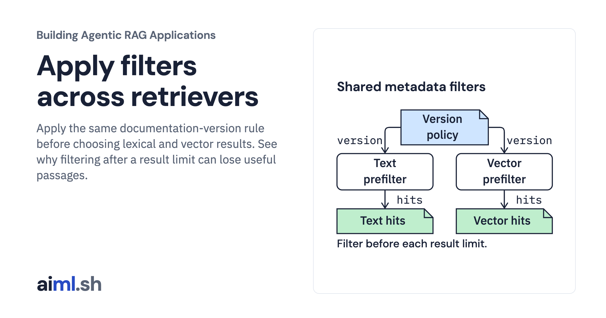

 [Building Agentic RAG Applications](../) · lesson 13 of 37

# Apply filters across retrievers

[](https://aiml.sh/courses/agentic-rag/apply-filters-across-retrievers/)

Apply the same documentation-version rule before choosing lexical and vector results. See why filtering after a result limit can lose useful passages.

- **Full lesson:** [https://aiml.sh/courses/agentic-rag/apply-filters-across-retrievers/](https://aiml.sh/courses/agentic-rag/apply-filters-across-retrievers/)
- **Reading time:** 25 min
- **Uses:** langchain-core 1.7.0, numpy 2.5.4 and pydantic 2.14.1 plus SQLite FTS5; complete pins in requirements.lock

## Lab

The [`lab/`](lab/) folder holds the complete runnable code, tests and recorded outputs, the same files as the lesson's download on aiml.sh. The lesson explains each step.

### Lab notes

#### Apply filters across retrievers

Both retrievers accept the same policy: `None` or `{}` means all versions;
`{"version":{"$eq":"3.12"}}` selects an exact numeric major.minor version string.
Unknown versions produce no candidates. Other fields, operators, wrong value
types and malformed version strings are rejected. Missing or invalid source
version metadata is rejected at construction.

The LangChain vector store applies its callable predicate before selecting top-k.
The actual SQLite FTS5 lexical query uses a parameterized `version=?` condition
before `ORDER BY bm25(...) LIMIT ?`. The same four chunk rows and candidate IDs
feed both retrievers. SQLite scores and vector similarities are different values;
the program does not compare or fuse them.

The lexical query API deliberately accepts one ASCII alphanumeric term of at
most 64 characters. It does not parse a natural-language question or expose raw
FTS query operators. The vector query must be one of the recorded development
questions. The report names these different query representations explicitly.

The prefilter comparison uses the recorded development question about replacing
a file for vector search and `encoding` for lexical search. For version 3.13,
filtering either unfiltered top-one result yields no row. Filtering the candidate
set first returns the available 3.13 passage. This constructed diagnostic tests
selection order; its passage is not claimed to answer the overwrite question.

Tests verify exact candidate sets, excluded-version refusal, empty results,
empty-filter behavior, invalid policies and metadata, invalid lexical queries,
and the top-one underfill regression using the actual framework and FTS5 index.
The vector adapter and its tests are copied byte-identically from the vector lab.

##### Runtime and preserved inputs

Python 3.12 or later. Direct dependencies are pinned in `requirements.txt`; the
complete installed dependency closure is recorded in `requirements.lock`.
The recorded run uses LangChain Core 1.7.0, NumPy 2.5.4 and Pydantic 2.14.1.
No package was installed for this run. Use an environment with these dependencies
already present, then run from this lesson directory:

```sh
python run.py
python -m unittest -v
python render_output.py /tmp/retrieval-report.html
```

`fixtures/vectors.json` is a byte-identical copy of the preserved Qwen
`qwen3-embedding:0.6b` document/question vectors from the earlier recorded baseline.
`fixtures/provenance.json` preserves the original model digest, query instruction,
source run and vector-file SHA-256. The raw file retains the historic held-out
question vectors, but `SavedEmbeddings` exposes only the four development
questions. No held-out query was executed in this lab. It looks up the recorded
question string directly; it does not add a prompt prefix or compute a vector.

`fixtures/snapshot.json` preserves the source/chunk IDs from the versioning lab.
Its four normalized chunk texts match the saved document-vector keys exactly.
The API version metadata describes the summarized Python documentation, not the
interpreter running this lab. The corpus consists of supplied original summaries,
not live fetched documentation.

The runner uses no model, provider credentials, downloads or network request.
The actual recorded run was also executed with outbound socket connections
blocked. Model execution in the original baseline is historical provenance;
this lesson proves local framework replay only.

##### Artifacts and limits

`runs/2026-10-23-replay/run.json` contains the actual returned rows and scores;
`stdout.txt` is exact program output, `tests.txt` records actual tests and
`execution.json` binds runtime/dependency versions and source hashes. The HTML
renderer reads that record and does not rerun queries. Equal vector scores use chunk ID as a stable secondary ordering. The store scores
all eligible candidates, then the adapter sorts and truncates; filtering still
occurs before scoring and selection. A fresh run should match
the record under the pinned stack; floating point values can change across
library versions.

The snapshot originates from the supplied local versioning lab. The copied versioning validator recomputes the canonical snapshot, metadata
and chunk identity contract before insertion. It cannot authenticate an author
or recover original raw bytes from normalized text. A version filter is an application selection rule, not an
authorization boundary. The tiny fixture does not measure production search
quality, throughput or robustness.
