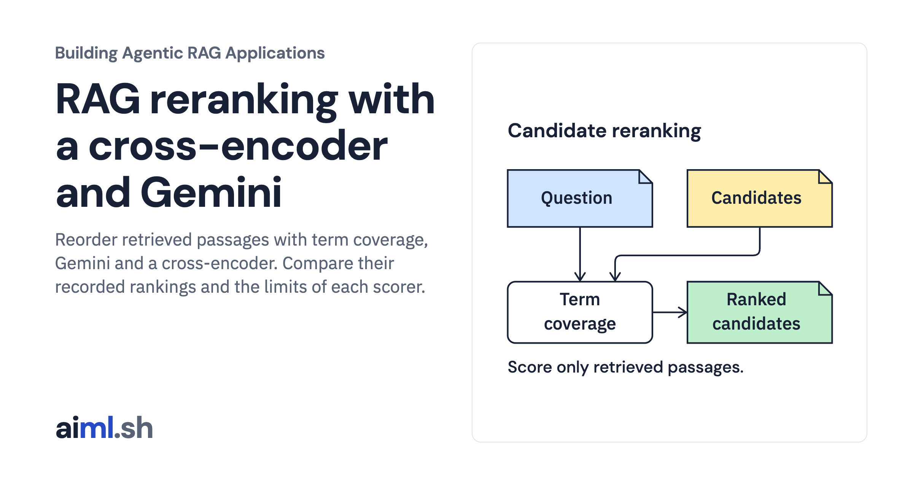
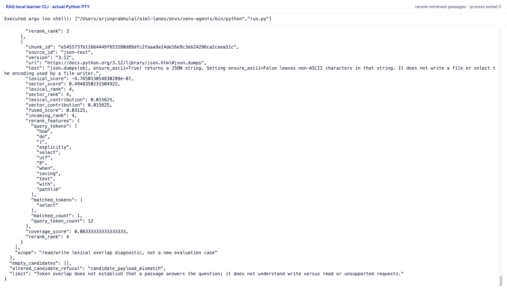

 [Building Agentic RAG Applications](../) · lesson 15 of 37

# Rerank retrieved passages

[](https://aiml.sh/courses/agentic-rag/rerank-retrieved-passages/)

Reorder retrieved passages with term coverage, Gemini and a cross-encoder. Compare their recorded rankings and the limits of each scorer.

- **Full lesson:** [https://aiml.sh/courses/agentic-rag/rerank-retrieved-passages/](https://aiml.sh/courses/agentic-rag/rerank-retrieved-passages/)
- **Reading time:** 25 min
- **Uses:** langchain-core 1.7.0, numpy 2.5.4 and pydantic 2.14.1; complete pins in requirements.lock; Gemini REST needs no additional SDK; optional scorer pins in cross-encoder-requirements.lock

## Lab

The [`lab/`](lab/) folder holds the complete runnable code, tests and recorded outputs, the same files as the lesson's download on aiml.sh. The lesson explains each step.

### Lab notes

#### Rerank retrieved passages

This lab runs a transparent deterministic token-coverage heuristic as a second
stage over actual hybrid candidates. It is not a learned reranker, cross-encoder
or model. It compares query/passage token sets without labels or expected answers.

The tokenizer is the hybrid retriever's `question_terms`: lowercase ASCII
alphanumeric runs, at most 512 input characters, 32 token occurrences and 64
characters per token. It preserves first occurrence while removing duplicates.
No stopword removal, synonym expansion or linguistic understanding is used.
For each candidate, the score is the number of distinct query tokens present in
the passage divided by the distinct query-token count. Exact coverage ties keep
the incoming RRF rank. The trace keeps query tokens, matched tokens, counts,
original branch ranks/native scores, fused score and incoming/reranked positions.

`rerank` validates the snapshot and each candidate's exact source ID, chunk ID,
API version, URL and text. It rejects unknown/duplicate candidates, altered
payloads, invalid ranks and nonfinite/invalid upstream scores. It cannot invent
a new chunk. The requested top-k truncates only after all candidate features
are calculated. Empty candidates return an empty list after input validation.

The actual four development runs retain every incoming order. For the UTF-8
write question, the read and write summaries tie on overlap and the read passage
stays first. The unsupported backup question still receives candidates. A
separate unfiltered diagnostic reuses the same first development question and
shows read/write overlap across all supplied versions. No label or new query is
introduced by this diagnostic. A separate controlled candidate-order contract
check reverses the actual replacement-question candidate list and records how
coverage reorders it. That check is not an evaluation case or a quality gain. These results show the heuristic's limits, not a
retrieval improvement. Tests verify identity preservation, token receipts,
label independence, incoming-order ties, empty inputs, malformed requests,
unknown vectors and changed candidate payloads.

##### Runtime and frozen inputs

Requires Python 3.12 or later because the pinned NumPy version requires it.
`requirements.txt` pins the direct installed dependencies and `requirements.lock`
records their installed dependency closure. No installation was performed.
Use an environment with these packages already present, then run from this
lesson directory:

```sh
python run.py
python -m unittest -v
python render_output.py /tmp/module6-report.html
```

The hybrid, vector, document-loading and versioning cores are copied unchanged
from the preceding labs. SQLite FTS5 executes a quoted OR expression over the
original question's lowercase ASCII alphanumeric terms; the vector store replays
the exact same full question's saved embedding. No prompt prefix or embedding
computation is added. Both branches apply the requested version before selecting
candidate passages. RRF uses one-based ranks, not native score arithmetic.

`fixtures/vectors.json` is byte-identical to the earlier Qwen embedding recording.
Its provenance file retains the original run, model digest, query instruction
and file hash. The raw historical recording includes held-out vectors; only the
four original development questions are exposed and queried here. Source text,
version and current chunk identities come from the frozen versioning snapshot.
The copied validator checks normalized snapshot integrity. Raw source identity
and author authenticity remain provenance assumptions; hashes alone do not
establish authorization or factual accuracy.

The actual local execution appears in `runs/2026-10-23-rerank/result.json`, with
exact `stdout.txt`, `stderr.txt`, actual `tests.txt` and source/runtime hashes in
`execution.json`. Outbound socket connections were denied during the recorded
run. This is actual framework retrieval over preserved vectors, not a new model
run. The HTML renderer reads the record without running retrieval.

##### Original CLI capture

This terminal ending retains query-token coverage details, the empty candidate list and the altered-candidate refusal. The heuristic still cannot determine whether a passage answers the question.

Reproduce with the prepared Python environment: `python run.py`. The manifest retains the exact interpreter argv and source hashes. One original PTY process exited zero with no terminal input or network attempt. The capture server received its live session bytes; it did not reprint a saved output file. The top/end images are completed scroll positions of that process, not separate executions.



[Original terminal PNG](lab/runs/native-cli-20261023/images/completed-end-1920@2x.png) · [Top of the same session](lab/runs/native-cli-20261023/images/completed-top-1920@2x.png) · [Original stdout](lab/runs/native-cli-20261023/stdout.txt) · [Actual JSON](lab/runs/native-cli-20261023/result.json) · [Command and source manifest](lab/runs/native-cli-20261023/manifest.json).

The earlier HTML report remains a secondary view. Saved vectors/replies and scripted choices keep their existing limitations; these local CLI captures add no fresh model inference.


##### Gemini comparison

`gemini_rerank.py` adds a fresh Gemini 3.1 Flash-Lite run beside the original offline baseline. The saved run is `runs/2026-10-24-gemini/result.json`; `requests/` retains the exact sanitized REST payloads, provider responses, usage and local receipt timings. Original recordings remain unchanged. Tests replay exact requests offline and never load a key.

Use Python 3.12 on macOS/Linux. The transport uses standard-library HTTPS and `fcntl` for its shared budget lock; no SDK or model download is needed. This environment used its installed certifi CA bundle through `SSL_CERT_FILE`; use your trusted system CA setup. The reranking driver also needs the original pinned lab dependencies.

Fresh execution is optional and incurs API usage. Set `GOOGLE_API_KEY` or `GEMINI_API_KEY` securely in the environment, then run:

```sh
python gemini_rerank.py --ledger /tmp/aiml-gemini-budget.json --output runs/my-gemini-run/result.json
```

Use the **same ledger path for all three labs**. The transport fixes the model, temperature 0, one candidate, 2048 maximum output tokens and minimal thinking. It accepts text-only input up to 60000 serialized bytes, reserves $0.10 before each request, allows at most 80 reservations ($8), and performs no automatic retries. The owner authorized a $10 total ceiling for the recorded session. Reservations survive failed attempts. Usage-based estimates use the pricing checked on 2026-10-24; these are not invoice totals or a billing-account limit. The ledger cannot account for unrelated callers or a separately created ledger. Existing run results cannot be overwritten.

The recorded run is an illustration, not a relevance or agent-quality benchmark. Read the article for retained failures and comparison limits.

##### Dedicated cross-encoder comparison

`cross_encoder.py` pins `cross-encoder/ms-marco-MiniLM-L6-v2` to revision `233902d25c440f23af6f7d6e94d2946bac0bee0a` (Apache-2.0). In a separate Python 3.12 environment, install `cross-encoder-requirements.lock`, run `python cross_encoder.py --model-dir /tmp/aiml-cross-encoder --prepare`, then `python cross_encoder.py --model-dir /tmp/aiml-cross-encoder --output runs/my-cross-encoder/result.json`. The download contains only six named safetensors/tokenizer/config files; weights remain outside this lab. Inference loads local files only with remote code disabled, CPU float32 and one thread. Pair inputs above 512 tokens fail instead of truncating.

`runs/cross-encoder-v1/result.json` records actual local inference, file hashes, package versions and inference-only timings. Raw logits are ranking scores, not probabilities. Original hybrid candidates remain unchanged. Twelve expanded cases use exhaustive version-eligible pools in a four-document fixture, with four known diagnostic and eight new validation strings. Both scorers hit all six answerable validation targets at rank one; no validation improvement is claimed. Unsupported cases have no scored target. This is not a general benchmark or answer evaluation.

Run `python -m unittest test_cross_encoder -v` in the original retrieval environment to replay saved scores and identity checks offline. These tests need neither Torch nor the downloaded model. `runs/cross-encoder-v1/provenance.json` binds source, fixtures and result. The original Gemini and coverage results are preserved.
