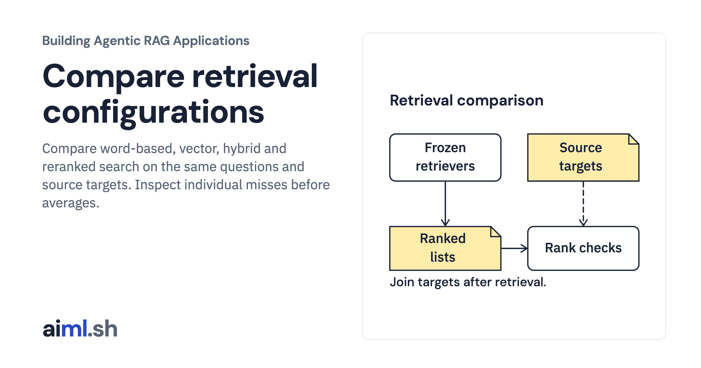
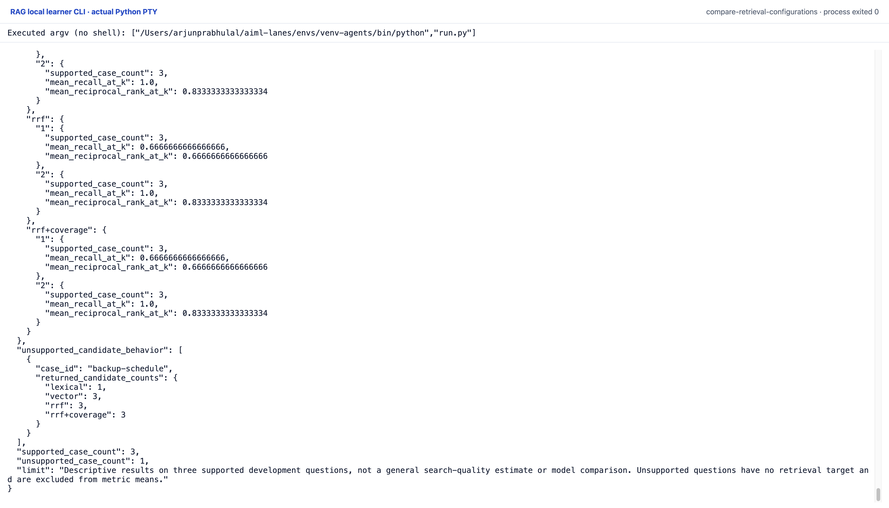

 [Building Agentic RAG Applications](../) · lesson 16 of 37

# Compare retrieval configurations

[](https://aiml.sh/courses/agentic-rag/compare-retrieval-configurations/)

Compare word-based, vector, hybrid and reranked search on the same questions and source targets. Inspect individual misses before averages.

- **Full lesson:** [https://aiml.sh/courses/agentic-rag/compare-retrieval-configurations/](https://aiml.sh/courses/agentic-rag/compare-retrieval-configurations/)
- **Reading time:** 25 min
- **Uses:** langchain-core 1.7.0, numpy 2.5.4 and pydantic 2.14.1; complete pins in requirements.lock

## Lab

The [`lab/`](lab/) folder holds the complete runnable code, tests and recorded outputs, the same files as the lesson's download on aiml.sh. The lesson explains each step.

### Lab notes

#### Compare retrieval configurations

This lab freezes four configurations before evaluation: lexical, vector, RRF,
and RRF followed by the transparent token-coverage reranker. Each branch receives
the same original question, requested API version, frozen corpus and candidate
budget of three. RRF's rank constant is 60. The comparison reports cutoffs one
and two. No configuration parameter is tuned from these results.

`retrieve_runs` receives only case ID, question text and requested version.
Expected answers and target IDs are not passed to retrieval or reranking. After
all ranking completes, `bind_targets` maps original legacy target IDs to current
versioned chunk IDs by exact source ID, API version, raw source SHA-256 and chunk
text SHA-256. Exactly one current chunk must match each target. A receipt keeps
both old and current IDs; comparing those IDs directly would be wrong.

For supported questions, recall@k is retrieved labeled target chunks divided by
all labeled target chunks. Reciprocal-rank@k is the inverse of the first target's
rank when that rank is within k, otherwise zero. The record keeps target ranks
and explicit misses. Aggregate means use only the three supported development
questions. The unsupported backup question has no target; its metrics are null,
it is excluded from means, and its returned candidate counts appear separately.
Retrieval cannot establish an abstention or an answer-generation outcome.

All configurations produce the same aggregate values in this tiny set and miss
the UTF-8 write target at rank one. The coverage heuristic offers no observed
ranking benefit here. The case set is too small and was already used during
development; it is not a general search-quality estimate or a winner selection.
No held-out question is queried. Tests cover exact legacy-label binding,
malformed/ambiguous targets, post-retrieval label independence, rank arithmetic,
case joins and unsupported-case denominator exclusion.

##### Runtime and frozen inputs

Requires Python 3.12 or later because the pinned NumPy version requires it.
`requirements.txt` pins the direct installed dependencies and `requirements.lock`
records their installed dependency closure. No installation was performed.
Use an environment with these packages already present, then run from this
lesson directory:

```sh
python run.py
python -m unittest -v
python render_output.py /tmp/module6-report.html
```

The hybrid, vector, document-loading and versioning cores are copied unchanged
from the preceding labs. SQLite FTS5 executes a quoted OR expression over the
original question's lowercase ASCII alphanumeric terms; the vector store replays
the exact same full question's saved embedding. No prompt prefix or embedding
computation is added. Both branches apply the requested version before selecting
candidate passages. RRF uses one-based ranks, not native score arithmetic.

`fixtures/vectors.json` is byte-identical to the earlier Qwen embedding recording.
Its provenance file retains the original run, model digest, query instruction
and file hash. The raw historical recording includes held-out vectors; only the
four original development questions are exposed and queried here. Source text,
version and current chunk identities come from the frozen versioning snapshot.
The copied validator checks normalized snapshot integrity. Raw source identity
and author authenticity remain provenance assumptions; hashes alone do not
establish authorization or factual accuracy.

The actual local execution appears in `runs/2026-10-23-compare/result.json`, with
exact `stdout.txt`, `stderr.txt`, actual `tests.txt` and source/runtime hashes in
`execution.json`. Outbound socket connections were denied during the recorded
run. This is actual framework retrieval over preserved vectors, not a new model
run. The HTML renderer reads the record without running retrieval.

##### Original CLI capture

The completed command retains recall and reciprocal-rank values, including the unsupported question outside the metric means. This remains a small development comparison, not a search-quality estimate.

Reproduce with the prepared Python environment: `python run.py`. The manifest retains the exact interpreter argv and source hashes. One original PTY process exited zero with no terminal input or network attempt. The capture server received its live session bytes; it did not reprint a saved output file. The top/end images are completed scroll positions of that process, not separate executions.



[Original terminal PNG](lab/runs/native-cli-20261023/images/completed-end-1920@2x.png) · [Top of the same session](lab/runs/native-cli-20261023/images/completed-top-1920@2x.png) · [Original stdout](lab/runs/native-cli-20261023/stdout.txt) · [Actual JSON](lab/runs/native-cli-20261023/result.json) · [Command and source manifest](lab/runs/native-cli-20261023/manifest.json).

The earlier HTML report remains a secondary view. Saved vectors/replies and scripted choices keep their existing limitations; these local CLI captures add no fresh model inference.
