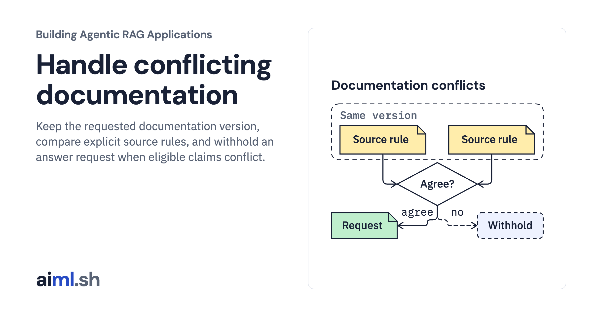
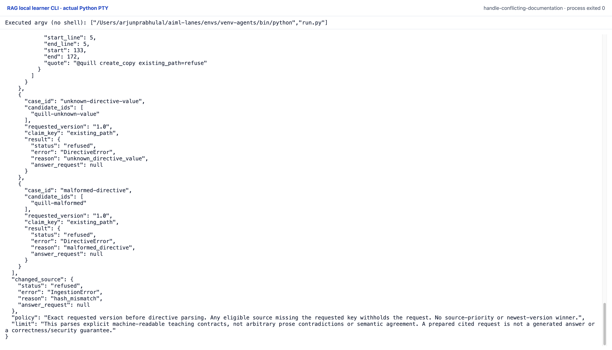

 [Building Agentic RAG Applications](../) · lesson 21 of 37

# Handle conflicting documentation

[](https://aiml.sh/courses/agentic-rag/handle-conflicting-documentation/)

Keep the requested documentation version, compare explicit source rules, and withhold an answer request when eligible claims conflict.

- **Full lesson:** [https://aiml.sh/courses/agentic-rag/handle-conflicting-documentation/](https://aiml.sh/courses/agentic-rag/handle-conflicting-documentation/)
- **Reading time:** 25 min
- **Uses:** Standard library only; preserved answer replay or synthetic source fixtures, no provider SDK

## Lab

The [`lab/`](lab/) folder holds the complete runnable code, tests and recorded outputs, the same files as the lesson's download on aiml.sh. The lesson explains each step.

### Lab notes

#### Handle conflicting documentation

This local pre-generation gate parses an explicit machine-readable teaching
contract. It is not an NLP/NLI system or a contradiction detector for arbitrary
prose. Quill is a fictional SDK. Every documentation file here is an original
synthetic developer fixture; its rules do not describe a real framework.

##### Narrow contract and decision policy

A directive occupies one complete unindented line:

```text
@quill create_copy existing_path=refuse
```

The only operation is `create_copy`. Supported claim keys and values are
`existing_path=refuse|overwrite` and `close_required=yes|no`. Whitespace, spelling
and case are exact. A line containing `@quill`, or starting with an `@` marker
after indentation, must satisfy that grammar. Unknown prefixes, operations,
keys and values, malformed directives and duplicate keys within one source
raise `DirectiveError`. Ordinary prose is not interpreted as a claim. A source
may declare different supported keys, but the gate compares only the requested
operation/key. It never infers a conflict between unrelated propositions.

`gate` accepts a pinned manifest, unique controlled source IDs, an exact numeric
major.minor version string and a supported claim key. The unchanged module-three
loader first validates the complete snapshot's local file bytes against their
pinned SHA-256 values. The gate then selects candidate sources with exactly the
requested version before parsing their directives. A newer version cannot
supply a missing rule. Unsupported values in an excluded version are not parsed;
changed file bytes anywhere in the pinned snapshot still cause load refusal.

For eligible sources:

- No eligible version returns `not_in_docs`, with no request.
- Any eligible source missing the requested key returns `not_in_docs`, including
  partial coverage when another eligible source declares the key.
- Different declared values return `conflict`, retaining every quote and
  withholding the request. Source order, recency and title do not choose a winner.
- Agreeing values return `ready`, with all source claims in a cited request.
  The program prepares messages only; it does not generate or send an answer.

Controlled IDs are source IDs, not search results. This lab does not perform
retrieval or judge whether the caller selected all relevant documents. Every
claim includes the source ID/version, raw file hash, metadata-bound revision,
path/URL, exact quote, one-based inclusive line span and zero-based end-exclusive
character offsets into normalized text. These offsets count Python characters,
not bytes. The source revision hashes pinned source metadata, including the raw
file hash. These receipts establish local binding; they do not authenticate an
author or prove that a directive is correct. The manifest metadata is trusted
local input, not an access-control policy.

##### Run offline

Requires Python 3.11 or later. Dependencies: standard library only. No install,
model, provider request, network access or download is needed. Run from this
lesson directory:

```sh
python3 run.py
python3 -m unittest -v
python3 render_output.py /tmp/quill-conflicts-report.html
```

`load_documents.py` is copied byte-identically from
`load-developer-documentation`. The fixtures and this gate are specific to this
lesson; no earlier synthetic SDK rules were changed.

The actual run is `runs/2026-10-23-conflicts/result.json`, with exact stdout,
stderr, test output and source/environment hashes beside it. It records
wrong-version exclusion, agreement, same-version disagreement, absent version,
missing/partially missing claims, unknown values, malformed directives and a
changed pinned source. The changed-source case uses an isolated temporary copy;
the original fixture stays intact. The recording harness denies outbound socket
connections. A fresh run reproduces the deterministic result without a model.
The HTML renderer reads that actual record and does not execute generation.

Tests exercise version eligibility, all-source citations, conflict/request
separation, missing-rule refusal, grammar failures, quote/span/revision binding,
changed source bytes and invalid controlled IDs/version metadata. These cases
show the narrow parser and gate contract, not general prose understanding,
semantic answer quality or a security guarantee.

##### Original CLI capture

The CLI ending shows malformed directives and changed source bytes being refused. The fixture-specific gate prepares or withholds requests; it does not generate an answer.

Reproduce with the prepared Python environment: `python run.py`. The manifest retains the exact interpreter argv and source hashes. One original PTY process exited zero with no terminal input or network attempt. The capture server received its live session bytes; it did not reprint a saved output file. The top/end images are completed scroll positions of that process, not separate executions.



[Original terminal PNG](lab/runs/native-cli-20261023/images/completed-end-1920@2x.png) · [Top of the same session](lab/runs/native-cli-20261023/images/completed-top-1920@2x.png) · [Original stdout](lab/runs/native-cli-20261023/stdout.txt) · [Actual JSON](lab/runs/native-cli-20261023/result.json) · [Command and source manifest](lab/runs/native-cli-20261023/manifest.json).

The earlier HTML report remains a secondary view. Saved vectors/replies and scripted choices keep their existing limitations; these local CLI captures add no fresh model inference.
