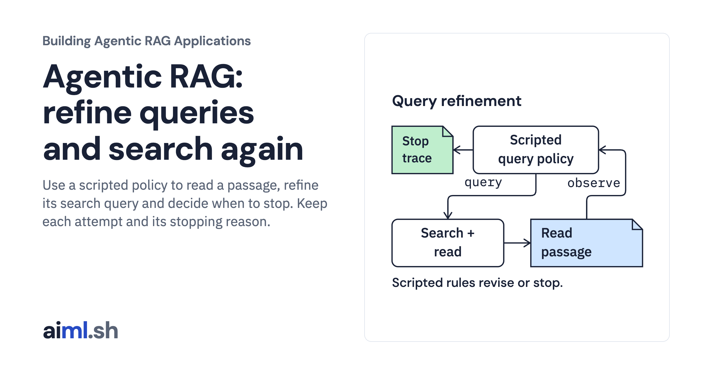
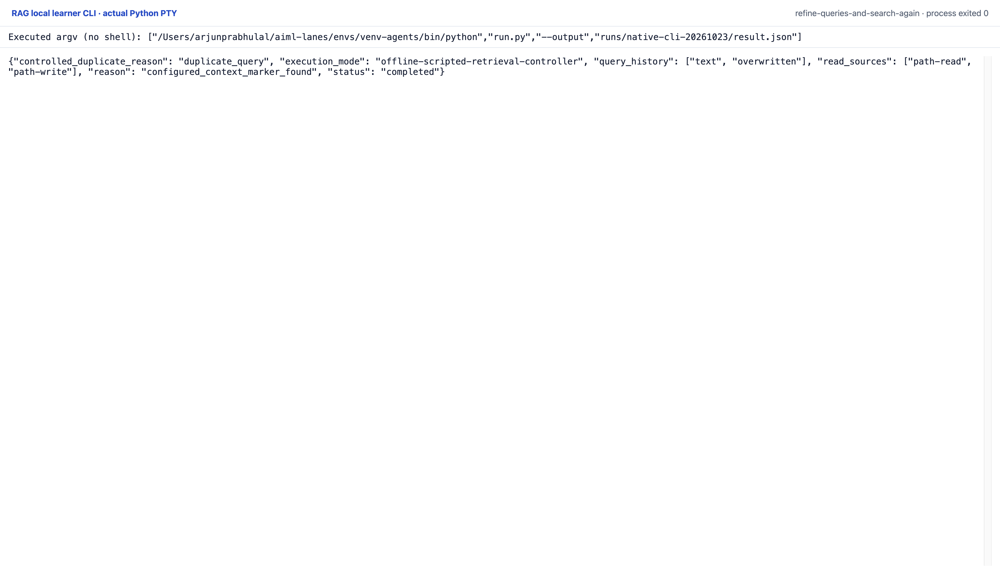

 [Building Agentic RAG Applications](../) · lesson 23 of 37

# Refine queries with a scripted policy

[](https://aiml.sh/courses/agentic-rag/refine-queries-and-search-again/)

Use a scripted policy to read a passage, refine its search query and decide when to stop. Keep each attempt and its stopping reason.

- **Full lesson:** [https://aiml.sh/courses/agentic-rag/refine-queries-and-search-again/](https://aiml.sh/courses/agentic-rag/refine-queries-and-search-again/)
- **Reading time:** 25 min
- **Uses:** Standard library only; no provider SDK or model download

## Lab

The [`lab/`](lab/) folder holds the complete runnable code, tests and recorded outputs, the same files as the lesson's download on aiml.sh. The lesson explains each step.

### Lab notes

#### Refine Queries and Search Again

Run a deterministic scripted retrieval controller over the same pinned local
Python documentation summaries. Requires Python 3.11 or later and SQLite FTS5;
standard library only. No model chooses tools, rewrites queries or produces an
answer. No model/API, network, package or download runs.

```sh
python3 run.py --output runs/my-run/result.json
python3 -m unittest discover -v
python3 render_output.py --input runs/my-run/result.json --output /tmp/refine-report.html
```

Run from this directory. The complete executed trace, stdout/stderr, tests,
commands and source/environment hashes are in `runs/2026-10-23-refine/`.
The HTML renderer displays actual saved observations, not a terminal recreation.

##### Declare the policy before running it

`refine.py` defines `ScriptedPolicy(question, version, config=None)` and
`run_controller(tools, question, version, config=None)`. The policy receives only
the original question, requested version and declared configuration. It does
not accept a case ID, expected source labels, expected answer or judge feedback.
The question remains unchanged in the result; query rewrites are separate trace
entries.

The handwritten rule table targets the small developer-task classes seen in the
development examples: existing/overwrite/replace cues choose `overwritten`;
JSON chooses `json`; read cues choose `read`; saving/write/pathlib cues choose
`write`. Each has a corresponding literal passage marker. These rules and markers
were authored for those examples. They are not learned reasoning, a general
planner, a model-agent trajectory or a semantic answer check.

The controller starts with query `text`, reads the first unseen result and checks
its configured literal marker. If absent, it issues the declared refinement and
reads a new result. Default maximum is two search rounds; a custom policy can
allow 1–3. Search/read observations contain their exact arguments and complete
bound results. Stop status `completed` means the configured context marker was
found; it is not an accepted answer or proof that the source solves the question.

##### Follow the actual branch

For “Will write_text replace the contents of an existing file?”, native search
`text` first leads to `path-read`. Its text lacks `overwritten`, so the rule issues
`overwritten` and reads `path-write`. That passage contains the literal marker,
and the controller stops. The run records two distinct searches and two actual
reads, with current corpus/receipt/passage hashes and source/version/line spans.

Repeated queries stop before another search. A new query returning only already
read passages stops without another read. No-hit queries remain bounded by the
round limit. An unmatched task class stops with `no_refinement_rule`; it does not
claim the question is unsupported by the corpus. Invalid or altered tool results
produce a failed run. A separate hard step guard protects against a policy bug.
The controlled duplicate-query example in the run deliberately demonstrates that
stop path.

The search/read core and pinned corpus are byte-identical to Add Search and Read
Tools. Handles are authoritative issued receipts, not arbitrary paths/URLs.
`validate_read()` checks every returned passage before policy observations accept
it. Queries are single ASCII alphanumeric terms; version eligibility applies
before requested top-k. No new embeddings or retrieval algorithms are introduced.

##### Tests and limits

The 20 tests include the copied 12 search/read contract checks plus controller
checks: `test_duplicate_query_stops_before_second_search`,
`test_no_new_passages_stops_without_duplicate_read`,
`test_no_hit_queries_are_bounded`, `test_development_labels_are_not_policy_inputs`
and `test_corrupted_read_result_fails_controller`.

The complete development-case fixture is preserved unchanged, including its old
baseline target chunk IDs. Labels stay outside the controller. Any later outcome
comparison must match source ID/version/source and chunk hashes to the current
snapshot; historical IDs are not claimed to equal current IDs. No held-out queries,
fresh inference, accuracy improvement, latency benchmark or production claim is
made. The subsequent limits lesson adds explicit per-action resource accounting.

##### Original CLI capture

The command prints the text-to-overwritten query sequence, reads path-read then path-write, and retains the duplicate-query stop. The controller follows authored rules rather than model decisions.

Reproduce with the prepared Python environment: `python run.py --output runs/native-cli-20261023/result.json`. The manifest retains the exact interpreter argv and source hashes. One original PTY process exited zero with no terminal input or network attempt. The capture server received its live session bytes; it did not reprint a saved output file. The top/end images are completed scroll positions of that process, not separate executions.



[Original terminal PNG](lab/runs/native-cli-20261023/images/completed-end-1920@2x.png) · [Top of the same session](lab/runs/native-cli-20261023/images/completed-top-1920@2x.png) · [Original stdout](lab/runs/native-cli-20261023/stdout.txt) · [Actual JSON](lab/runs/native-cli-20261023/result.json) · [Command and source manifest](lab/runs/native-cli-20261023/manifest.json).

This run uses SQLite 3.45.3; the earlier recording uses 3.53.4. Only tiny native-score digits and derived token/request/result hashes differ. The source text, ordering, actions and outcomes match; both unmodified results remain available. See [exact differences](lab/runs/native-cli-20261023/historical-diff.json).

The earlier HTML report remains a secondary view. Saved vectors/replies and scripted choices keep their existing limitations; these local CLI captures add no fresh model inference.
