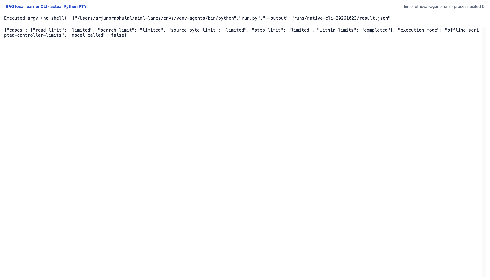

# Limit retrieval agent runs

This is an offline **scripted tool controller**, not an executed model agent.
`run_limited` validates an action, checks it has not already run, checks every
budget, reserves capacity, and only then invokes the real local search/read
tool. A denied action is explicitly marked `invoked: false` and adds no tool
attempt. Invalid action schemas, unknown tools, forged handles and repeated
calls fail closed. Search-case and omitted-default-k variants count as the same
repeated search.

`Limits` bounds admitted action steps, search attempts, read attempts and
cumulative source-text byte reservations. Zero is allowed to disable admission;
booleans and out-of-range values are rejected. Each attempted action consumes
one step and its tool-type count even if the tool fails. A read's byte cost comes
from an issued metadata receipt validated before read invocation. The read
result must then match the authoritative source/receipt exactly, including text,
hashes and URL, before it reaches the policy. Validated delivered bytes are
recorded separately from reservations.

The terminal controller states are `completed`, `limited` and `failed`.
`completed` means the policy stopped requesting tools; it does not prove that
useful context or a correct answer was obtained. The run records a normal
four-action search/read/refine/read sequence, each admission limit, and an
explicit controlled exception after a real local search. That fault is a
contract check, not a measured reliability rate. Failed tool calls do not retry
or continue. No generated answer is produced.

Tests instrument actual tool invocations to prove every denied action stops
before invocation, including cumulative budgets. They also cover strict schemas,
repeated calls, actual counter receipts, terminal tool errors and a same-size
altered read rejected by the source receipt validator.

## Runtime and frozen inputs

Python 3.11 or later, standard library only, with SQLite FTS5 available. No
installation, provider credentials, model, network request or download is used.
From this lesson directory:

```sh
python3 run.py --output /tmp/retrieval-result.json
python3 -m unittest -v
python3 render_output.py /tmp/retrieval-report.html
```

With `--output`, the runner writes full JSON and prints a concise summary. Without
it, stdout contains the full JSON. `tools.py`, `bm25.py`, `version_documents.py`,
`load_documents.py` and `refine.py` are copied unchanged from the preceding
search/read and refinement labs. The source snapshot and original four
**development** cases are copied exactly. No held-out question is loaded or
queried. Source-version metadata refers to the summarized Python API, not the
interpreter running the controller.

The frozen corpus is loaded before a run. Tool admission counters do not cover
fixture initialization, policy callback computation, process runtime, wall time,
model tokens or inference spend. A policy callback can block; this local runner
is not a hard timeout or process sandbox. Read bytes mean UTF-8 text bytes
reserved for authentic source handles, not total filesystem I/O or HTTP bytes.
The prepared corpus and tools enforce the size contract; a remote or streaming
tool with unknown output size would require a different admission mechanism.

The actual recording denies outbound socket connections. Full result JSON,
exact stdout/stderr, actual test output and source/environment hashes accompany
the run. The report renderer reads that record without calling tools. No timing
or new answer-generation measurement is claimed. Reproducing the same commands
under the same snapshot yields the deterministic result.

Actual result: `runs/2026-10-23-limits/result.json`.

## Original CLI capture

The CLI summary distinguishes the completed normal run from four limited runs. The full JSON also retains the controlled tool failure and its admitted-attempt counters.

Reproduce with the prepared Python environment: `python run.py --output runs/native-cli-20261023/result.json`. The manifest retains the exact interpreter argv and source hashes. One original PTY process exited zero with no terminal input or network attempt. The capture server received its live session bytes; it did not reprint a saved output file. The top/end images are completed scroll positions of that process, not separate executions.



[Original terminal PNG](runs/native-cli-20261023/images/completed-end-1920@2x.png) · [Top of the same session](runs/native-cli-20261023/images/completed-top-1920@2x.png) · [Original stdout](runs/native-cli-20261023/stdout.txt) · [Actual JSON](runs/native-cli-20261023/result.json) · [Command and source manifest](runs/native-cli-20261023/manifest.json).

This run uses SQLite 3.45.3; the earlier recording uses 3.53.4. Only tiny native-score digits and derived token/request/result hashes differ. The source text, ordering, actions and outcomes match; both unmodified results remain available. See [exact differences](runs/native-cli-20261023/historical-diff.json).

The earlier HTML report remains a secondary view. Saved vectors/replies and scripted choices keep their existing limitations; these local CLI captures add no fresh model inference.
