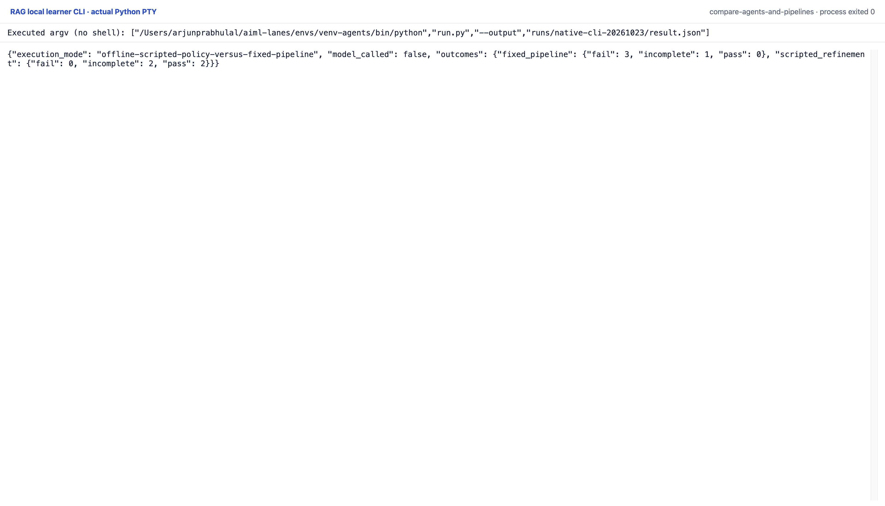

# Compare agents and pipelines

This compares two frozen deterministic policies, not model agents or generated
answers. Both receive the same original question, API version and source
snapshot. Both start with the same broad `text` search and have identical maximum
step/search/read/source-byte budgets. The fixed pipeline searches once and reads
the first result. The scripted policy checks a configured literal marker after
reading and can use a question-only hand-coded rewrite for another search/read.
Its extra rules and additional actual tool effort are explicit confounds.
The result cannot isolate architecture from policy design or effort.

Only case ID, question and requested version enter execution. Labels join
**after** all policy runs. Legacy target IDs map to current passage IDs through
exact source ID, API version, raw-source SHA-256 and chunk-text SHA-256; binding
receipts keep both identities. The outcome checker also requires current source
metadata and actual read-text hashes to match. A known passage ID alone cannot
turn altered text into a pass.

The common outcome checks use `pass`, `fail` and `incomplete`, separately from
controller terminal states. Reading every exact bound target is a pass for this
source-retrieval check. A completed policy that misses its target fails; budget
exhaustion or a policy that stops incomplete remains incomplete. Controller/tool
errors fail supported cases. The unsupported question has no labeled retrieval
target and remains incomplete; its raw controller status and errors are still
retained. It is not counted as a correct abstention or an answer-quality pass.

All eight main trials remain in the result, including fixed-pipeline misses,
the scripted UTF-8-write miss and unsupported cases. Per-policy counts retain
all three outcome states. These four previously used development fixtures are
not a general quality estimate, winner selection, held-out evaluation or model
comparison. Tests verify equal inputs/budgets, label independence, exact legacy
bindings, failure/incomplete retention, altered-read refusal and trial joins.

## Runtime and frozen inputs

Python 3.11 or later, standard library only, with SQLite FTS5 available. No
installation, provider credentials, model, network request or download is used.
From this lesson directory:

```sh
python3 run.py --output /tmp/retrieval-result.json
python3 -m unittest -v
python3 render_output.py /tmp/retrieval-report.html
```

With `--output`, the runner writes full JSON and prints a concise summary. Without
it, stdout contains the full JSON. `tools.py`, `bm25.py`, `version_documents.py`,
`load_documents.py` and `refine.py` are copied unchanged from the preceding
search/read and refinement labs. The source snapshot and original four
**development** cases are copied exactly. No held-out question is loaded or
queried. Source-version metadata refers to the summarized Python API, not the
interpreter running the controller.

The frozen corpus is loaded before a run. Tool admission counters do not cover
fixture initialization, policy callback computation, process runtime, wall time,
model tokens or inference spend. A policy callback can block; this local runner
is not a hard timeout or process sandbox. Read bytes mean UTF-8 text bytes
reserved for authentic source handles, not total filesystem I/O or HTTP bytes.
The prepared corpus and tools enforce the size contract; a remote or streaming
tool with unknown output size would require a different admission mechanism.

The actual recording denies outbound socket connections. Full result JSON,
exact stdout/stderr, actual test output and source/environment hashes accompany
the run. The report renderer reads that record without calling tools. No timing
or new answer-generation measurement is claimed. Reproducing the same commands
under the same snapshot yields the deterministic result.

Actual result: `runs/2026-10-23-comparison/result.json`.

## Original CLI capture

The terminal keeps every outcome: the fixed pipeline has zero passes, three failures and one incomplete case; scripted refinement has two passes and two incomplete cases. No answers are generated.

Reproduce with the prepared Python environment: `python run.py --output runs/native-cli-20261023/result.json`. The manifest retains the exact interpreter argv and source hashes. One original PTY process exited zero with no terminal input or network attempt. The capture server received its live session bytes; it did not reprint a saved output file. The top/end images are completed scroll positions of that process, not separate executions.



[Original terminal PNG](runs/native-cli-20261023/images/completed-end-1920@2x.png) · [Top of the same session](runs/native-cli-20261023/images/completed-top-1920@2x.png) · [Original stdout](runs/native-cli-20261023/stdout.txt) · [Actual JSON](runs/native-cli-20261023/result.json) · [Command and source manifest](runs/native-cli-20261023/manifest.json).

This run uses SQLite 3.45.3; the earlier recording uses 3.53.4. Only tiny native-score digits and derived token/request/result hashes differ. The source text, ordering, actions and outcomes match; both unmodified results remain available. See [exact differences](runs/native-cli-20261023/historical-diff.json).

The earlier HTML report remains a secondary view. Saved vectors/replies and scripted choices keep their existing limitations; these local CLI captures add no fresh model inference.


## Gemini comparison

`gemini_policy.py` adds a fresh Gemini 3.1 Flash-Lite run beside the original offline baseline. The saved run is `runs/2026-10-24-gemini/result.json`; `requests/` retains the exact sanitized REST payloads, provider responses, usage and local receipt timings. Original recordings remain unchanged. Tests replay exact requests offline and never load a key.

Use Python 3.12 on macOS/Linux. The transport uses standard-library HTTPS and `fcntl` for its shared budget lock; no SDK or model download is needed. This environment used its installed certifi CA bundle through `SSL_CERT_FILE`; use your trusted system CA setup. The reranking driver also needs the original pinned lab dependencies.

Fresh execution is optional and incurs API usage. Set `GOOGLE_API_KEY` or `GEMINI_API_KEY` securely in the environment, then run:

```sh
python gemini_policy.py --ledger /tmp/aiml-gemini-budget.json --output runs/my-gemini-run/result.json
```

Use the **same ledger path for all three labs**. The transport fixes the model, temperature 0, one candidate, 2048 maximum output tokens and minimal thinking. It accepts text-only input up to 60000 serialized bytes, reserves $0.10 before each request, allows at most 80 reservations ($8), and performs no automatic retries. The owner authorized a $10 total ceiling for the recorded session. Reservations survive failed attempts. Usage-based estimates use the pricing checked on 2026-10-24; these are not invoice totals or a billing-account limit. The ledger cannot account for unrelated callers or a separately created ledger. Existing run results cannot be overwritten.

The recorded run is an illustration, not a relevance or agent-quality benchmark. Read the article for retained failures and comparison limits.

## Version 2 schema policy and broader frozen cases

`schema_policy.py` offers action-specific schemas: a query term selected from question/observation words, a host-issued short read reference, or a stop decision. The host resolves references to exact original handles and still validates admission. This is structured JSON generation, not provider function calling.

Run `python benchmark.py --ledger /tmp/aiml-gemini-budget.json --output runs/my-schema-policy/result.json` with the same shared ledger as the other Gemini labs. Five requests per case cap this twelve-case addition at 60 requests; the global ledger still refuses at 80 reservations and retains failed attempts. No automatic retry is added. Questions are frozen in `fixtures/expanded-cases.json`; labels are joined only after policy execution. Four v1 questions are diagnostic, not held out from v2 design. Eight new validation strings reuse related intent families in the same tiny corpus.

`runs/gemini-schema-v2/result.json` and `requests/` retain the actual run, including one validation failure, one refused proposal and a diagnostic admission denial. The model passed five of eight validation target-read checks, with two incomplete. These are not answer-quality outcomes or evidence of a general advantage. `python -m unittest test_schema_policy -v` replays every request hash and trace offline and tests invalid queries, unissued references and the request cap. Original v1 records are unchanged. See the run's `provenance.json` for source/input hashes.
