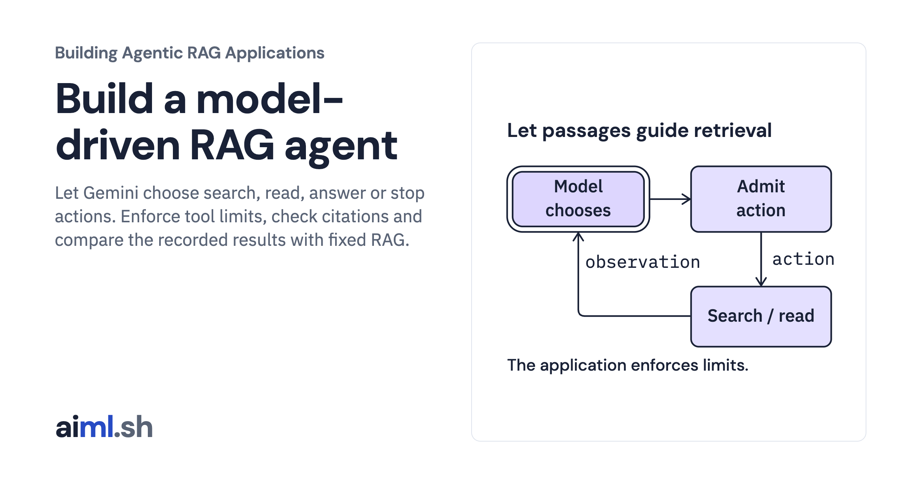

 [Building Agentic RAG Applications](../) · lesson 26 of 37

# Build a model-driven RAG agent

[](https://aiml.sh/courses/agentic-rag/build-a-model-driven-rag-agent/)

Let Gemini choose search, read, answer or stop actions. Enforce tool limits, check citations and compare the recorded results with fixed RAG.

- **Full lesson:** [https://aiml.sh/courses/agentic-rag/build-a-model-driven-rag-agent/](https://aiml.sh/courses/agentic-rag/build-a-model-driven-rag-agent/)
- **Reading time:** 35 min
- **Uses:** Python standard library; Gemini API key only for fresh inference

## Lab

The [`lab/`](lab/) folder holds the complete runnable code, tests and recorded outputs, the same files as the lesson's download on aiml.sh. The lesson explains each step.

### Lab notes

#### Model-driven RAG retrieval

Run the complete recorded comparison without a key or network:

```sh
python3 run.py
python3 -m unittest discover -v
```

Python 3.11+ with SQLite FTS5; standard library only. No dependency installation.
The four source paragraphs are original summaries inherited byte for byte from
Add Search and Read Tools. The lexical adapter extends its single-term search
to literal OR terms; reads retain issued-handle and snapshot validation.

The model chooses search, read, answer or stop using structured JSON. This is an
application action protocol, not Gemini-native function calling. The same model
assesses evidence and writes the answer. Counts and byte limits are application
checks. Exact source IDs and quotes do not prove semantic support.

##### Fresh inference

Fresh inference may incur API charges. Inspect the plan without loading a key:

```sh
python3 run.py --live
```

Only after reviewing the plan and setting GOOGLE_API_KEY or GEMINI_API_KEY:

```sh
python3 run.py --live --execute-approved
```

Uses Gemini 3.8 Flash, LOW thinking, temperature 0, maxOutputTokens 1024, no
retries, max 200 HTTP attempts per process, max 30000 serialized request bytes.
The controller also bounds calls, searches, reads, source bytes and elapsed time.
HTTP requests use the remaining deadline (at most 45 seconds). Local synchronous
tool calls are not forcibly interrupted. No external browse/write tools exist.

Copy the lab before fresh inference: recordings under runs/gemini are replaced.
An interrupted run leaves partial.json and completed per-trial exchanges. The
code does not automatically retry or resume it. Headers and API keys are never
recorded. This CLI has no HTTP application deployment or concurrent-worker guard.

##### Evidence and checks

`runs/gemini/result.json` is the original live API comparison; per-trial JSON
contains exact request bodies and raw responses, including returned modelVersion
and usageMetadata. Replay validates the request before decoding each old reply.
The source hashes identify the Python files present at the original execution;
subsequent report presentation files are separate from that execution.

`fixtures/cases.json` was written before live inference and its hash is recorded.
Its source labels and answer patterns are projected out of execution inputs.
Two development questions and two held-out questions are repeated twice under
both policies. This tiny authored split does not measure generalization.
The version-specific paragraph lacks some requested information: reading it
cannot supply a complete answer. The backup case expects explicit abstention,
not an unsupported negative claim. Failed and incomplete runs remain in totals.
Answer-pattern checks are deliberately narrow. Review the complete explanations
against their quotes and source text; do not report these fixture passes as
semantic correctness or a benchmark advantage.

The recorded agent made additional searches for serialization and file writing.
Both policies passed the same number of fixtures. Both inferred an unsupported
backup claim; one agent trial repeated a query and another stopped incomplete.
Model stop is distinct from application failure and exhausted allowance.
Billing cost was not measured; raw token usage is available.

Generate a local HTML view of the saved live data:

```sh
python3 render_output.py --html /tmp/model-driven-rag-report.html
```

Opening that report or its screenshot is a saved-run inspection, not new inference.
The source, tests, fixtures and recordings are the runnable unit. No service,
latency target, production search quality or security certification is claimed.

After the original live run, the owner raised the API allowance from 80 to 200.
The provider and execution-plan caps changed; selected-case replay summary checking
was also corrected and tested. No new inference was run.
The original report retains its original 80-request cap and execution hashes.
Exact-request offline replay checks the current code against every recorded exchange.

The article capture shows an original CLI execution through a local PTY of
`python3 run.py --case serialize-and-save`. `runs/gemini/replay-cli.txt` holds
its original stdout; `replay-cli.json` records the command, exit status and hashes.
Its provider responses are replayed, but retrieval and checks execute again.
