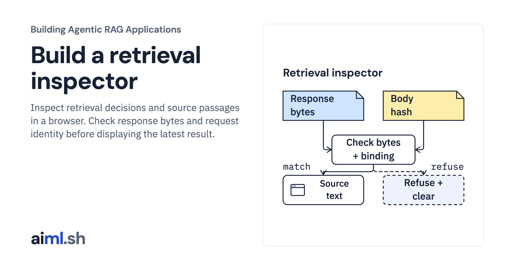

 [Building Agentic RAG Applications](../) · lesson 28 of 37

# Build a retrieval inspector

[](https://aiml.sh/courses/agentic-rag/build-a-retrieval-inspector/)

Inspect retrieval decisions and source passages in a browser. Check response bytes and request identity before displaying the latest result.

- **Full lesson:** [https://aiml.sh/courses/agentic-rag/build-a-retrieval-inspector/](https://aiml.sh/courses/agentic-rag/build-a-retrieval-inspector/)
- **Reading time:** 25 min
- **Uses:** FastAPI, Uvicorn, HTTPX and Pydantic; pinned in requirements.txt; Node native test runner, websockets and an installed Chrome for browser recording

## Lab

The [`lab/`](lab/) folder holds the complete runnable code, tests and recorded outputs, the same files as the lesson's download on aiml.sh. The lesson explains each step.

### Lab notes

#### Build a retrieval inspector

This is an actual same-origin browser inspector over the copied local FastAPI
retrieval adapter. It shows scripted tool decisions and source evidence, not a
new generated answer or a model-driven agent. All Python retrieval/core files
match the HTTP lab and the earlier pinned retrieval fixture.

##### Runtime and commands

Use Python 3.12+, Node with its native test runner and an installed Chrome or
Chromium for optional browser evidence. Python dependencies are pinned in
`requirements.txt`; `requirements.lock` includes their installed dependency
closure. Local fonts carry their licenses under `static/fonts`. This execution
used already prepared dependencies; no package, browser or model was downloaded.

For a new reader environment:

```sh
python -m venv .venv
. .venv/bin/activate
python -m pip install -r requirements.lock
```

Start the ordinary application:

```sh
python inspector_app.py --port 8765
```

Open `http://127.0.0.1:8765/inspector`. The local form sends its actual question,
version and allowances to `/retrieve`; `/health` supplies readiness and corpus
identity. Try the existing-file question, version `9.99` for absent eligible
evidence, and a zero step allowance for pre-action denial.

Run the owned tests:

```sh
python -m unittest discover -v
node --test test_inspector.mjs
```

The Python suite includes actual loopback HTTP assets/API/empty/limited/fault
checks and invokes the Node client suite. Count the Node cases once when
reporting test instances; running them separately does not add new tests.

Reproduce the actual browser evidence with an existing executable:

```sh
CHROME_PATH=/absolute/path/to/chrome python run.py --output scratch/result.json --captures scratch/browser
```

The recorder starts real Uvicorn child processes on inherited loopback sockets,
then drives installed Chrome via CDP. It observes actual browser HTTP request and
response bodies, compares rendered JSON with the received body, and captures
original native-width UI images. No screenshot is edited. `run.py` requires no
model or provider key. Its configured browser and local socket connections are
necessary; it downloads nothing.

The HTML source is `static/inspector.html.txt`; the explicit `/inspector` route serves it as HTML. The text suffix keeps the downloadable source from becoming a standalone page in the teaching site.

##### UI and consistency contracts

- The form stays disabled until local readiness and during an in-flight request.
  A duplicate submit does not create another POST or disturb the loading state.
  New submission hides the earlier result before awaiting the response.
- HTTP failures remain errors. Completed, incomplete and limited retrieval are
  returned results with different source evidence and admission decisions.
- Successful response text must match `X-Retrieval-Body-SHA256` before JSON
  parsing. This is SHA-256 of the exact UTF-8 response payload, avoiding Python
  and JavaScript floating-point reserialization differences.
- The browser then checks normalized question/version/allowances, corpus and
  request digest, bounds, source version, text SHA/UTF-8 bytes, and HTTPS links.
  It retains the Python result digest but does not recompute its canonical JSON
  form. Hash consistency is not server authentication or source authorization;
  an attacker who replaces both data and receipts can recompute unkeyed hashes.
- Returned text is inserted with `textContent`. The actual browser includes a
  markup-like question probe. This is evidence for that path, not an XSS audit.
- Native table/code scrolling, focus, disclosure keyboard activation and JSON
  copy are checked against the actual running application.

##### Controlled fixtures and limits

The normal server has no artificial delay or injected fault. The recorder uses a
trusted `350ms` delay fixture solely to capture loading, and a separate trusted
server factory to return an actual controlled HTTP tool failure. These are not
latency or reliability measurements. Neither fixture is selectable through the
public request JSON. A browser-only interception changes a real response body
while retaining its original receipt; refusal is recorded as a deliberate fault,
not observed service corruption.

The browser wait timeout does not cancel server work. Client body-size checks
happen after receiving text; they do not bound network memory. Tool allowances
exclude corpus initialization, policy callback time, disk I/O, memory and model
tokens. The app has no authentication, permission-aware search, multi-user
isolation, remote deployment or capacity result. Use supplied public teaching
summaries and loopback only.

`runs/2026-10-23-inspector/result.json` preserves actual browser responses,
controlled-fault provenance and process lifecycle logs. PIDs, ports and logs may
vary on another execution. Source/local/archive byte parity compares the sealed
files, not a claim that process metadata is identical on rerun.

##### Original CLI capture

From this unpacked lesson directory, with the pinned dependencies installed, run:

```sh
python -m unittest -v test_inspector
```

[runs/2026-10-23-native-cli/terminal.png](lab/runs/2026-10-23-native-cli/terminal.png)
is the original 3840×2200 capture of an actual command process in its original
PTY, streamed directly into the terminal display. Saved stdout was not replayed.
The command and environment-specific Python path appear in
[session.json](lab/runs/2026-10-23-native-cli/session.json); the full unmodified
terminal bytes are in [terminal.txt](lab/runs/2026-10-23-native-cli/terminal.txt).
The command runs four Python integration tests against actual local HTTP and invokes the eight Node client guards. This terminal capture does not show a browser UI session. No model or provider request was made.

Earlier report images remain archived reports; the inspector's earlier browser
images remain historical browser captures. Neither substitutes for this CLI
capture. [previous-readme.md](lab/runs/2026-10-23-native-cli/previous-readme.md)
preserves the README version named by the earlier run's source hashes. Executed
Python and JavaScript code is unchanged by this documentation attachment.
