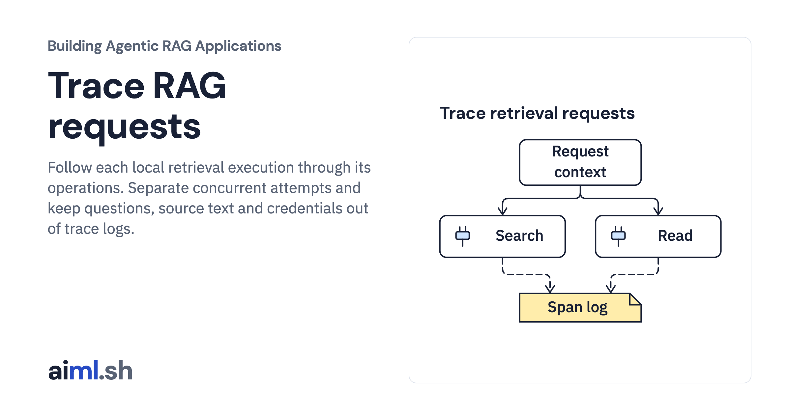

 [Building Agentic RAG Applications](../) · lesson 32 of 37

# Trace RAG requests

[](https://aiml.sh/courses/agentic-rag/trace-rag-requests/)

Follow each local retrieval execution through its operations. Separate concurrent attempts and keep questions, source text and credentials out of trace logs.

- **Full lesson:** [https://aiml.sh/courses/agentic-rag/trace-rag-requests/](https://aiml.sh/courses/agentic-rag/trace-rag-requests/)
- **Reading time:** 25 min
- **Uses:** FastAPI, Uvicorn and HTTPX; exact versions in requirements.lock

## Lab

The [`lab/`](lab/) folder holds the complete runnable code, tests and recorded outputs, the same files as the lesson's download on aiml.sh. The lesson explains each step.

### Lab notes

#### Trace local retrieval requests

This lab runs real FastAPI/Uvicorn/HTTPX requests with the existing scripted documentation retriever. It creates local structured spans, without a model call, hosted collector, OpenTelemetry SDK, network provider, or generated answer.

Use Python 3.11+ with the exact already prepared dependencies in `requirements.lock`. The recorded run used `/tmp/aiml-review-venv/bin/python`; no install or download was performed. From this folder:

```sh
python run.py --output scratch-result.json
python -m unittest -v
```

The CLI launches temporary loopback child servers, performs concurrent requests, fetches their local trace records, and shuts down/reaps the processes. `runs/2026-10-23-trace/result.json` is the actual run. `stdout.txt`, `stderr.txt`, `tests.txt`, and `execution.json` preserve execution and source bindings. The same request content produces the same existing content `request_id`, while every execution receives a fresh random `X-Execution-Trace-ID`.

`recorder.py` constructs only fixed fields: random trace/span IDs, parent ID, order, an allowlisted span name, and operational status. It never accepts questions, source paragraphs, credentials, URLs, exception messages, or arbitrary attributes. Context variables propagate into `asyncio.to_thread` and reset in `finally`; tools and SQLite connections are created inside each worker. Span order is start order, not elapsed time. No durations or latency measurements are claimed.

The root request span contains request admission, admitted search/read actions, and controlled error recording. Action admission instrumentation runs immediately before a core-admitted tool invocation; a denied core budget produces a separate `admission` span with `denied` status. Body/schema refusals happen before execution tracing. Tool errors and HTTP 500/503 mark the root error; successful completion does not establish passage relevance or answer correctness. API response bodies retain normal retrieval content; the redaction claim applies to the structured span log, not all application data.

Retention defaults to 32 traces × 32 spans. Fixed ASCII fields bound a span to at most 320 serialized UTF-8 bytes; the recorder reports a conservative aggregate byte bound. New requests evict the oldest trace, including an active trace if necessary. Later spans for an evicted/full trace are dropped without breaking retrieval. `dropped_traces` and `dropped_spans` expose this loss. This is bounded diagnostic retention, not a durable audit log. The unauthenticated `/traces` endpoint is a local demonstration interface, not a production access policy.

`test_trace.py` checks actual core invocation, fresh IDs, parent/context isolation, redaction, active eviction, bounded spans, retention, and reset. `test_http.py` crosses actual socket/process boundaries and checks concurrency, strict input rejection, a limited run, and sanitized injected failure. Mutations in temporary copies disable the span-name allowlist, context reset, and retention bound; each is killed by a named assertion (results summarized in `execution.json`).

The copied `service.py`, `tools.py`, `refine.py`, `limits.py`, lexical/snapshot loaders, fixture bytes, HTTP body middleware (`http_contract.py`), and loopback helpers match Module 10 exactly. The fixture corpus is the supplied original Python API summaries; it is not fetched or updated here. Original fixture attribution remains in the manifest. See `execution.json` for file hashes and parity. No global tracing, authentication, multi-process correlation, persistence, or semantic quality guarantee is implemented.
