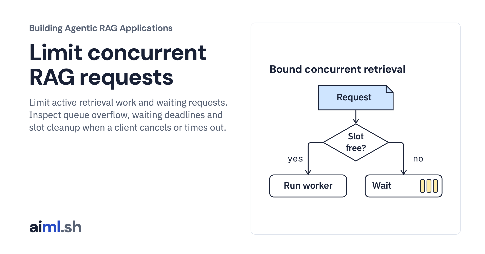

 [Building Agentic RAG Applications](../) · lesson 33 of 37

# Limit concurrent RAG requests

[](https://aiml.sh/courses/agentic-rag/limit-concurrent-rag-requests/)

Limit active retrieval work and waiting requests. Inspect queue overflow, waiting deadlines and slot cleanup when a client cancels or times out.

- **Full lesson:** [https://aiml.sh/courses/agentic-rag/limit-concurrent-rag-requests/](https://aiml.sh/courses/agentic-rag/limit-concurrent-rag-requests/)
- **Reading time:** 25 min
- **Uses:** FastAPI, Uvicorn and HTTPX; exact versions in requirements.lock

## Lab

The [`lab/`](lab/) folder holds the complete runnable code, tests and recorded outputs, the same files as the lesson's download on aiml.sh. The lesson explains each step.

### Lab notes

#### Limit concurrent local retrieval requests

This lab executes actual concurrent HTTPX requests against one Uvicorn process. A FIFO gate bounds active retrieval work and waiting requests before the existing scripted retriever runs. There are no model calls, generated answers, provider requests, installs, or downloads.

Use Python 3.11+ and the exact already prepared dependencies in `requirements.lock`. The recorded run used `/tmp/aiml-review-venv/bin/python`. From this folder:

```sh
python run.py --output scratch-result.json
python -m unittest -v
```

The feature CLI launches temporary loopback servers, exercises queue overflow, a waiting deadline, successful FIFO promotion, a constructor failure, and a client read timeout, then shuts down/reaps each process. Actual records are under `runs/2026-10-23-concurrency/`: `result.json`, stdout/stderr, tests, and source/environment bindings.

`gate.py` admits up to one active request and one waiting request by default. An active slot is acquired before `asyncio.to_thread(retrieve, ...)`; the worker constructs its own SQLite tools. Additional requests receive HTTP 429 `queue_full`. A queued request uses an event-loop monotonic deadline (0.15 seconds in the default fixture) and receives HTTP 503 `wait_timeout` before retrieval starts. FIFO promotion transfers a released slot to the oldest waiter. Schema/body bounds reuse Module 10's strict model and middleware. They are checked before the concurrency gate.

A lease releases in `finally`, including worker constructor failures. Python cannot stop a running synchronous worker thread: `finish_worker` shields the worker and defers cancellation propagation until it actually finishes. Capacity therefore remains occupied while the thread is running. Queued task cancellation removes its waiter; a cancellation racing with promotion releases that transferred slot. A client timeout is a separate event: the actual HTTP run records server work still active after `httpx.ReadTimeout`, then observes eventual release. It does not claim that disconnect cancels server work. Direct task cancellation is tested separately, without pretending it was an HTTP cancellation receipt.

`delay_fixture.py` is a trusted local factory that delays its first search by 0.35 seconds so admission states are observable. `success_fixture.py` gives a waiting request a one-second deadline for the FIFO case. Neither delay nor failure is selectable through public HTTP inputs. These delays are not measured service latency, a throughput benchmark, or evidence of deployment capacity. The real HTTP driver waits for observed gate states rather than assuming client submission order. The event history retains the latest 128 state transitions; it is not a durable log.

`test_gate.py` checks overflow before invocation, queue expiry/removal, FIFO order, active bounds, queued cancellation, worker cancellation while a lease is held, and release after errors. `test_http.py` verifies actual process/socket responses, timeout distinction, promotion, and idle counters. Temporary-copy mutations disable queue overflow, release, and deadline refusal; all three are killed by named assertion tests (summary in `execution.json`).

The core retrieval files, original Python-summary fixtures, strict HTTP contract (`http_contract.py`), and loopback helpers are byte-equal Module 10 copies; `execution.json` records hashes/parity. Corpus loading occurs at server startup outside admission counters. A gate is local to one event loop and one process. It does not implement cross-process capacity, rate limits, fairness between users, authentication, request execution deadlines, or bounded shutdown of arbitrary stuck synchronous work. Configure only trusted factories; the demo has no cancellation power over a worker that never returns.
