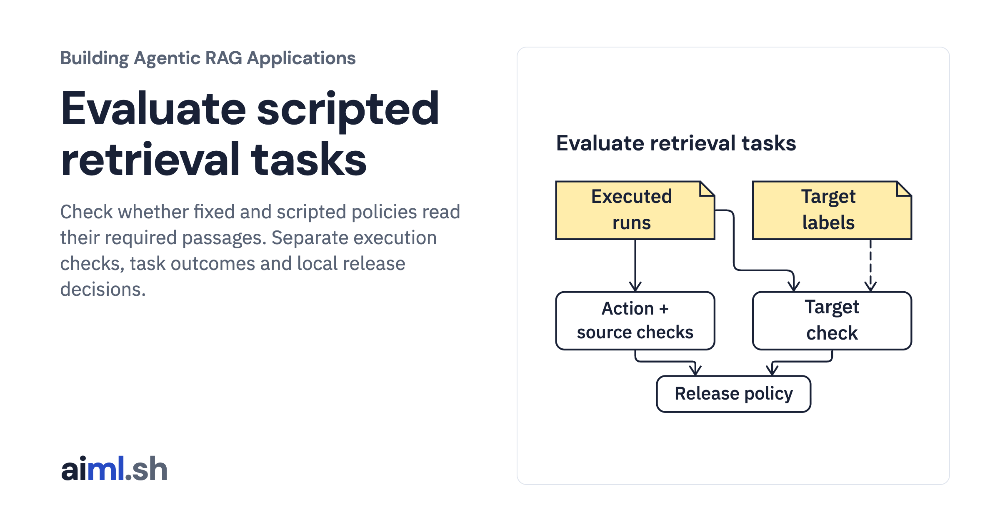

 [Building Agentic RAG Applications](../) · lesson 35 of 37

# Evaluate scripted retrieval tasks

[](https://aiml.sh/courses/agentic-rag/evaluate-retrieval-agent-tasks/)

Check whether fixed and scripted policies read their required passages. Separate execution checks, task outcomes and local release decisions.

- **Full lesson:** [https://aiml.sh/courses/agentic-rag/evaluate-retrieval-agent-tasks/](https://aiml.sh/courses/agentic-rag/evaluate-retrieval-agent-tasks/)
- **Reading time:** 25 min
- **Uses:** Python standard library with SQLite FTS5; no third-party packages

## Lab

The [`lab/`](lab/) folder holds the complete runnable code, tests and recorded outputs, the same files as the lesson's download on aiml.sh. The lesson explains each step.

### Lab notes

#### Evaluate scripted retrieval tasks

Run the exact preceding fixed-pipeline and scripted-refinement implementations, then check their read results against the original development targets. This is a standard-library-only, offline evaluator. There is no model agent, generated answer, provider request, download, installation, or network call.

Use Python 3.11+ with SQLite FTS5 available. From this folder:

```sh
python run.py --output scratch-result.json
python -m unittest -v
```

The actual run is `runs/2026-10-23-evaluation/result.json`, with stdout, stderr, test output and source/environment/parity bindings alongside it. `requirements.txt` and `requirements.lock` are exact preceding-lab copies and require no third-party packages. The recorded interpreter was the already prepared local Python environment.

##### Freeze execution inputs before checking targets

`execute_trials(snapshot, questions, config)` accepts only case ID, question and requested version. It executes both unchanged policies twice using a copied configuration. Labels never enter either policy or retrieval operation. The corpus snapshot ID, canonical configuration ID, full original case-file ID, versioned checker/release-policy ID and per-repeat trial IDs bind the evaluation inputs. The full original four development cases remain unchanged; no held-out cases are queried and no policy is tuned here.

Only after all execution returns does `evaluate_run` bind the original targets by source ID, version, raw source hash and exact chunk-text hash. A missing or ambiguous target refuses evaluation instead of silently substituting a current passage ID. Duplicate/missing trials, altered questions and changed trial IDs also refuse the join. These consistency IDs are not signatures or authentication.

##### Separate the checks

Each trial retains its original runtime and has three views:

- `controller_terminal` reports completed, limited or failed execution, without treating completion as task success.
- `execution_integrity` independently reconstructs issued search handles in a fresh local verifier, compares successful search output, validates the exact read payload against pinned source text/metadata, checks requested-version eligibility, and checks action admission, reservations, byte totals and observation/trace agreement. It does not trust a known passage ID, a repaired result self-hash or a self-reported pass flag. A failed tool call has no successful source payload; the checker checks its structural terminal path but does not authenticate the cause of an exception.
- `task_outcome` reports pass/fail/incomplete for reading all exact eligible target passages. Integrity failure forces fail; a budget limit stays incomplete; a completed run that missed a target fails. An unsupported question has no target and remains incomplete, outside the supported denominator. Its controller status and integrity result remain visible even when it is unsupported.

The verifier replays deterministic local search to reconstruct authoritative issued handles. This is checker work, not an extra action by the evaluated policy, and it has no model or external service. Raw records preserve every failed/incomplete trial, not just aggregates.

##### Apply an explicit fixture release policy

`release_gate(report, expected_identity, policy_name)` returns `PASS`, `FAIL` or `NOTCOMPARABLE`. It requires the expected corpus/configuration/cases identity, complete unique repeats, and identical deterministic runtime records across repeats. Identity mismatch, missing repetitions, no supported targets or repeat disagreement returns `NOTCOMPARABLE`.

For comparable records the frozen policy requires every supported trial to pass and zero integrity failures. This threshold is an explicit small-fixture policy, not a general quality standard. Repeating deterministic scripted code does not produce a confidence interval, independent sampling, robustness estimate, or evidence about a model's quality.

**Actual full-suite result:** both policies return `FAIL`. The fixed pipeline misses supported targets. Scripted refinement passes replace-file and JSON-result tasks but the existing UTF-8 write case remains incomplete after its rule selects JSON text. The evaluator does not change those rules or targets to produce a pass. The unsupported backup question remains incomplete. A named unit test checks the `PASS` branch using a declared one-case subset; that is not the released full-suite result or a recommendation to discard failing cases.

The run also preserves these deliberate failure scenarios:

- A genuinely executed one-step budget stops before reading target text; supported task outcomes are incomplete and the gate fails.
- A trusted tool subclass actually raises during search. Failed runtimes and failed task outcomes remain in the report.
- A post-execution corruption fixture changes both a successful read observation and its corresponding trace result. The evaluator rejects the altered source payload. This is an evaluator fault injection, not a claim that the original tool emitted corrupted text.
- A target hash changed only in a label-binding fault fixture refuses the post-execution join as `NOTCOMPARABLE`, retaining the already executed trial IDs.
- A different expected corpus identity returns `NOTCOMPARABLE`.

`test_evaluator.py` covers these cases, label isolation, exact read/source/handle membership, version eligibility, budget/trace totals, repeat completeness, deterministic disagreement and strict configuration types. Four temporary-copy mutations remove read validation, ignore usage totals, ignore requested versions and include unsupported trials in the denominator. All are killed by named assertions; `execution.json` preserves their output.

##### Source boundary

The copied `compare.py`, `tools.py`, `refine.py`, `limits.py`, lexical/snapshot loaders, fixtures, license and dependency files are byte-equal to `compare-agents-and-pipelines`. See `execution.json` for parity and SHA-256 bindings. The original Python API summary corpus is supplied locally and is not refreshed here.

This checks source-retrieval task contracts on four development fixtures. It does not evaluate generated answers, semantic understanding, open-ended agents, authorization, deployed behavior or held-out quality. The two policies differ in domain-specific rules and actual effort despite sharing maximum budgets; this is not an isolated causal comparison of architectural choices. Release decisions assume the in-process evaluator and its inputs are trusted; the JSON record is not tamper-proof evidence.
