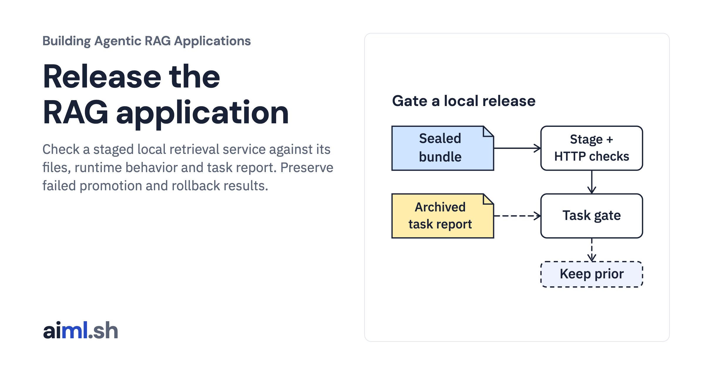

 [Building Agentic RAG Applications](../) · lesson 36 of 37

# Release the RAG application

[](https://aiml.sh/courses/agentic-rag/release-the-rag-application/)

Check a staged local retrieval service against its files, runtime behavior and task report. Preserve failed promotion and rollback results.

- **Full lesson:** [https://aiml.sh/courses/agentic-rag/release-the-rag-application/](https://aiml.sh/courses/agentic-rag/release-the-rag-application/)
- **Reading time:** 25 min
- **Uses:** FastAPI, Uvicorn, HTTPX and Pydantic; pinned in requirements.lock

## Lab

The [`lab/`](lab/) folder holds the complete runnable code, tests and recorded outputs, the same files as the lesson's download on aiml.sh. The lesson explains each step.

### Lab notes

#### Release the RAG application

This is a local artifact release drill. It seals the exact existing FastAPI
runtime, starts the staged copy over real loopback HTTP, checks readiness,
retrieval, strict invalid-input refusal and the response-byte hash, then checks
the preceding archived scripted retrieval-task report. That report still fails
its frozen development-fixture threshold. Promotion is refused and the existing
artifact pointer stays byte-identical. No answer is generated or graded.

The rollback activity starts from an explicitly synthetic two-entry artifact
registry. It really restores the previous directory and retained release ID,
after revalidating every file. It does not claim those entries were prior
deployments. Updating this JSON pointer does not switch running service traffic.
There is no cloud deployment, DNS change, container registry, signing service,
production rollback, database migration or multi-process release lock here.

##### Run and inspect

Requires Python 3.12 or later and the prepared packages pinned in
`requirements.lock`. The unchanged FastAPI runtime comes from the preceding
HTTP lab. `evaluator.py` and `compare.py` are exact copies of the preceding task
evaluation lab, and `fixtures/task-evaluation.json` is its actual archived run.
No packages, models, provider credentials or network downloads are needed during
execution. From this directory in the prepared environment:

```sh
python run.py --output scratch-result.json
python -m unittest -v test_release
```

The driver uses temporary candidate directories and a temporary registry. It
starts an actual staged Uvicorn subprocess, sends HTTP requests and reaps it.
Raw process lifecycle and status remain in the result. Child signal exit status
is retained rather than relabeled as zero. The top-level driver succeeds when
the expected refusal and rollback assertions hold; that is not a release pass.

Expected observations: runtime smoke passes; archived scripted task gate is
`FAIL`; promotion is `task_gate_not_accepted` with unchanged pointer; rollback
from its seeded registry restores the previous identity; changed code is refused
as `file_hash_mismatch`. These are separate checks, not a composite quality score.

##### Identity and failure boundaries

`package` copies an explicit file closure into a new directory and hashes each
file. A separately retained release ID hashes the canonical manifest. Checking
only a candidate's self-supplied hashes would be insufficient: replacing both
code and manifest must still fail against the retained expected identity. These
hashes check consistency; they do not authenticate an untrusted publisher.

Verification refuses extra files and symlinks. It runs before staging, before
promotion and before rollback. The task gate binds the archived report to the
candidate corpus and recomputes its frozen policy using the copied checker.
The archive is trusted, previously executed input; this step does not run a new
evaluation or establish quality on unseen requests. The runtime and task checks
are deliberately independent. Passing HTTP smoke cannot waive task failures.

`atomic_state` fsyncs a temporary registry file and uses `os.replace` in the same
directory. The tests cover replace failure without losing the old pointer.
This is a single-writer local-file contract, not a cross-process transaction or
a power-loss guarantee for directory metadata. The smoke-result object is a
trusted orchestrator value, not an authenticated remote attestation.

`test_positive_control_atomic_pointer_and_rollback` explicitly stubs a passing
task gate only to test the success branch. That unit fixture is not counted as
an observed quality pass. Other tests preserve the actual task failure, changed
files, replaced manifests, extra files, symlinks, wrong smoke binding, failed
atomic replacement and a changed rollback target.

`runs/2026-10-23-release/` contains the actual result, raw output, test log,
commands, dependency versions and source hashes. Native CLI captures retain the
original process output separately; saved stdout is not replayed as execution.

The saved run and terminal capture use the earlier controller, identified by
their original source hashes. The current helper loader prevents Python cache
files from changing the sealed bundle; a regression test checks this behavior
with the real staged service.
