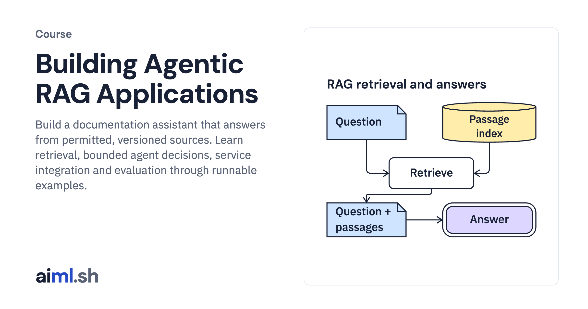

#  Building Agentic RAG Applications

Build a documentation assistant that answers from permitted, versioned sources. Learn retrieval, bounded agent decisions, service integration and evaluation through runnable examples.

- **Course on aiml.sh:** [https://aiml.sh/courses/agentic-rag/](https://aiml.sh/courses/agentic-rag/)
- **Lessons:** 37 · **Reading time:** about 15 hours
- **Prerequisites:** Basic Python functions and JSON. Model requests and embeddings are introduced in the first module; review development and held-out splits before Module 2. Module 3 uses local UTF-8 fixtures and needs no model server.

## What you'll learn

- Trace RAG requests, replay saved replies and consume a real Gemini provider stream.
- Ingest and version documentation, then compare lexical, vector and hybrid retrieval.
- Choose source windows and fit them into a token-bounded request.
- Compare fixed, scripted and Gemini-selected retrieval policies, then expose search and read through HTTP and MCP.
- Apply collection permissions, caching, tracing and concurrency limits, then use task evaluations to control a local release.

## Lessons

| # | Lesson | Time | Code | Full lesson |
|---|---|---|---|---|
| 1 | [How RAG works](01-how-rag-works/) | 6&nbsp;min | [lab](01-how-rag-works/lab/) | [read](https://aiml.sh/courses/agentic-rag/how-rag-works/) |
| 2 | [Trace a RAG request from search to answer](02-follow-a-rag-request-end-to-end/) | 25&nbsp;min | [lab](02-follow-a-rag-request-end-to-end/lab/) | [read](https://aiml.sh/courses/agentic-rag/follow-a-rag-request-end-to-end/) |
| 3 | [Build a RAG eval dataset](03-build-a-rag-eval-dataset/) | 25&nbsp;min | [lab](03-build-a-rag-eval-dataset/lab/) | [read](https://aiml.sh/courses/agentic-rag/build-a-rag-eval-dataset/) |
| 4 | [Record a RAG baseline](04-record-a-rag-baseline/) | 28&nbsp;min | [lab](04-record-a-rag-baseline/lab/) | [read](https://aiml.sh/courses/agentic-rag/record-a-rag-baseline/) |
| 5 | [Load developer documentation](05-load-developer-documentation/) | 20&nbsp;min | [lab](05-load-developer-documentation/lab/) | [read](https://aiml.sh/courses/agentic-rag/load-developer-documentation/) |
| 6 | [Track passage sources](06-track-passage-sources/) | 20&nbsp;min | [lab](06-track-passage-sources/lab/) | [read](https://aiml.sh/courses/agentic-rag/track-passage-sources/) |
| 7 | [Handle ingestion failures](07-handle-ingestion-failures/) | 20&nbsp;min | [lab](07-handle-ingestion-failures/lab/) | [read](https://aiml.sh/courses/agentic-rag/handle-ingestion-failures/) |
| 8 | [Version documents and chunks](08-version-documents-and-chunks/) | 25&nbsp;min | [lab](08-version-documents-and-chunks/lab/) | [read](https://aiml.sh/courses/agentic-rag/version-documents-and-chunks/) |
| 9 | [Resume document ingestion](09-resume-document-ingestion/) | 25&nbsp;min | [lab](09-resume-document-ingestion/lab/) | [read](https://aiml.sh/courses/agentic-rag/resume-document-ingestion/) |
| 10 | [Update and delete indexed content](10-update-and-delete-indexed-content/) | 25&nbsp;min | [lab](10-update-and-delete-indexed-content/lab/) | [read](https://aiml.sh/courses/agentic-rag/update-and-delete-indexed-content/) |
| 11 | [How BM25 ranks documents](11-how-bm25-ranks-documents/) | 25&nbsp;min | [lab](11-how-bm25-ranks-documents/lab/) | [read](https://aiml.sh/courses/agentic-rag/how-bm25-ranks-documents/) |
| 12 | [Add vector retrieval](12-add-vector-retrieval/) | 25&nbsp;min | [lab](12-add-vector-retrieval/lab/) | [read](https://aiml.sh/courses/agentic-rag/add-vector-retrieval/) |
| 13 | [Apply filters across retrievers](13-apply-filters-across-retrievers/) | 25&nbsp;min | [lab](13-apply-filters-across-retrievers/lab/) | [read](https://aiml.sh/courses/agentic-rag/apply-filters-across-retrievers/) |
| 14 | [Build hybrid retrieval](14-build-hybrid-retrieval/) | 25&nbsp;min | [lab](14-build-hybrid-retrieval/lab/) | [read](https://aiml.sh/courses/agentic-rag/build-hybrid-retrieval/) |
| 15 | [Rerank retrieved passages](15-rerank-retrieved-passages/) | 25&nbsp;min | [lab](15-rerank-retrieved-passages/lab/) | [read](https://aiml.sh/courses/agentic-rag/rerank-retrieved-passages/) |
| 16 | [Compare retrieval configurations](16-compare-retrieval-configurations/) | 25&nbsp;min | [lab](16-compare-retrieval-configurations/lab/) | [read](https://aiml.sh/courses/agentic-rag/compare-retrieval-configurations/) |
| 17 | [Choose chunk boundaries](17-choose-chunk-boundaries/) | 25&nbsp;min | [lab](17-choose-chunk-boundaries/lab/) | [read](https://aiml.sh/courses/agentic-rag/choose-chunk-boundaries/) |
| 18 | [Retrieve surrounding context](18-retrieve-surrounding-context/) | 25&nbsp;min | [lab](18-retrieve-surrounding-context/lab/) | [read](https://aiml.sh/courses/agentic-rag/retrieve-surrounding-context/) |
| 19 | [Assemble context within a token budget](19-assemble-context-within-a-token-budget/) | 25&nbsp;min | [lab](19-assemble-context-within-a-token-budget/lab/) | [read](https://aiml.sh/courses/agentic-rag/assemble-context-within-a-token-budget/) |
| 20 | [Stream RAG answers](20-stream-rag-answers/) | 25&nbsp;min | [lab](20-stream-rag-answers/lab/) | [read](https://aiml.sh/courses/agentic-rag/stream-rag-answers/) |
| 21 | [Handle conflicting documentation](21-handle-conflicting-documentation/) | 25&nbsp;min | [lab](21-handle-conflicting-documentation/lab/) | [read](https://aiml.sh/courses/agentic-rag/handle-conflicting-documentation/) |
| 22 | [Add search and read tools](22-add-search-and-read-tools/) | 25&nbsp;min | [lab](22-add-search-and-read-tools/lab/) | [read](https://aiml.sh/courses/agentic-rag/add-search-and-read-tools/) |
| 23 | [Refine queries with a scripted policy](23-refine-queries-and-search-again/) | 25&nbsp;min | [lab](23-refine-queries-and-search-again/lab/) | [read](https://aiml.sh/courses/agentic-rag/refine-queries-and-search-again/) |
| 24 | [Bound scripted retrieval runs](24-limit-retrieval-agent-runs/) | 25&nbsp;min | [lab](24-limit-retrieval-agent-runs/lab/) | [read](https://aiml.sh/courses/agentic-rag/limit-retrieval-agent-runs/) |
| 25 | [Compare fixed, scripted and Gemini retrieval policies](25-compare-agents-and-pipelines/) | 25&nbsp;min | [lab](25-compare-agents-and-pipelines/lab/) | [read](https://aiml.sh/courses/agentic-rag/compare-agents-and-pipelines/) |
| 26 | [Build a model-driven RAG agent](26-build-a-model-driven-rag-agent/) | 35&nbsp;min | [lab](26-build-a-model-driven-rag-agent/lab/) | [read](https://aiml.sh/courses/agentic-rag/build-a-model-driven-rag-agent/) |
| 27 | [Serve the RAG application with FastAPI](27-serve-the-rag-application-with-fastapi/) | 25&nbsp;min | [lab](27-serve-the-rag-application-with-fastapi/lab/) | [read](https://aiml.sh/courses/agentic-rag/serve-the-rag-application-with-fastapi/) |
| 28 | [Build a retrieval inspector](28-build-a-retrieval-inspector/) | 25&nbsp;min | [lab](28-build-a-retrieval-inspector/lab/) | [read](https://aiml.sh/courses/agentic-rag/build-a-retrieval-inspector/) |
| 29 | [Connect retrieval tools through MCP](29-connect-retrieval-tools-through-mcp/) | 25&nbsp;min | [lab](29-connect-retrieval-tools-through-mcp/lab/) | [read](https://aiml.sh/courses/agentic-rag/connect-retrieval-tools-through-mcp/) |
| 30 | [Authorize collection searches](30-authorize-collection-searches/) | 20&nbsp;min | [lab](30-authorize-collection-searches/lab/) | [read](https://aiml.sh/courses/agentic-rag/authorize-collection-searches/) |
| 31 | [Cache retrieval results](31-cache-retrieval-results/) | 20&nbsp;min | [lab](31-cache-retrieval-results/lab/) | [read](https://aiml.sh/courses/agentic-rag/cache-retrieval-results/) |
| 32 | [Trace RAG requests](32-trace-rag-requests/) | 25&nbsp;min | [lab](32-trace-rag-requests/lab/) | [read](https://aiml.sh/courses/agentic-rag/trace-rag-requests/) |
| 33 | [Limit concurrent RAG requests](33-limit-concurrent-rag-requests/) | 25&nbsp;min | [lab](33-limit-concurrent-rag-requests/lab/) | [read](https://aiml.sh/courses/agentic-rag/limit-concurrent-rag-requests/) |
| 34 | [Run RAG evals on an updated corpus](34-run-rag-evals-on-an-updated-corpus/) | 20&nbsp;min | [lab](34-run-rag-evals-on-an-updated-corpus/lab/) | [read](https://aiml.sh/courses/agentic-rag/run-rag-evals-on-an-updated-corpus/) |
| 35 | [Evaluate scripted retrieval tasks](35-evaluate-retrieval-agent-tasks/) | 25&nbsp;min | [lab](35-evaluate-retrieval-agent-tasks/lab/) | [read](https://aiml.sh/courses/agentic-rag/evaluate-retrieval-agent-tasks/) |
| 36 | [Release the RAG application](36-release-the-rag-application/) | 25&nbsp;min | [lab](36-release-the-rag-application/lab/) | [read](https://aiml.sh/courses/agentic-rag/release-the-rag-application/) |
| 37 | [Build the developer knowledge assistant](37-build-developer-knowledge-assistant/) | 35&nbsp;min | [lab](37-build-developer-knowledge-assistant/lab/) | [read](https://aiml.sh/courses/agentic-rag/build-developer-knowledge-assistant/) |

Each lesson folder has a short summary, its diagram and its lab. The complete lesson, with explanations, recorded results and checks, is on aiml.sh.

[Back to all courses](../../README.md#courses)
