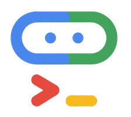
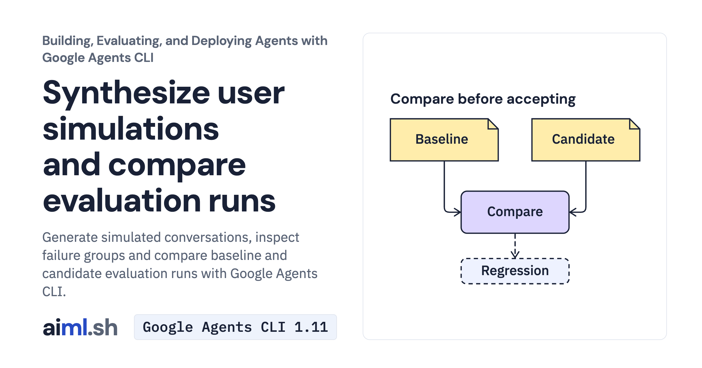

 [Building, Evaluating, and Deploying Agents with Google Agents CLI](../) · lesson 4 of 6

# Synthesize user simulations and compare evaluation runs

[](https://aiml.sh/courses/agents-cli/synthesize-user-simulations-and-compare-eval-runs/)

Generate simulated conversations, inspect failure groups and compare baseline and candidate evaluation runs with Google Agents CLI.

- **Full lesson:** [https://aiml.sh/courses/agents-cli/synthesize-user-simulations-and-compare-eval-runs/](https://aiml.sh/courses/agents-cli/synthesize-user-simulations-and-compare-eval-runs/)
- **Reading time:** 20 min
- **Uses:** google-agents-cli 1.11.0, google-adk 2.13.0

## Lab

The [`lab/`](lab/) folder holds the complete runnable code, tests and recorded outputs, the same files as the lesson's download on aiml.sh. The lesson explains each step.

### Lab notes

#### Synthesize user simulations and compare evaluation runs

This is the complete `agents-cli-eval-compare` teaching lab. Extract it and begin in this directory. Install Python 3.12+ and uv before running the commands below.

Keep the generated project from Lesson 1. Replace `/absolute/path/to/docuctl-docs` with its real path. The extracted lab and generated project are different directories.

##### Commands, in lesson order

```bash
python3.12 -m venv .venv
source .venv/bin/activate
python -m pip install -r requirements-lock.txt
LAB_DIR="$PWD"
```

```bash
export PROJECT_DIR="/absolute/path/to/docuctl-docs"
cd "$PROJECT_DIR"
```

```bash
#### Generate 3 multi-turn simulated conversations with up to 4 turns each
agents-cli eval dataset synthesize \
  -n 3 \
  --max-turns 4 \
  --model gemini-3.8-flash \
  --instruction "Developers asking about docuctl 1.x vs 2.x rollback, token expiry, and unbuilt features" \
  --output artifacts/traces/synthesized-docuctl.json
```

```bash
agents-cli eval analyze \
  --eval-result $BASELINE_RESULT \
  --metric multi_turn_tool_use_quality \
  --top-k 2 \
  --project "$GOOGLE_CLOUD_PROJECT"
```

```bash
agents-cli eval compare \
  artifacts/eval_results/baseline.json \
  artifacts/eval_results/candidate.json
```

```bash
cd "$LAB_DIR"
"$LAB_DIR/.venv/bin/python" -m unittest -v test_eval_compare.py
```

##### What the checks establish

Offline tests exercise local helpers and supplied examples. They do not invoke Gemini, deploy infrastructure, register an agent or verify telemetry delivery. Model-generation commands can incur charges; deployment and registration require your own cloud resources and credentials.


##### Exercise the real CLI comparator without model calls

From this extracted lab (not the generated project):

```bash
python prepare_comparison.py
agents-cli eval compare baseline.example.json candidate.example.json
```

The inputs are supplied examples. Comparing them exercises the CLI comparator but does not measure Gemini quality or a prompt improvement.

##### Explicit simulator model

In CLI 1.11.0, `--model` configures scenario generation; the user simulator has a separate model default. To run the saved plans with the recorded explicit Gemini 3.8 Flash configuration, execute the helper from this lab directory:

```bash
python run_simulations.py "$PROJECT_DIR" generated-plans.json simulations.json
```

The helper runs actual ADK simulations (three scenarios, at most four turns each) and saves invocation objects, not CLI eval-grade traces. It does not regenerate the scenarios. Baseline/candidate score dictionaries are supplied comparator exercises, not measurements from these simulations.
