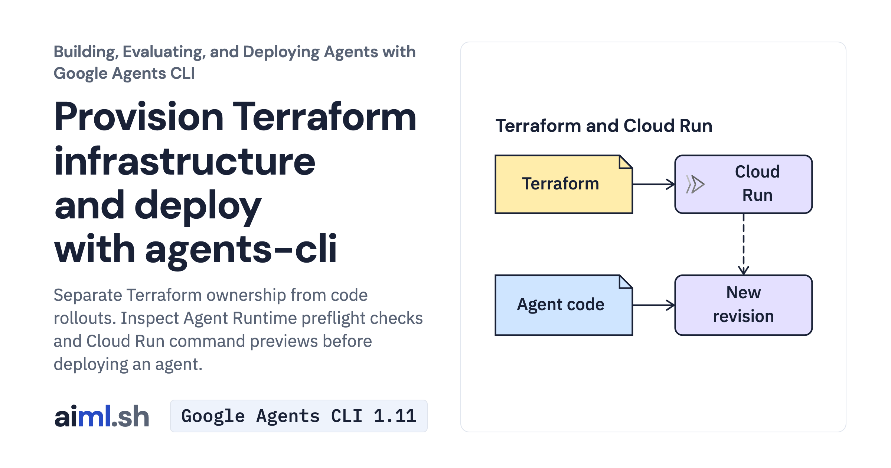

 [Building, Evaluating, and Deploying Agents with Google Agents CLI](../) · lesson 5 of 6

# Provision Terraform infrastructure and deploy with agents-cli

[](https://aiml.sh/courses/agents-cli/provision-terraform-and-deploy-with-agents-cli/)

Separate Terraform ownership from code rollouts. Inspect Agent Runtime preflight checks and Cloud Run command previews before deploying an agent.

- **Full lesson:** [https://aiml.sh/courses/agents-cli/provision-terraform-and-deploy-with-agents-cli/](https://aiml.sh/courses/agents-cli/provision-terraform-and-deploy-with-agents-cli/)
- **Reading time:** 22 min
- **Uses:** google-agents-cli 1.11.0, terraform 1.9+

## Lab

The [`lab/`](lab/) folder holds the complete runnable code, tests and recorded outputs, the same files as the lesson's download on aiml.sh. The lesson explains each step.

### Lab notes

#### Provision Terraform infrastructure and deploy with agents-cli

This is the complete `agents-cli-deploy-infra` teaching lab. Extract it and begin in this directory. Install Python 3.12+ and uv before running the commands below.

Keep the generated project from Lesson 1. Replace `/absolute/path/to/docuctl-docs` with its real path. The extracted lab and generated project are different directories.

##### Commands, in lesson order

```bash
python3.12 -m venv .venv
source .venv/bin/activate
python -m pip install -r requirements-lock.txt
LAB_DIR="$PWD"
```

```bash
export PROJECT_DIR="/absolute/path/to/docuctl-docs"
cd "$PROJECT_DIR"
```

```bash
export GOOGLE_CLOUD_PROJECT="YOUR_PROJECT_ID"
gcloud auth application-default login
gcloud config set project "$GOOGLE_CLOUD_PROJECT"
terraform -chdir=deployment/terraform/single-project init
terraform -chdir=deployment/terraform/single-project plan -out=reviewed.tfplan
#### Only after reviewing the plan:
terraform -chdir=deployment/terraform/single-project apply reviewed.tfplan
```

```bash
#### Validate an Agent Runtime deployment without creating resources
agents-cli deploy \
  --deployment-target agent_runtime \
  --project "$GOOGLE_CLOUD_PROJECT" \
  --region us-central1 \
  --cpu 2 \
  --memory 4Gi \
  --concurrency 8 \
  --min-instances 1 \
  --max-instances 6 \
  --dry-run

#### Validate a Cloud Run deployment with Secret Manager bindings
agents-cli deploy \
  --deployment-target cloud_run \
  --project "$GOOGLE_CLOUD_PROJECT" \
  --region us-central1 \
  --cpu 1 \
  --memory 4Gi \
  --concurrency 8 \
  --min-instances 1 \
  --max-instances 10 \
  --secrets DOCUCTL_TOKEN=docuctl-ci-token:latest \
  --dry-run
```

```bash
cd "$LAB_DIR"
"$LAB_DIR/.venv/bin/python" -m unittest -v test_deploy_infra.py
```

##### What the checks establish

Offline tests exercise local helpers and supplied examples. They do not invoke Gemini, deploy infrastructure, register an agent or verify telemetry delivery. Model-generation commands can incur charges; deployment and registration require your own cloud resources and credentials.

The saved outputs are actual CLI dry-runs. They validate flags and print deployment commands without creating infrastructure. Terraform apply, deployed requests and telemetry are not recorded here.
