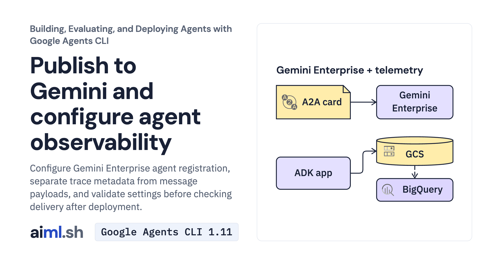

 [Building, Evaluating, and Deploying Agents with Google Agents CLI](../) · lesson 6 of 6

# Publish to Gemini and configure agent observability

[](https://aiml.sh/courses/agents-cli/publish-to-gemini-and-configure-agent-observability/)

Configure Gemini Enterprise agent registration, separate trace metadata from message payloads, and validate settings before checking delivery after deployment.

- **Full lesson:** [https://aiml.sh/courses/agents-cli/publish-to-gemini-and-configure-agent-observability/](https://aiml.sh/courses/agents-cli/publish-to-gemini-and-configure-agent-observability/)
- **Reading time:** 20 min
- **Uses:** google-agents-cli 1.11.0, google-adk 2.13.0

## Lab

The [`lab/`](lab/) folder holds the complete runnable code, tests and recorded outputs, the same files as the lesson's download on aiml.sh. The lesson explains each step.

### Lab notes

#### Publish to Gemini and configure agent observability

This is the complete `agents-cli-publish-observe` teaching lab. Extract it and begin in this directory. Install Python 3.12+ and uv before running the commands below.

Keep the generated project from Lesson 1. Replace `/absolute/path/to/docuctl-docs` with its real path. The extracted lab and generated project are different directories.

##### Commands, in lesson order

```bash
python3.12 -m venv .venv
source .venv/bin/activate
python -m pip install -r requirements-lock.txt
LAB_DIR="$PWD"
```

```bash
export PROJECT_DIR="/absolute/path/to/docuctl-docs"
cd "$PROJECT_DIR"
export AGENT_CARD_URL="YOUR_DEPLOYED_AGENT_CARD_URL"
export GEMINI_APP_ID="YOUR_GEMINI_ENTERPRISE_APP_RESOURCE_NAME"
```

```bash
#### List Gemini Enterprise apps in the project
agents-cli publish gemini --list --project-id "$GOOGLE_CLOUD_PROJECT"

#### Register a Cloud Run A2A agent explicitly in programmatic mode
agents-cli publish gemini \
  --registration-type a2a \
  --agent-card-url $AGENT_CARD_URL \
  --gemini-app-id $GEMINI_APP_ID \
  --display-name "docuctl Docs Assistant" \
  --description "Answers developer questions about docuctl 2.x commands"
```

```bash
cd "$LAB_DIR"
"$LAB_DIR/.venv/bin/python" -m unittest -v test_publish_observe.py
```

##### What the checks establish

Offline tests exercise local helpers and supplied examples. They do not invoke Gemini, deploy infrastructure, register an agent or verify telemetry delivery. Model-generation commands can incur charges; deployment and registration require your own cloud resources and credentials.

The actual project app listing was empty. Saved registration routing and observability results come from executing the local helper with illustrative resource IDs; they do not prove registration or telemetry delivery.
