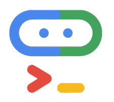
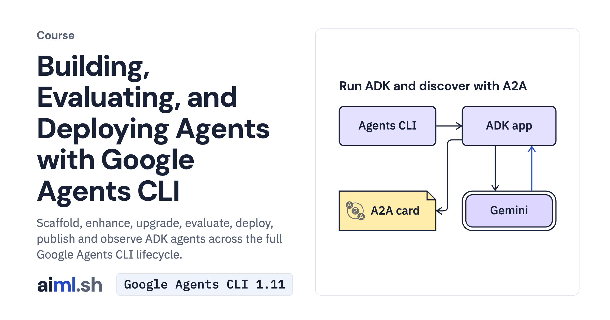

#  Building, Evaluating, and Deploying Agents with Google Agents CLI

Scaffold, enhance, upgrade, evaluate, deploy, publish and observe ADK agents across the full Google Agents CLI lifecycle.

- **Course on aiml.sh:** [https://aiml.sh/courses/agents-cli/](https://aiml.sh/courses/agents-cli/)
- **Lessons:** 6 · **Reading time:** about 2 hours
- **Prerequisites:** Python 3.12, a terminal, and basic familiarity with Google ADK agents (the Building Agents with Google ADK 2.0 course covers them).
- **Framework:** Google Agents CLI 1.11

## What you'll learn

- Scaffold an ADK prototype with agents-cli scaffold create, keep App(name='app') aligned with agent_directory, pass agents-cli lint, and run multi-turn local sessions.
- Graduate a prototype in place with scaffold enhance, run 3-way template merges with scaffold upgrade, and add or override CLI commands with agents-cli-extension.yaml.
- Decouple trace collection (eval generate) from scoring (eval grade), synthesize multi-turn user simulations, cluster losses with eval analyze, and inspect result differences with eval compare and a separate regression gate.
- Provision Terraform infrastructure, inspect Agent Runtime preflight checks and Cloud Run command previews with deploy --dry-run, register ADK or A2A agents with publish gemini, and query two-tier BigQuery telemetry.

## Lessons

| # | Lesson | Time | Code | Full lesson |
|---|---|---|---|---|
| 1 | [Scaffold, lint, and run an ADK project with Google Agents CLI](01-create-and-run-an-agent-project-with-agents-cli/) | 18&nbsp;min | [lab](01-create-and-run-an-agent-project-with-agents-cli/lab/) | [read](https://aiml.sh/courses/agents-cli/create-and-run-an-agent-project-with-agents-cli/) |
| 2 | [Enhance, upgrade, and extend an Agents CLI project](02-upgrade-and-extend-an-agents-cli-project/) | 20&nbsp;min | [lab](02-upgrade-and-extend-an-agents-cli-project/lab/) | [read](https://aiml.sh/courses/agents-cli/upgrade-and-extend-an-agents-cli-project/) |
| 3 | [Generate traces and grade evaluations with agents-cli eval](03-evaluate-an-agent-with-agents-cli-eval/) | 22&nbsp;min | [lab](03-evaluate-an-agent-with-agents-cli-eval/lab/) | [read](https://aiml.sh/courses/agents-cli/evaluate-an-agent-with-agents-cli-eval/) |
| 4 | [Synthesize user simulations and compare evaluation runs](04-synthesize-user-simulations-and-compare-eval-runs/) | 20&nbsp;min | [lab](04-synthesize-user-simulations-and-compare-eval-runs/lab/) | [read](https://aiml.sh/courses/agents-cli/synthesize-user-simulations-and-compare-eval-runs/) |
| 5 | [Provision Terraform infrastructure and deploy with agents-cli](05-provision-terraform-and-deploy-with-agents-cli/) | 22&nbsp;min | [lab](05-provision-terraform-and-deploy-with-agents-cli/lab/) | [read](https://aiml.sh/courses/agents-cli/provision-terraform-and-deploy-with-agents-cli/) |
| 6 | [Publish to Gemini and configure agent observability](06-publish-to-gemini-and-configure-agent-observability/) | 20&nbsp;min | [lab](06-publish-to-gemini-and-configure-agent-observability/lab/) | [read](https://aiml.sh/courses/agents-cli/publish-to-gemini-and-configure-agent-observability/) |

Each lesson folder has a short summary, its diagram and its lab. The complete lesson, with explanations, recorded results and checks, is on aiml.sh.

[Back to all courses](../../README.md#courses)
