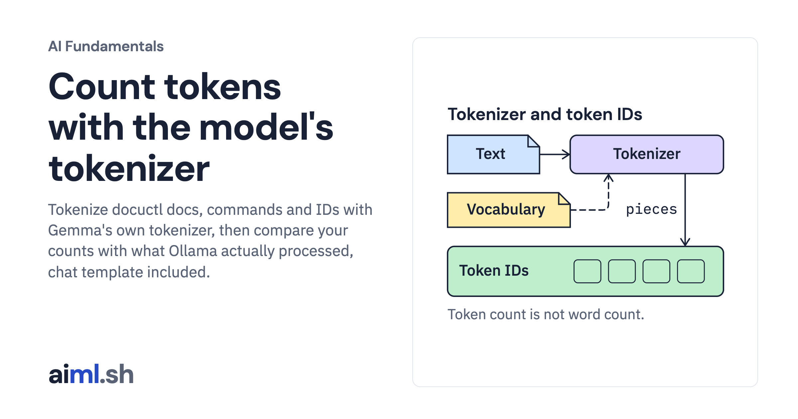

 [AI Fundamentals](../) · lesson 2 of 11

# Count tokens with the model's tokenizer

[](https://aiml.sh/courses/ai-fundamentals/tokens-and-tokenizers/)

Tokenize docuctl docs, commands and IDs with Gemma's own tokenizer, then compare your counts with what Ollama actually processed, chat template included.

- **Full lesson:** [https://aiml.sh/courses/ai-fundamentals/tokens-and-tokenizers/](https://aiml.sh/courses/ai-fundamentals/tokens-and-tokenizers/)
- **Reading time:** 9 min
- **Uses:** tokenizers 0.23.3, ollama 0.6.3 (Python client), pytest 9.1.1, the Gemma 4 tokenizer.json

## Lab

The [`lab/`](lab/) folder holds the complete runnable code, tests and recorded outputs, the same files as the lesson's download on aiml.sh. The lesson explains each step.

### Lab notes

#### Count tokens with the model's tokenizer

Download `/labs/tokens-and-tokenizers.zip` and extract it. Keep the included fixtures and Python files together in `tokens-and-tokenizers/`. Requires Python 3.12 or later.

##### Setup, tests and execution

From this directory:

```sh
python3.12 -m venv .venv
.venv/bin/python -m pip install -r requirements-lock.txt
mkdir -p gemma-tokenizer
curl --fail --location \
  https://huggingface.co/google/gemma-4-E2B-it/resolve/3e22461f65e89153144f8adb70e3b8c2cc9845a7/tokenizer.json \
  --output gemma-tokenizer/tokenizer.json
export TOKENIZER_PATH="$PWD/gemma-tokenizer"

#### Offline tests: no model calls
.venv/bin/python -m pytest -q

#### Run after reading the implementation below
.venv/bin/python count_tokens.py
```

Only the tokenizer file is downloaded, about 32 MB; model weights are not needed for counting. The pinned file was checked against the existing local tokenizer and reproduces the saved counts. Compare its SHA-256 with `cc8d3a0ce36466ccc1278bf987df5f71db1719b9ca6b4118264f45cb627bfe0f`. The offline tests use this file without a model request; `compare_runtime.py` additionally needs Ollama with both models named in its source.

Read `count_tokens.py` before its live run. Some drivers write their results next to the source; use a fresh extracted copy when comparing with the bundled recordings. The tests exercise the implementation with local fixtures or replaced model clients; passing them does not establish model quality.
