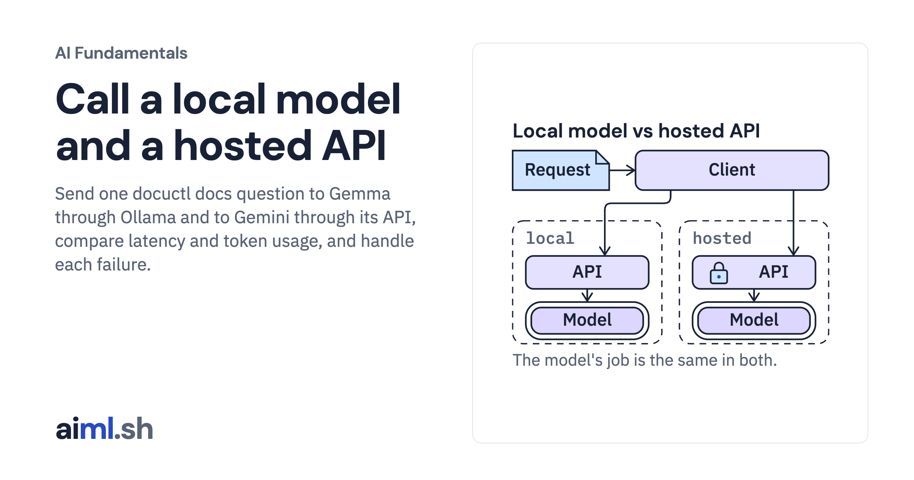

 [AI Fundamentals](../) · lesson 6 of 11

# Call a local model and a hosted API

[](https://aiml.sh/courses/ai-fundamentals/local-models-and-hosted-apis/)

Send one docuctl docs question to Gemma through Ollama and to Gemini through its API, compare latency and token usage, and handle each failure.

- **Full lesson:** [https://aiml.sh/courses/ai-fundamentals/local-models-and-hosted-apis/](https://aiml.sh/courses/ai-fundamentals/local-models-and-hosted-apis/)
- **Reading time:** 10 min
- **Uses:** ollama 0.6.3 and google-genai 2.32.0 (Python clients), pytest 9.1.1

## Lab

The [`lab/`](lab/) folder holds the complete runnable code, tests and recorded outputs, the same files as the lesson's download on aiml.sh. The lesson explains each step.

### Lab notes

#### Call a local model and a hosted API

Download `/labs/local-models-and-hosted-apis.zip` and extract it. Keep the included fixtures and Python files together in `local-models-and-hosted-apis/`. Requires Python 3.12 or later.

##### Setup, tests and execution

From this directory:

```sh
python3.12 -m venv .venv
.venv/bin/python -m pip install -r requirements-lock.txt
#### The live comparison calls BOTH providers; set GOOGLE_API_KEY first.
export GEMINI_MODEL=gemini-3.8-flash

#### Offline tests: no model calls
.venv/bin/python -m pytest -q

#### Run after reading the implementation below
ollama pull gemma4:e2b
.venv/bin/python ask_both.py
```

The live commands contact Ollama or the hosted provider; the offline tests replace model calls. Run them from the extracted lab directory. Saved outputs describe earlier runs and are not regenerated by the offline tests.

Read `ask_both.py` before its live run. Some drivers write their results next to the source; use a fresh extracted copy when comparing with the bundled recordings. The tests exercise the implementation with local fixtures or replaced model clients; passing them does not establish model quality.

The fresh hosted request and response are in `runs/docuctl-2026-10-25/hosted-response.json`. The output file includes the paired local call. Provider signature fields are omitted from the public projection.
