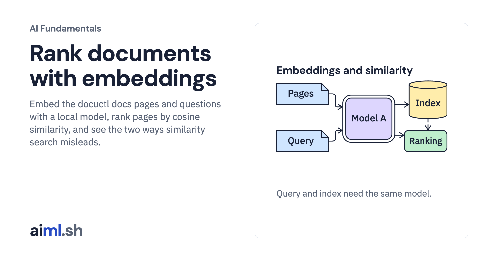

 [AI Fundamentals](../) · lesson 8 of 11

# Rank documents with embeddings

[](https://aiml.sh/courses/ai-fundamentals/vectors-and-similarity/)

Embed the docuctl docs pages and questions with a local model, rank pages by cosine similarity, and see the two ways similarity search misleads.

- **Full lesson:** [https://aiml.sh/courses/ai-fundamentals/vectors-and-similarity/](https://aiml.sh/courses/ai-fundamentals/vectors-and-similarity/)
- **Reading time:** 10 min
- **Uses:** ollama 0.6.3 (Python client), numpy 2.5.4, pytest 9.1.1, the qwen3-embedding:0.6b model

## Lab

The [`lab/`](lab/) folder holds the complete runnable code, tests and recorded outputs, the same files as the lesson's download on aiml.sh. The lesson explains each step.

### Lab notes

#### Rank documents with embeddings

Download `/labs/vectors-and-similarity.zip` and extract it. Keep the included fixtures and Python files together in `vectors-and-similarity/`. Requires Python 3.12 or later.

##### Setup, tests and execution

From this directory:

```sh
python3.12 -m venv .venv
.venv/bin/python -m pip install -r requirements-lock.txt

#### Offline tests: no model calls
.venv/bin/python -m pytest -q

#### Run after reading the implementation below
ollama pull qwen3-embedding:0.6b
.venv/bin/python rank_pages.py
```

The live commands contact Ollama or the hosted provider; the offline tests replace model calls. Run them from the extracted lab directory. Saved outputs describe earlier runs and are not regenerated by the offline tests.

Read `rank_pages.py` before its live run. Some drivers write their results next to the source; use a fresh extracted copy when comparing with the bundled recordings. The tests exercise the implementation with local fixtures or replaced model clients; passing them does not establish model quality.
