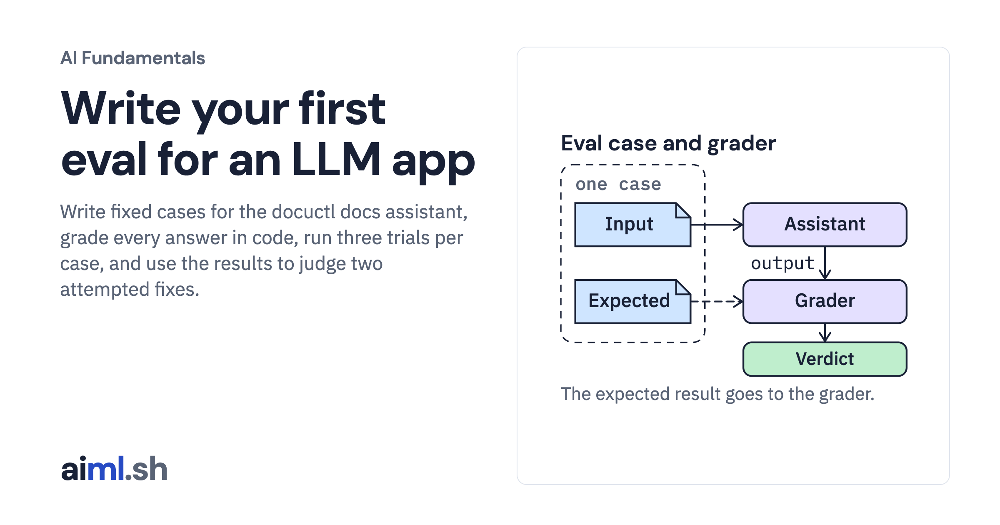

 [AI Fundamentals](../) · lesson 11 of 11

# Write your first eval for an LLM app

[](https://aiml.sh/courses/ai-fundamentals/what-is-an-evaluation/)

Write fixed cases for the docuctl docs assistant, grade every answer in code, run three trials per case, and use the results to judge two attempted fixes.

- **Full lesson:** [https://aiml.sh/courses/ai-fundamentals/what-is-an-evaluation/](https://aiml.sh/courses/ai-fundamentals/what-is-an-evaluation/)
- **Reading time:** 11 min
- **Uses:** ollama 0.6.3 (Python client), pydantic 2.14.1, pytest 9.1.1, the gemma4:e2b model

## Lab

The [`lab/`](lab/) folder holds the complete runnable code, tests and recorded outputs, the same files as the lesson's download on aiml.sh. The lesson explains each step.

### Lab notes

#### Write your first eval for an LLM app

Download `/labs/what-is-an-evaluation.zip` and extract it. Keep the included fixtures and Python files together in `what-is-an-evaluation/`. Requires Python 3.12 or later.

##### Setup, tests and execution

From this directory:

```sh
python3.12 -m venv .venv
.venv/bin/python -m pip install -r requirements-lock.txt

#### Offline tests: no model calls
.venv/bin/python -m pytest -q

#### Run after reading the implementation below
ollama pull gemma4:e2b
.venv/bin/python run_eval.py
```

The live commands contact Ollama or the hosted provider; the offline tests replace model calls. Run them from the extracted lab directory. Saved outputs describe earlier runs and are not regenerated by the offline tests.

Read `run_eval.py` before its live run. Some drivers write their results next to the source; use a fresh extracted copy when comparing with the bundled recordings. The tests exercise the implementation with local fixtures or replaced model clients; passing them does not establish model quality.

New docuctl executions save their generated files under `runs/local-docuctl/`. Root recording files retain the original experiment; the offline replay checks those original files. Compare a new run separately instead of relabeling the earlier model output.
