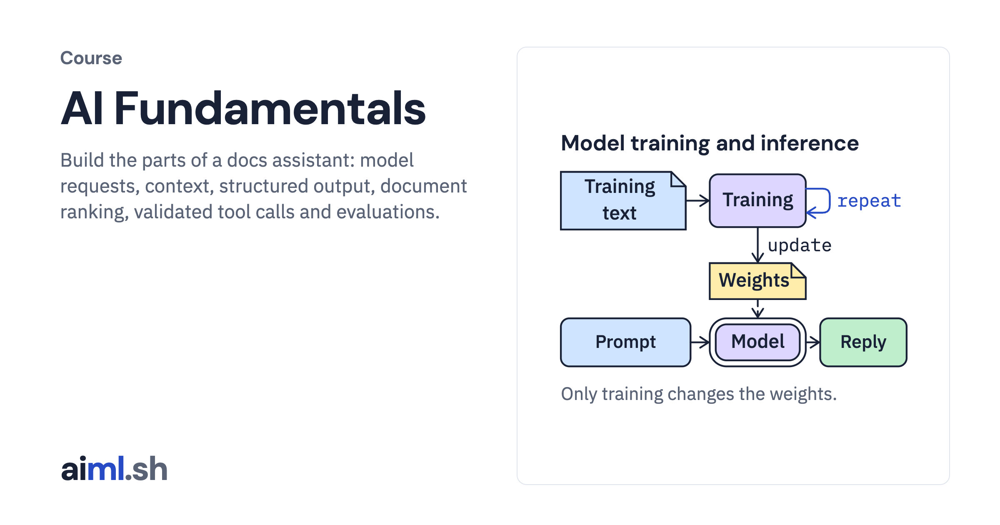

#  AI Fundamentals

Build the parts of a docs assistant: model requests, context, structured output, document ranking, validated tool calls and evaluations.

- **Course on aiml.sh:** [https://aiml.sh/courses/ai-fundamentals/](https://aiml.sh/courses/ai-fundamentals/)
- **Lessons:** 11 · **Reading time:** about 2 hours
- **Prerequisites:** Basic Python, a terminal and JSON. Local labs use Ollama; the hosted comparison also needs a Gemini API key.

## What you'll learn

- Trace tokenization, next-token generation, context limits and sampling in recorded model runs.
- Call local and hosted models, validate structured responses, and distinguish runtime errors from incorrect answers.
- Rank docs with embeddings and check a model-proposed tool call before executing it.
- Test prompt injection controls and compare answers against fixed evaluation cases.

## Lessons

| # | Lesson | Time | Code | Full lesson |
|---|---|---|---|---|
| 1 | [Run inference with a local LLM](01-what-is-inference/) | 9&nbsp;min | [lab](01-what-is-inference/lab/) | [read](https://aiml.sh/courses/ai-fundamentals/what-is-inference/) |
| 2 | [Count tokens with the model's tokenizer](02-tokens-and-tokenizers/) | 9&nbsp;min | [lab](02-tokens-and-tokenizers/lab/) | [read](https://aiml.sh/courses/ai-fundamentals/tokens-and-tokenizers/) |
| 3 | [Trace next-token generation](03-next-token-prediction/) | 9&nbsp;min | [lab](03-next-token-prediction/lab/) | [read](https://aiml.sh/courses/ai-fundamentals/next-token-prediction/) |
| 4 | [Send chat messages within the context window](04-messages-and-context/) | 10&nbsp;min | [lab](04-messages-and-context/lab/) | [read](https://aiml.sh/courses/ai-fundamentals/messages-and-context/) |
| 5 | [Control sampling, output limits and streaming](05-generation-controls/) | 10&nbsp;min | [lab](05-generation-controls/lab/) | [read](https://aiml.sh/courses/ai-fundamentals/generation-controls/) |
| 6 | [Call a local model and a hosted API](06-local-models-and-hosted-apis/) | 10&nbsp;min | [lab](06-local-models-and-hosted-apis/lab/) | [read](https://aiml.sh/courses/ai-fundamentals/local-models-and-hosted-apis/) |
| 7 | [Get structured output and validate it with Pydantic](07-json-and-files/) | 10&nbsp;min | [lab](07-json-and-files/lab/) | [read](https://aiml.sh/courses/ai-fundamentals/json-and-files/) |
| 8 | [Rank documents with embeddings](08-vectors-and-similarity/) | 10&nbsp;min | [lab](08-vectors-and-similarity/lab/) | [read](https://aiml.sh/courses/ai-fundamentals/vectors-and-similarity/) |
| 9 | [Validate a model-proposed tool call](09-tools-and-permissions/) | 11&nbsp;min | [lab](09-tools-and-permissions/lab/) | [read](https://aiml.sh/courses/ai-fundamentals/tools-and-permissions/) |
| 10 | [Defend a tool-using assistant against prompt injection](10-human-control/) | 11&nbsp;min | [lab](10-human-control/lab/) | [read](https://aiml.sh/courses/ai-fundamentals/human-control/) |
| 11 | [Write your first eval for an LLM app](11-what-is-an-evaluation/) | 11&nbsp;min | [lab](11-what-is-an-evaluation/lab/) | [read](https://aiml.sh/courses/ai-fundamentals/what-is-an-evaluation/) |

Each lesson folder has a short summary, its diagram and its lab. The complete lesson, with explanations, recorded results and checks, is on aiml.sh.

[Back to all courses](../../README.md#courses)
