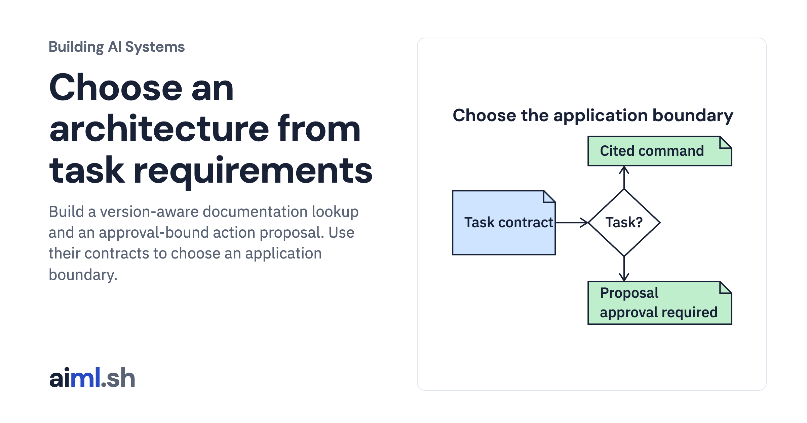

 [Building AI Systems](../) · lesson 1 of 21

# Choose an architecture from task requirements

[](https://aiml.sh/courses/building-ai-systems/choose-an-ai-system-architecture/)

Build a version-aware documentation lookup and an approval-bound action proposal. Use their contracts to choose an application boundary.

- **Full lesson:** [https://aiml.sh/courses/building-ai-systems/choose-an-ai-system-architecture/](https://aiml.sh/courses/building-ai-systems/choose-an-ai-system-architecture/)
- **Reading time:** 25 min
- **Uses:** Standard library only

## Lab

The [`lab/`](lab/) folder holds the complete runnable code, tests and recorded outputs, the same files as the lesson's download on aiml.sh. The lesson explains each step.

### Lab notes

#### Choose an architecture from task requirements

Python 3.12+, standard library only. No API key, model download or GPU.

```bash
python3.12 -m venv .venv
source .venv/bin/activate
python architecture.py
python -m unittest -v test_architecture.py
```

The program returns a versioned command template or a maintainer action proposal. It never executes docuctl. pages.json contains fictional source documents; cases.json supplies the requests.

run-output.txt contains the saved local output. run-metadata.json binds the source, tests, input files and output by SHA-256.
