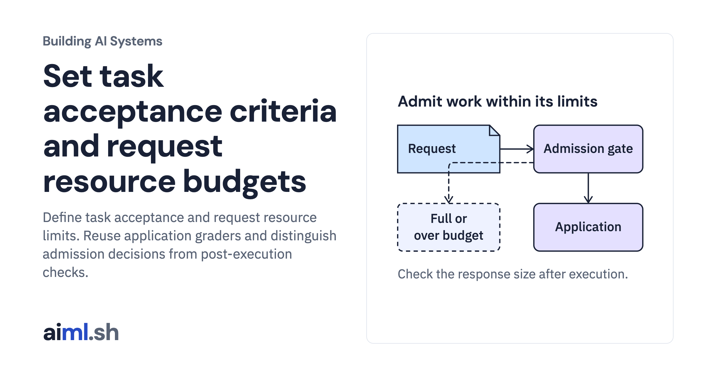

 [Building AI Systems](../) · lesson 3 of 21

# Set task acceptance criteria and request resource budgets

[](https://aiml.sh/courses/building-ai-systems/set-task-acceptance-criteria-and-request-resource-budgets/)

Define task acceptance and request resource limits. Reuse application graders and distinguish admission decisions from post-execution checks.

- **Full lesson:** [https://aiml.sh/courses/building-ai-systems/set-task-acceptance-criteria-and-request-resource-budgets/](https://aiml.sh/courses/building-ai-systems/set-task-acceptance-criteria-and-request-resource-budgets/)
- **Reading time:** 25 min
- **Uses:** Standard library only

## Lab

The [`lab/`](lab/) folder holds the complete runnable code, tests and recorded outputs, the same files as the lesson's download on aiml.sh. The lesson explains each step.

### Lab notes

#### Set task acceptance criteria and request resource budgets

Python 3.12 or later; standard library only. Extract the complete ZIP and enter
ai-system-acceptance/:

```bash
python3.12 -m venv .venv
source .venv/bin/activate
python inspect_acceptance.py
python inspect_acceptance.py --check
python -m unittest -v test_acceptance.py
```

PowerShell activation: .venv\Scripts\Activate.ps1.
Use --save my-policy-result.json to save a separate local result.

The lab reuses architecture.py, pages.json, cases.json, task.py and vendor/harness.py
from ai-system-evaluation unchanged. vendor/gate.py is copied unchanged from the
published limit-concurrent-rag-requests lab. Their source hashes/provenance are
recorded in run-metadata.json. No new agent loop, tokenizer, queue or grader engine
is implemented.

policy.json declares source/output UTF-8 byte caps, active/waiting capacity and a
queue-wait limit. Byte counts are exact for the source snapshot and canonical JSON
used here, not HTTP overhead, model tokens or total process memory. Source bytes
are checked after reading the snapshot but before application invocation. Output
bytes are checked after the local function returns; an oversized response is
withheld rather than truncated. Failed task checks also withhold the response. This cannot undo execution or bound its cost.

meets_contract requires both the existing task verdict and resource checks. A
correct required refusal can meet that response contract; this never authorizes
executing a rollback. No lab branch executes commands from its output.

The queue-full and wait-timeout probes deliberately hold a capacity lease. They
check real local admission outcomes, not deployed throughput or latency targets.
The queue wait is bounded; there is no end-to-end execution deadline, heap-memory
limit or monetary cap. finish_worker keeps the lease while its local thread runs.
No model/provider request, cloud resource, GPU job or download is used.
