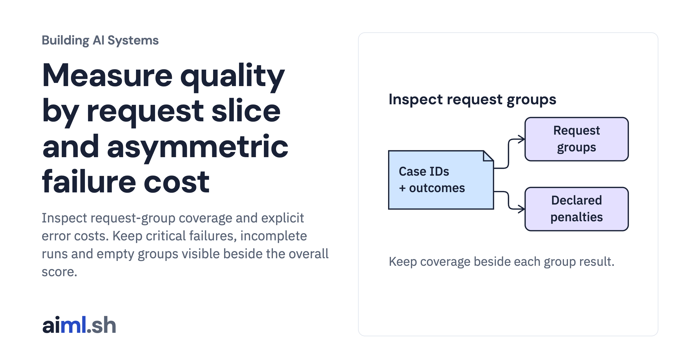

 [Building AI Systems](../) · lesson 6 of 21

# Measure quality by request slice and asymmetric failure cost

[](https://aiml.sh/courses/building-ai-systems/measure-quality-by-request-slice-and-asymmetric-failure-cost/)

Inspect request-group coverage and explicit error costs. Keep critical failures, incomplete runs and empty groups visible beside the overall score.

- **Full lesson:** [https://aiml.sh/courses/building-ai-systems/measure-quality-by-request-slice-and-asymmetric-failure-cost/](https://aiml.sh/courses/building-ai-systems/measure-quality-by-request-slice-and-asymmetric-failure-cost/)
- **Reading time:** 25 min
- **Uses:** Standard library only

## Lab

The [`lab/`](lab/) folder holds the complete runnable code, tests and recorded outputs, the same files as the lesson's download on aiml.sh. The lesson explains each step.

### Lab notes

#### Measure quality by request slice and asymmetric failure cost

Python 3.12+ standard library. This lesson analyzes unchanged saved outcomes
from the AI Systems evaluation-set lab: twelve authored development cases under
six local-function configurations. It does not rerun those systems or call a model.

##### Run

Unpack the complete ZIP and enter `ai-system-slices/`:

```sh
python3.12 -m venv .venv
source .venv/bin/activate
python analyze_slices.py
python analyze_slices.py --check
python -m unittest -v test_slices.py
```

No package installation, keys, services, downloads or training are needed. To save
a separate analysis without overwriting an existing file:

```sh
python analyze_slices.py --save my-slice-analysis.json
```

##### Interpret the output

The source and permission probes both pass 11 of 12 cases. Their declared scenario
costs are 8 and 100 points respectively. The permission probe fails the single
reader/production/proposal case: 0 of 1 passes in that explicitly critical slice.
Required refusals count as passes when the task expects them.
These values describe deliberately chosen fixtures and a declared penalty policy,
not a statistical model-quality estimate or observed monetary impact.

The no-output probe retains all twelve cases with one incomplete result. Its total
cost is unknown; the policy supplies a [0,100] range for that unknown case. That
range is not a confidence interval or a bound on actual business loss. Completed
passes alone would hide missing execution, so pass/completion fractions retain the
full slice denominator. An empty version-4 slice has no rate or cost, not 100% pass.

Slice predicates match literal request fields. Missing role defaults to reader,
matching the existing Request contract. Environment prod is not silently changed
to production. A case can appear in several slices; do not add overlapping slice
counts or costs to construct a total. The overall report counts each case once.

##### Files and reuse

- `cases.json`, `saved-report.json`: unchanged reference cases and actual saved
  local-function report from `ai-system-evaluation/`. Original numerical records
  and application source remain untouched. The report has one trial per case.
- `vendor/harness.py`, `vendor/task.py`: unchanged case-loader and task contract
  from that lab. The existing harness validates cases here; its run() is not called.
- `input-manifest.json`: reviewed file identities. Case-set, task and harness
  identities are checked against the saved report before analysis.
- `cost-policy.json`: declared scenario points for known first-failure boundaries,
  bounds for incomplete execution and named request-slice predicates.
- `analyze_slices.py`: validates policy, aligns every result by ID, constructs a
  per-case cost ledger and summarizes overlapping request groups.
- `test_slices.py`: 19 offline tests, including changed saved inputs, missing or
  repeated results, empty slices, literal request fields and incomplete costs.
- `result.json`, `run-output.txt`, `run-metadata.json`: actual local analysis output
  and source/fixture hashes. No fresh model output or application execution.
- `requirements-lock.txt`: no third-party dependencies; not an interpreter image lock.

##### Boundaries and changes

The earlier report names the first failed check, not every possible defect or a
proven root cause. This policy assigns one penalty to that observed boundary per
case. It is not a sum of all consequences of a request. Unknown boundaries are
refused instead of receiving a default zero penalty. Missing result rows are an
invalid report; an intentionally incomplete execution is an explicit result row.

Policy edits change the interpretation, not the recorded pass/fail outcomes.
Use separately saved analyses to compare declared penalties. For production
risk estimates, request prevalence and impact assumptions need independent data;
this hand-built development set supplies neither. File hashes prevent unnoticed
revision mixing, not malicious replacement of both the files and trusted references.
