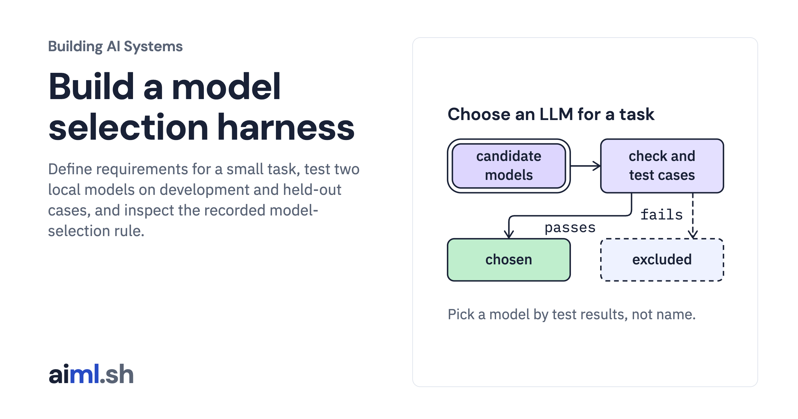

 [Building AI Systems](../) · lesson 10 of 21

# Build a model selection harness

[](https://aiml.sh/courses/building-ai-systems/build-a-model-selection-harness/)

Define requirements for a small task, test two local models on development and held-out cases, and inspect the recorded model-selection rule.

- **Full lesson:** [https://aiml.sh/courses/building-ai-systems/build-a-model-selection-harness/](https://aiml.sh/courses/building-ai-systems/build-a-model-selection-harness/)
- **Reading time:** 22 min
- **Uses:** Python standard library; local Qwen3.5 0.8B and Gemma 4 E2B models via Ollama

## Lab

The [`lab/`](lab/) folder holds the complete runnable code, tests and recorded outputs, the same files as the lesson's download on aiml.sh. The lesson explains each step.

### Lab notes

#### Choose a local model for one task

Python 3.11 or later, standard library only. Recording a run needs a local
[Ollama](https://ollama.com/download) server with both candidate models installed.
Deciding and testing run offline from the saved record.

```sh
ollama pull qwen3.5:0.8b
ollama pull gemma4:e2b
python3 select_model.py record --hardware "describe your machine"   # live: writes selection-run.json
python3 select_model.py                                              # offline: writes decision.json
python3 -m unittest -v test_select_model.py                         # offline tests
```

`select_model.py record` checks each candidate's installed artifact (digest, capability,
context window, license metadata) before it sends any chat request. A candidate that fails
a check is not run. It then unloads the model, loads it again with the lesson's context size,
and sends every development and held-out case once. Without `record`, the script reads
`selection-run.json` and applies the selection rule to the development results only.
Exit code 0 means a candidate was chosen; 2 means no candidate met every requirement.

##### Files

- `requirements.json`: the application's requirements and the selection rule's limits.
- `candidates.json`: the two candidates, their pinned Ollama digests and what we read on
  each publisher's model card on 2026-10-20.
- `cases-development.json`, `cases-held-out.json`: labeled developer reports.
- `select_model.py`: the checks, the case runner and the decision.
- `selection-run.json`: the recorded run, with every answer and timing.
- `decision.json`: the decision computed from the record.
- `test_select_model.py`, `test-output.txt`: offline tests and their recorded output.

##### Limits

Fifteen short synthetic reports show how each model behaves on this task; they do not
measure accuracy on real reports. Each case ran once at temperature 0 with seed 42.
Timings come from one machine, one request at a time, and are not a capacity estimate.
The script does not download models, retry failed requests or measure memory use.

##### Data and license

The requirements, cases and run records are synthetic and were written for this lesson.
They contain no third-party data. This directory does not include model weights. Both
models are released under the Apache License 2.0 according to their model cards:
[Qwen3.5-0.8B](https://huggingface.co/Qwen/Qwen3.5-0.8B) and
[Gemma 4 E2B IT](https://huggingface.co/google/gemma-4-E2B-it).
