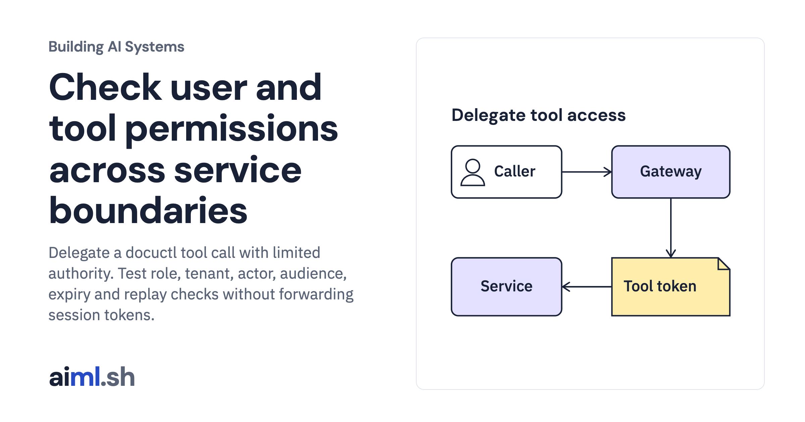

 [Building AI Systems](../) · lesson 11 of 21

# Check user and tool permissions across service boundaries

[](https://aiml.sh/courses/building-ai-systems/build-authentication-and-authorization-boundaries-for-users-and-tools/)

Delegate a docuctl tool call with limited authority. Test role, tenant, actor, audience, expiry and replay checks without forwarding session tokens.

- **Full lesson:** [https://aiml.sh/courses/building-ai-systems/build-authentication-and-authorization-boundaries-for-users-and-tools/](https://aiml.sh/courses/building-ai-systems/build-authentication-and-authorization-boundaries-for-users-and-tools/)
- **Reading time:** 22 min
- **Uses:** Python standard library; no model server for the docuctl demonstration or offline tests

## Lab

The [`lab/`](lab/) folder holds the complete runnable code, tests and recorded outputs, the same files as the lesson's download on aiml.sh. The lesson explains each step.

### Lab notes

#### Docuctl delegated tool authorization

Python 3.11 or newer; the current Docuctl demonstration uses only the standard library and makes no model requests. Unzip the complete lab and run commands from this directory.

```bash
python3 -m venv .venv
source .venv/bin/activate
python docuctl_demo.py
python -m unittest -v test_docuctl.py
```

`docuctl-output.json` is the saved output of this local demonstration. Its proposals are authored test inputs, not recorded model choices. Publication and review are simulated local decisions; the demonstration does not publish documentation or contact another service.

##### Preserved historical experiment

The original source files, test fixtures and model recordings below retain their original identifiers. The Docuctl demonstration does not rename or regenerate those records. Commands that explicitly record new model output are optional historical instructions and are not required for the current lesson.

#### Authentication and authorization boundaries for users and tools

Python 3.11 or newer, standard library only. Tested with Python 3.11 and 3.15. Recording new model proposals needs a local Ollama server with `gemma4:e2b` at the digest in `model.json`; replaying them needs nothing else.

- `tokens.py`: HS256 JSON Web Tokens: signing, and verification of form, algorithm, type, signature, audience, expiry and one-time use. The key is a printed teaching value, not a secret.
- `boundary.py`: the gateway and the two tool services. The gateway checks the session, the tool, its arguments and the user's role, then mints a token for one call; each service checks that token again, with the agent's `act` claim, its own scope and the order's tenant.
- `agent.py`: asks the pinned model which tool calls to make, or replays recorded answers keyed by the SHA-256 of each exact request.
- `policy.json`: users, roles, tools and orders. `conversations.json`: five synthetic requests. `model.json`: the pinned model.
- `recorded/proposals.json`: the five recorded model replies. `decisions.json`: every decision, the attack results and the audit log.
- `run_boundary.py`: runs the conversations and the attacks on a simulated clock.
- `test_boundary.py`: `python3 -m unittest -v test_boundary.py`

```bash
python3 run_boundary.py record   # live: Ollama with the pinned model; rewrites recorded/proposals.json
python3 run_boundary.py          # offline: rewrites decisions.json
python3 run_boundary.py --check  # offline: compares a fresh replay with decisions.json byte for byte
```

All users, orders and messages are synthetic, written for this build on October 20, 2026. The model is [Gemma 4 E2B](https://huggingface.co/google/gemma-4-E2B-it), Apache-2.0, run through Ollama 0.32.14.
