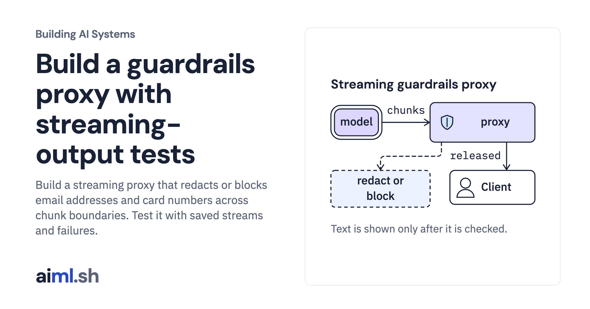

 [Building AI Systems](../) · lesson 13 of 21

# Build a guardrails proxy with streaming-output tests

[](https://aiml.sh/courses/building-ai-systems/build-a-guardrails-proxy-with-streaming-output-tests/)

Build a streaming proxy that redacts or blocks email addresses and card numbers across chunk boundaries. Test it with saved streams and failures.

- **Full lesson:** [https://aiml.sh/courses/building-ai-systems/build-a-guardrails-proxy-with-streaming-output-tests/](https://aiml.sh/courses/building-ai-systems/build-a-guardrails-proxy-with-streaming-output-tests/)
- **Reading time:** 20 min
- **Uses:** Python standard library only; local gemma4:e2b via Ollama only to record new streams

## Lab

The [`lab/`](lab/) folder holds the complete runnable code, tests and recorded outputs, the same files as the lesson's download on aiml.sh. The lesson explains each step.

### Lab notes

#### A guardrails proxy with streaming-output tests

Python 3.11 or newer, standard library only. Tested with Python 3.11 and 3.15. Recording new streams needs a local Ollama server with `gemma4:e2b` at the digest in `model.json`; replaying them needs nothing else.

- `guard.py`: `StreamGuard`, which holds back the trailing text that could still grow into an email address or a card number, redacts or blocks complete values in the rest, and releases it; plus the naive `per_chunk_filter` for comparison. Card numbers must pass the Luhn check.
- `proxy.py`: an HTTP proxy on 127.0.0.1 that reads an Ollama chat stream chunk by chunk and sends the client only what the guard releases, as newline-delimited JSON, ending with a line that reports the guard's findings. `ReplayUpstream` serves recorded streams; `OllamaUpstream` forwards to Ollama and records.
- `conversations.json`: one synthetic customer record and four questions. The card number passes the Luhn check; the order number fails it on purpose.
- `recorded/streams.json`: the four recorded streams, chunk by chunk, keyed by the SHA-256 of each exact request.
- `run_guard.py`: replays every stream through the proxy over HTTP, in redact and block mode, and checks that the output does not depend on chunk boundaries; writes `results.json`.
- `test_guard.py`: `python3 -m unittest -v test_guard.py`

```bash
python3 run_guard.py record   # live: Ollama with the pinned model; rewrites recorded/streams.json
python3 run_guard.py          # offline: rewrites results.json
python3 run_guard.py --check  # offline: compares a fresh replay with results.json byte for byte
```

The customer record and questions are synthetic, written for this build on October 20, 2026. The model is [Gemma 4 E2B](https://huggingface.co/google/gemma-4-E2B-it), Apache-2.0, run through Ollama 0.32.14.
