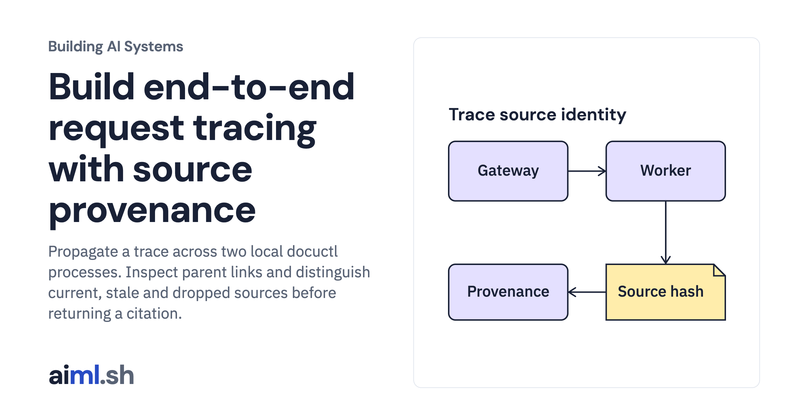

 [Building AI Systems](../) · lesson 14 of 21

# Build end-to-end request tracing with source provenance

[](https://aiml.sh/courses/building-ai-systems/build-end-to-end-request-tracing-with-evidence-provenance/)

Propagate a trace across two local docuctl processes. Inspect parent links and distinguish current, stale and dropped sources before returning a citation.

- **Full lesson:** [https://aiml.sh/courses/building-ai-systems/build-end-to-end-request-tracing-with-evidence-provenance/](https://aiml.sh/courses/building-ai-systems/build-end-to-end-request-tracing-with-evidence-provenance/)
- **Reading time:** 25 min
- **Uses:** Python standard library; no model server for the docuctl demonstration or offline tests

## Lab

The [`lab/`](lab/) folder holds the complete runnable code, tests and recorded outputs, the same files as the lesson's download on aiml.sh. The lesson explains each step.

### Lab notes

#### Docuctl cross-process tracing

Python 3.11 or newer; the current Docuctl demonstration uses only the standard library and makes no model requests. Unzip the complete lab and run commands from this directory.

```bash
python3 -m venv .venv
source .venv/bin/activate
python docuctl_trace.py
python -m unittest -v test_docuctl.py
```

`docuctl-output.json` is the saved output of this local demonstration. Its proposals are authored test inputs, not recorded model choices. The worker is a separate local subprocess reached through a JSON envelope; its counting clock is synthetic and is not a latency benchmark.

##### Preserved historical experiment

The original source files, test fixtures and model recordings below retain their original identifiers. The Docuctl demonstration does not rename or regenerate those records. Commands that explicitly record new model output are optional historical instructions and are not required for the current lesson.

#### End-to-end request tracing with evidence provenance

Python 3.11 or newer, standard library only. Tested with Python 3.11 and 3.15. Recording new model answers needs a local Ollama server with `gemma4:e2b` at the digest in `model.json`; replaying them needs nothing else.

- `tracing.py`: a small span tracer with W3C `traceparent` propagation, an injectable clock and ID source, a JSON Lines exporter and `collect()`, which rebuilds traces from several span files.
- `retrieval_service.py`: the retrieval service, a separate process with an HTTP endpoint on 127.0.0.1. It joins the caller's trace from the `traceparent` header and exports its own spans.
- `retrieve.py`: the TF-IDF cosine retriever from the [retriever build](https://aiml.sh/courses/), unchanged.
- `pipeline.py`: the gateway. It traces retrieval, context assembly, the model call and the citation check, and gives every citation a provenance verdict.
- `diagnose.py`: follows each failed evaluation row to its trace and names the step that lost the expected document.
- `harness.py`: the evaluation harness from the [versioned evaluation harness build](https://aiml.sh/courses/llm-evaluation/build-an-eval-harness/), unchanged (same SHA-256).
- `grounded_task.py`: the task module for grounded answers, loaded with `--task grounded_task`.
- `cases.json`: 5 development and 4 held-out cases. `corpus.json`: 7 synthetic support documents, with the index snapshot built before the refund policy changed.
- `model.json`: the pinned model, its license and the sampling settings. `recorded/model-calls.json`: the 48 recorded model calls, keyed by the SHA-256 of each exact request.
- `trace_run.py`: runs both pipeline versions, writes `runs/before/`, `runs/after/` and `runs/comparison.json`.
- `test_tracing.py`: `python3 -m unittest -v test_tracing.py`

Reproduce the recorded files from this directory:

```bash
python3 trace_run.py record   # live: needs Ollama and the pinned model; rewrites recorded/model-calls.json
python3 trace_run.py          # offline: replays the recording and rewrites runs/
python3 trace_run.py --check  # offline: compares a fresh replay with runs/
```

Timing fields change on every run: the harness's `RUN_DESCRIPTION_FIELDS` and the tracer's `TIMING_FIELDS` (`start_ns`, `end_ns`, `duration_ms`). `--check` and the tests compare everything else exactly. Span and trace IDs in the fixtures are derived from the case and trial so that they reproduce; `RandomIds` is the default outside fixtures.

##### Data and model

The documents, questions and expected facts are synthetic, written for this build on October 20, 2026, by one author; the held-out cases were written at the same time as the development cases and have not been edited since their first run. They contain no third-party text. The model is [Gemma 4 E2B](https://huggingface.co/google/gemma-4-E2B-it), Apache-2.0, run through Ollama 0.32.14.
