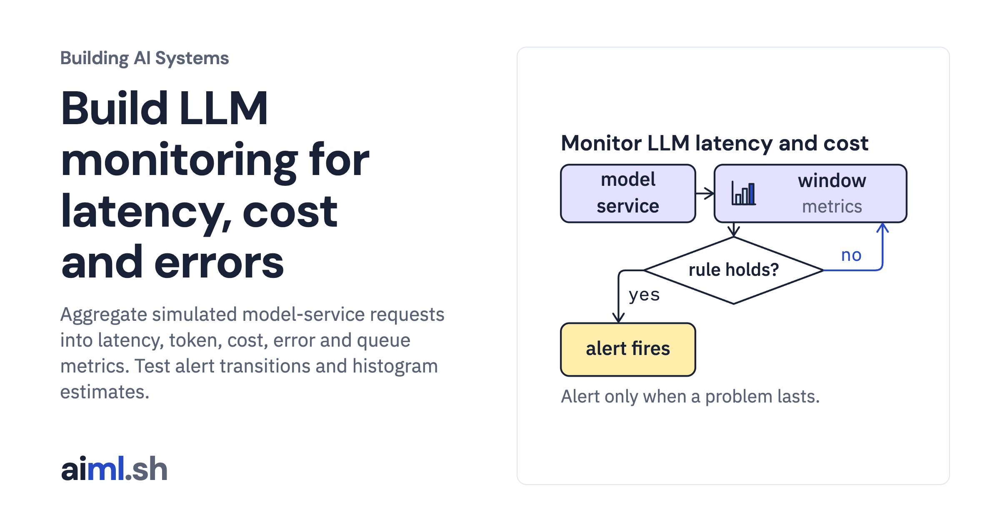

 [Building AI Systems](../) · lesson 15 of 21

# Build LLM monitoring for latency, cost and errors

[](https://aiml.sh/courses/building-ai-systems/build-llm-monitoring-for-latency-cost-and-errors/)

Aggregate simulated model-service requests into latency, token, cost, error and queue metrics. Test alert transitions and histogram estimates.

- **Full lesson:** [https://aiml.sh/courses/building-ai-systems/build-llm-monitoring-for-latency-cost-and-errors/](https://aiml.sh/courses/building-ai-systems/build-llm-monitoring-for-latency-cost-and-errors/)
- **Reading time:** 22 min
- **Uses:** Python standard library only

## Lab

The [`lab/`](lab/) folder holds the complete runnable code, tests and recorded outputs, the same files as the lesson's download on aiml.sh. The lesson explains each step.

### Lab notes

#### Latency, token, cost, error and queue monitoring

Python 3.11 or newer, standard library only. Tested with Python 3.11 and 3.15. No model or network is used.

- `monitor.py`: the simulation, the metric primitives (`Histogram` with explicit buckets, nearest-rank percentiles), the 60-second windows and the alert rule evaluation.
- `calls.json`: token counts and model time (prompt plus generation, without model loading) of the 48 calls to `gemma4:e2b` recorded in the [tracing build](https://aiml.sh/courses/building-ai-systems/build-end-to-end-request-tracing-with-evidence-provenance/). `extract_calls.py` rebuilds it from that build's recording.
- `traffic.json`: synthetic traffic phases, the client timeout and the two service configurations.
- `alerts.json`: the four alert rules. `prices.json`: example per-token prices, not any provider's prices.
- `monitoring.json`: the recorded windows, alert timelines and alert changes for both configurations.
- `test_monitor.py`: `python3 -m unittest -v test_monitor.py`

Reproduce:

```bash
python3 extract_calls.py     # needs the tracing build's folder next to this one
python3 monitor.py --write   # rewrites monitoring.json
python3 monitor.py --check   # compares a fresh run with monitoring.json byte for byte
```

##### Data

The traffic, thresholds and prices are synthetic, chosen on October 20, 2026, for this build. Only the per-call token counts and model times come from a recorded model; the queue, the timeouts and the windows are simulated on an integer clock.
