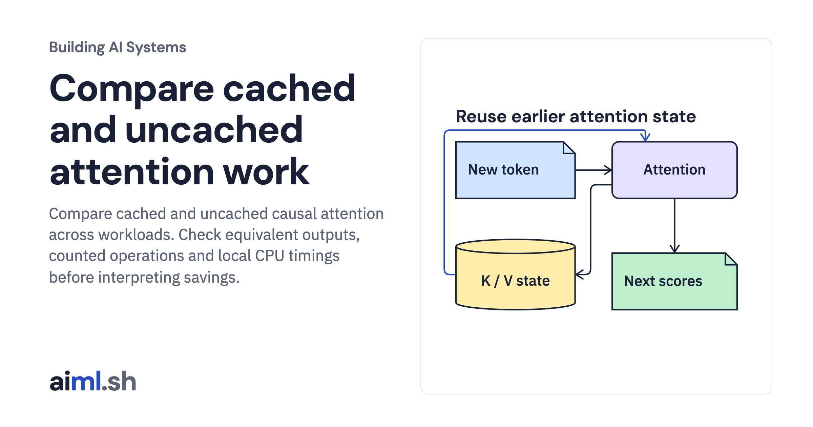

 [Building AI Systems](../) · lesson 16 of 21

# Compare cached and uncached attention work

[](https://aiml.sh/courses/building-ai-systems/measure-kv-cache-work/)

Compare cached and uncached causal attention across workloads. Check equivalent outputs, counted operations and local CPU timings before interpreting savings.

- **Full lesson:** [https://aiml.sh/courses/building-ai-systems/measure-kv-cache-work/](https://aiml.sh/courses/building-ai-systems/measure-kv-cache-work/)
- **Reading time:** 25 min
- **Uses:** Standard library only

## Lab

The [`lab/`](lab/) folder holds the complete runnable code, tests and recorded outputs, the same files as the lesson's download on aiml.sh. The lesson explains each step.

### Lab notes

#### Measure the work a KV cache removes

Python 3.12+, standard library only. No API key, model download or GPU.

```bash
python3.12 -m venv .venv
source .venv/bin/activate
python cache.py
python -m unittest -v test_cache.py
```

This is fixed-weight single-head causal attention using Python lists. The saved operation counts and machine-specific timings come from cache.py. No pretrained language model or GPU is used.

run-output.txt contains the saved local output. run-metadata.json binds the source, tests, input files and output by SHA-256.
