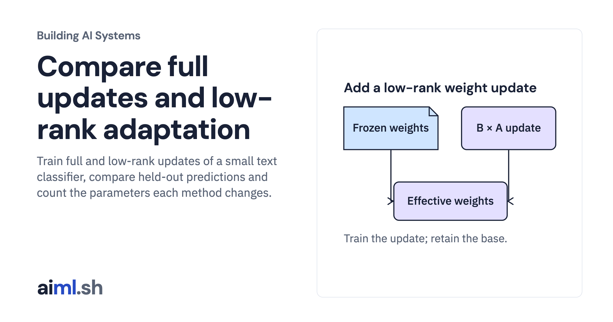

 [Building AI Systems](../) · lesson 17 of 21

# Compare full updates and low-rank adaptation

[](https://aiml.sh/courses/building-ai-systems/compare-full-and-low-rank-updates/)

Train full and low-rank updates of a small text classifier, compare held-out predictions and count the parameters each method changes.

- **Full lesson:** [https://aiml.sh/courses/building-ai-systems/compare-full-and-low-rank-updates/](https://aiml.sh/courses/building-ai-systems/compare-full-and-low-rank-updates/)
- **Reading time:** 25 min
- **Uses:** Standard library only

## Lab

The [`lab/`](lab/) folder holds the complete runnable code, tests and recorded outputs, the same files as the lesson's download on aiml.sh. The lesson explains each step.

### Lab notes

#### Compare full updates and low-rank adaptation

Python 3.12+, standard library only. No API key, model download or GPU.

```bash
python3.12 -m venv .venv
source .venv/bin/activate
python adapt.py
python -m unittest -v test_adapt.py
```

This trains a small bag-of-words intent classifier using full or low-rank updates. It is not an LLM fine-tuning or QLoRA benchmark. The output reports exact feature-vector overlap between train.json and heldout.json; the small fixture demonstrates the mechanism rather than generalization.

run-output.txt contains the saved local output. run-metadata.json binds the source, tests, input files and output by SHA-256.
