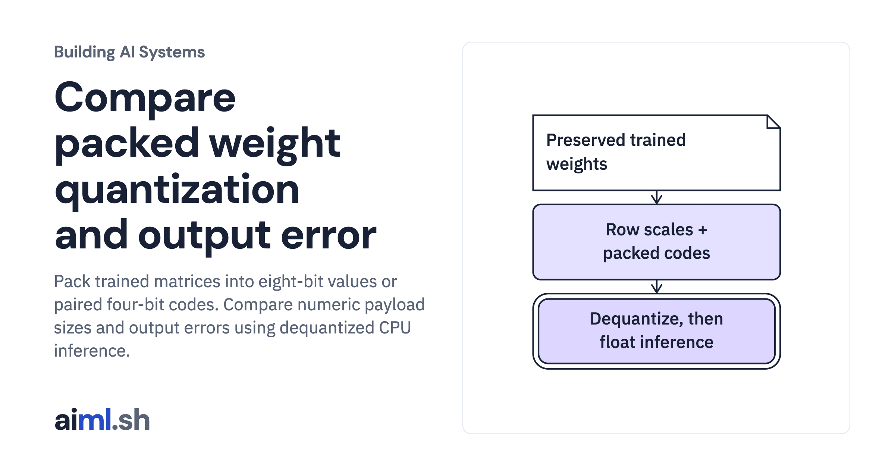

 [Building AI Systems](../) · lesson 18 of 21

# Compare packed weight quantization and output error

Pack trained matrices into eight-bit values or paired four-bit codes. Compare numeric payload sizes and output errors using dequantized CPU inference.

- **Full lesson:** [https://aiml.sh/courses/building-ai-systems/compare-packed-weight-quantization-and-output-error/](https://aiml.sh/courses/building-ai-systems/compare-packed-weight-quantization-and-output-error/)
- **Reading time:** 30 min
- **Uses:** PyTorch 2.14.1, pinned in requirements.txt

## Lab

The [`lab/`](lab/) folder holds the complete runnable code, tests and recorded outputs, the same files as the lesson's download on aiml.sh. The lesson explains each step.
